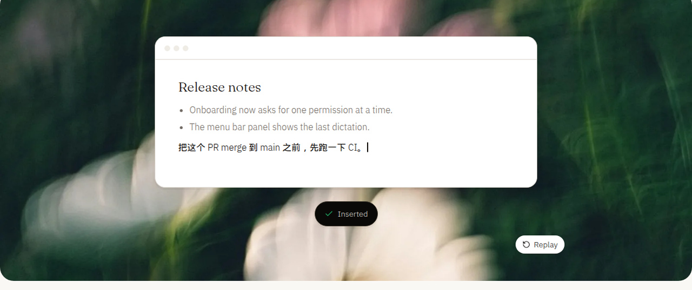

# Arion

Local-first voice input for macOS and Windows, built with [MyGo](https://github.com/egoist/mygo) native Go UI.

[English](README.md) · [简体中文](README.zh-CN.md) · [日本語](README.ja.md)

[](LICENSE)
[](go.work)
[](apps/desktop/go.mod)
[](apps/desktop/go.mod)
[](.nvmrc)
[](package.json)




## Overview

Arion combines on-device streaming speech recognition, conservative rule-based correction, personal vocabulary learning, optional live local rewriting, local candidate ranking contracts, and encrypted memory sync. Users can dictate via a global shortcut or system IME integration. Dictation runs offline after model provisioning; raw microphone audio and temporary foreign-window context never leave the device.

macOS and Windows are the primary desktop targets (`P0`), while iOS and Android are future targets (`P2`).

## Features

- **Global shortcut dictation and macOS IME host** — Press the shortcut (default `⌥Space`) in any app, speak Mandarin, English, or mixed technical text, and press again to insert once into the focused editor (`Esc` cancels). Also includes a hold-to-talk mode ([DSK-02](specs/001-desktop-input.md)) and the `ArionInput.app` macOS InputMethodKit host ([ADR 006](docs/decisions/006-macos-input-method-host.md)).
- **Automatic on-device model selection** — Speech recognition runs locally through `sherpa-onnx` (`v1.13.8`). The evaluated model bundle with the best measured accuracy that passes latency gates is downloaded, digest-verified, and loaded automatically with no manual model selection required ([ADR 004](docs/decisions/004-automatic-model-selection.md)).
- **Conservative correction and edit learning** — Applies deterministic rules (`arion-rules-v3`) and user-approved vocabulary while keeping recognition drafts separate from committed text. On macOS, edits made to inserted text are learned on-device with one-click undo ([ADR 014](docs/decisions/014-edit-learning.md)).
- **Optional live local rewriting (macOS Apple silicon)** — Edits text while you speak using Qwen3 1.7B in an isolated `arion-llm` ONNX Runtime GenAI worker process with KV prefix reuse, scene-aware formatting (**Match the app**, [ADR 012](docs/decisions/012-context-scene-selection.md)), and on-device cursor/screen/history term extraction ([ADR 011](docs/decisions/011-live-local-rewriting.md), [ADR 013](docs/decisions/013-rewrite-context-on-device.md)).
- **Native Go desktop shell** — Built with [MyGo](https://github.com/egoist/mygo) (`v0.4.6`) using Feature-Sliced Design in Go ([ADR 001](docs/decisions/001-desktop-native-boundaries.md), [ADR 007](docs/decisions/007-sunbeam-design-system.md)) with no Electron or webview in the desktop app. Includes a menu bar popover, a click-through floating pill that joins fullscreen Spaces, first-run onboarding, settings, local diagnostic ZIP export, and live-switched English / Simplified Chinese UI localization ([i18n](docs/frontend/i18n.md)).
- **Local encryption and self-hosted sync relay** — Personal vocabulary is encrypted locally with AES-256-GCM using keys stored in the macOS login Keychain or Windows DPAPI ([ADR 005](docs/decisions/005-local-encryption.md)). The repository also provides `services/sync`, a self-hostable Go ciphertext relay with `noop` and `oidc` account gates ([ADR 015](docs/decisions/015-hosted-relay-account-authorization.md)), plus a desktop loopback PKCE sign-in service ([account sign-in](docs/project/account-signin.md)).

## Current state and limitations

Arion is a working macOS (`arm64`) menu bar dictation app. Windows (`amd64`) code compiles and passes headless tests as well as CI window lifecycle, `SendInput`, and hold-key hook E2E tests on Windows Server 2022, but full interactive dictation has not yet been run end-to-end on a Windows host.

Not yet implemented or still open:

- **Local candidate ranking (`RNK-01`)** — The ranking contract and evaluation harness exist, but current recognizers expose a single hypothesis, so candidate ranking is not active.
- **Desktop memory sync client & enrollment (`MEM-01` / `SYNC-10`)** — The `services/sync` relay and desktop OIDC sign-in views/service are implemented, but the desktop SQLite outbox, device enrollment, and native OS credential-store execution remain open.
- **Windows TSF and live rewrite worker (`TSF-01` / `RWT-RUN-01`)** — Windows Text Services Framework (TSF) IME integration, Windows edit learning, and the Windows GenAI rewrite worker are not yet implemented.
- **Hold-to-talk and consent guide interactive verification** — Hold-to-talk gesture logic and the Windows low-level hook passed CI E2E, while the macOS event tap requires a user-granted Input Monitoring permission on an interactive desktop.
- **Rewrite blind human evaluation & general LLM correction (`LRW-REVIEW-01` / `COR-01`)** — Development benchmarks are recorded in [`benchmarks/results`](benchmarks/README.md), while blind human ratings (`LRW-A06`) remain open; standalone LLM correction outside the live rewrite pipeline is not adopted.
- **Signed public releases (`REL-01`)** — The in-app updater is implemented ([ADR 010](docs/decisions/010-in-app-updates.md)), but Developer ID code signing, notarization, and production bundle identifiers are pending.

See the [agent handoff](docs/project/agent-handoff.md) and [validation report](docs/quality/validation.md) for exact verification evidence and task gates.

## Quick start

### Prerequisites

- **Go 1.27.1** with `cgo` enabled (`go.work` uses Go automatic toolchain selection; `packages/core` and `services/sync` also check standalone with `GOWORK=off`).
- **macOS (`arm64`)**: Xcode Command Line Tools and macOS SDK.
- **Windows (`amd64`)**: Native toolchain required by MyGo, plus MinGW-w64 (`CC=x86_64-w64-mingw32-gcc`) when cross-packaging `cgo` and NSIS for installer builds.
- **Node 24** (`.nvmrc`) and **pinned `pnpm@10.33.0`** (`package.json`) for repository checks, evaluation tooling, and the static marketing site (`apps/site`). `npm` and `yarn` are rejected.

### Build and run

```sh
make install        # install the pinned pnpm workspace (--frozen-lockfile)
make check          # docs, JSON, Go layer boundaries, core/sync and evaluation tests
make desktop-check  # desktop tests and go vet (cgo)
make desktop-dev    # stage native runtimes and launch the desktop app in dev mode
make build desktop  # package Arion.app and a DMG under apps/desktop/build/
make e2e            # native window lifecycle E2E on a real desktop session
make e2e-macos      # owned product scenarios against the packaged Arion.app
make site-check     # marketing site (apps/site): i18n, types, lint, tests, static export
```

On first run, `make desktop-dev` opens onboarding, requests microphone and Accessibility permissions, and downloads the automatically selected recognition model bundle (about 270 MB) into `~/Library/Application Support/Arion/models/` (macOS) or `%AppData%\Arion\models\` (Windows). After model provisioning, dictation works offline. Run `make help` to list all benchmark, evaluation, and diagnostic targets.

## Documentation

### Project and specifications

- [Agentic Coding Guidelines (`AGENTS.md`)](AGENTS.md) — rules, boundaries, and workflows for contributors and coding agents.
- [Documentation Index (`docs/README.md`)](docs/README.md) — top-level map of all documentation domains.
- [Product Scope (`docs/project/README.md`)](docs/project/README.md) — confirmed scope, explicit boundaries, and stack status table.
- [Architecture (`docs/project/architecture.md`)](docs/project/architecture.md) — data flow, live local rewriting pipeline, runtime shape, and privacy boundaries.
- [Repository Ownership (`docs/project/repository.md`)](docs/project/repository.md) — Go workspace modules, FSD/DDD package boundaries, and working rules.
- [Specifications (`specs/README.md`)](specs/README.md) — normative requirements (`001` through `009`) and acceptance scenario IDs.
- [Agent Handoff (`docs/project/agent-handoff.md`)](docs/project/agent-handoff.md) — implemented milestones, open `P0`/`P1`/`P2` tasks, and completion gates.
- [Architecture Decision Records (`docs/decisions/README.md`)](docs/decisions/README.md) — ADRs `001` through `016`.

### Engineering, operations, and evaluation

- [Frontend Conventions (`docs/frontend/README.md`)](docs/frontend/README.md) — Feature-Sliced Design (FSD) in native Go and [Interface Localization (`docs/frontend/i18n.md`)](docs/frontend/i18n.md).
- [Backend Conventions (`docs/backend/README.md`)](docs/backend/README.md) — Domain-Driven Design (DDD) rules for `packages/core` and `services/sync`.
- [Local Development (`docs/operations/local-dev.md`)](docs/operations/local-dev.md) — toolchains, data locations, environment variables, and troubleshooting.
- [Deployment & Release Gates (`docs/operations/deployment.md`)](docs/operations/deployment.md) and [Sync Relay Runbook (`deploy/sync/README.md`)](deploy/sync/README.md).
- [Quality & Testing (`docs/quality/README.md`)](docs/quality/README.md), [Validation Report (`docs/quality/validation.md`)](docs/quality/validation.md), and [Native E2E (`docs/quality/e2e.md`)](docs/quality/e2e.md).
- [Research Evidence (`docs/research/README.md`)](docs/research/README.md), [Benchmark Methodology (`docs/research/benchmark-methodology.md`)](docs/research/benchmark-methodology.md), [Evaluation Runners (`tools/evaluation/README.md`)](tools/evaluation/README.md), and [Benchmark Results (`benchmarks/README.md`)](benchmarks/README.md).

## Contributors

[](https://github.com/AstraFoundry/Arion/graphs/contributors)

## Star History

[](https://star-history.com/#AstraFoundry/Arion&Date)

## License

Arion is developed by [AstraFoundry](https://github.com/AstraFoundry) and licensed under [AGPL-3.0](LICENSE) ([ADR 009](docs/decisions/009-agpl-license.md)). Report bugs in [GitHub Issues](https://github.com/AstraFoundry/Arion/issues).
