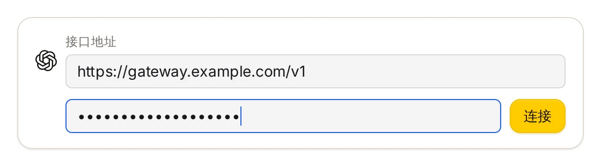
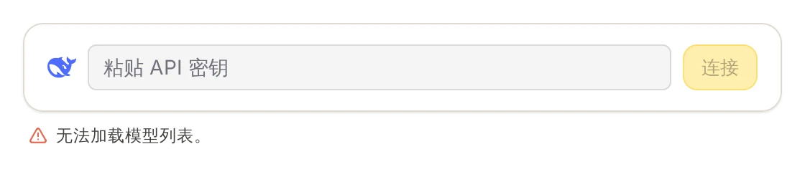
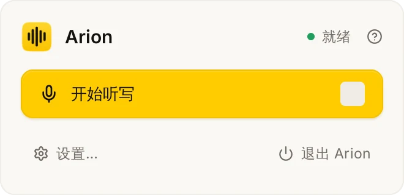
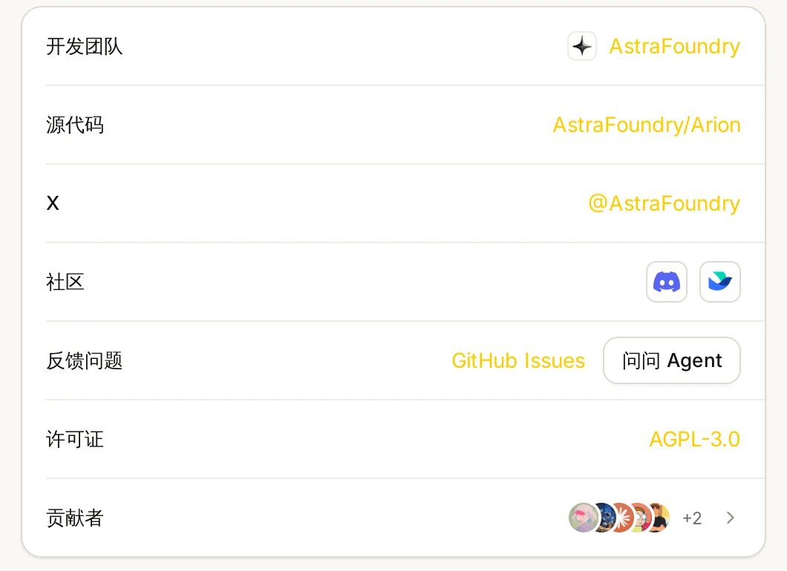
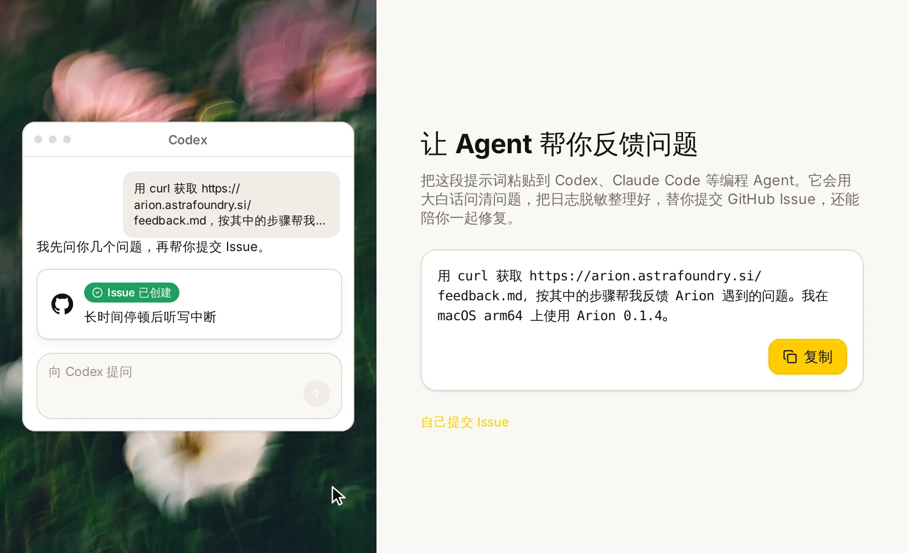

[Arion 0.1.1](/blog/arion-0-1-1/) 发布后的一周里，我们为 Apple 芯片 Mac 和 Windows x64 发了三个更新。0.1.2 修复了一个识别问题；0.1.3 让云端润色支持兼容服务，并让 macOS 上下一次听写启动得更轻；0.1.4 新增了把问题交给你常用的编程 Agent 来反馈的入口。

如果你还在用 0.1.1，打开「设置 › 关于」，点击「检查更新」即可。

## 词库不会再出现在草稿里（0.1.2）

词库条目同时也是热词：每次录音时，Arion 会把它们交给语音模型，让人名和术语按你的写法识别。在 0.1.1 里，模型偶尔会把这份列表原样念回来。如果你开口前停顿了一下、句尾声音渐弱，或者按住快捷键却没说话，草稿里可能出现一串你自己的词条，比如“Arion MLX Qwen”，而不是保持为空。

0.1.2 从两处修复了这个问题：

- **安静的音频不再送进模型。** Arion 以 20 ms 为单位，用判断分段结束的同一个 −42 dBFS 阈值检查每个音频窗口。整段都没有达到阈值的窗口直接返回空文本，不发起识别请求，模型也就没有机会“补全”内容。
- **照抄热词列表时重新识别。** 如果识别结果的开头或结尾按列表顺序连续出现两个及以上热词，Arion 会对同一段音频去掉热词提示再识别一次，并采用这次的结果。你真正说出的单个热词会保留，顺序不同或出现在句子中间的词也会保留。取消操作仍会立即终止请求。[^hotwords]

<dictation-pill state="listening" draft="把 Arion 的 MLX 版本发出去" label="Arion 听写胶囊显示草稿：把 Arion 的 MLX 版本发出去" caption="你真正说出的术语仍然由热词帮忙写对；变化在于，沉默和句尾停顿不会再变成一串热词。示意图，并非录屏。"></dictation-pill>

## 云端润色支持兼容服务（0.1.3）

服务商列表新增了「OpenAI compatible」与「Anthropic compatible」两项。填写 Base URL 和 API 密钥后，Arion 会读取该服务的模型列表供你选择。自建网关、区域镜像以及其他兼容这两种接口的服务都可以接入。感谢 [@harry-xm](https://github.com/harry-xm) [提出这个需求](https://github.com/AstraFoundry/Arion/issues/99)。

Base URL 与密钥一起保存在系统凭据存储中，每个服务商各占一项，切换服务商不会丢失各自的地址和密钥。官方 OpenAI 和 Anthropic 条目保持不变。隐私边界与其他云端服务商相同：Arion 只发送识别出的文字、场景和匹配到的词库条目，音频、光标与窗口上下文以及听写历史都留在本机。[^cloud]

服务需要提供模型列表。Arion 通过读取模型列表来验证密钥，所以不提供模型列表的代理仍然无法连接。

## DeepSeek 密钥恢复连接（0.1.3）

有效的 DeepSeek 密钥可能连接失败，界面提示「服务商拒绝了此密钥或登录。」[@huwan](https://github.com/huwan) [定位了原因](https://github.com/AstraFoundry/Arion/issues/101)：读取模型列表的请求带上了请求体，DeepSeek 的 CDN 直接返回 HTTP 403，Arion 把它当成了密钥被拒。

现在读取模型列表只发送不带请求体的 GET。只有明确的认证失败或 HTTP 401 才会被判定为密钥被拒；单纯的 403、限流、服务端错误或无法解析的响应会提示「无法加载模型列表。」验证失败不会覆盖你已保存的密钥，刷新失败也会保留原有的模型列表。本地日志只记录失败代码和 HTTP 状态码，不记录密钥、地址或响应内容。

## macOS 上麦克风启动更轻（0.1.3）

以前每次听写，Arion 都会在 macOS 上重新创建录音设备，结束后再销毁。现在 Arion 会保留一个已停止的设备，供下一次录音复用，热启动时跳过音频上下文和设备的初始化。

两次录音之间不会继续采集声音。复用前，Arion 会清空缓冲的音频和重采样状态、断开上一次会话，并重新检查麦克风权限以及所选或默认的输入设备。睡眠、锁屏、撤销权限和退出都会释放设备；更换输入设备或设备出错时也不会误用旧设备。Windows 仍然每次录音都创建新设备。[^capture]

## 让 Agent 帮你反馈问题（0.1.4）

很多人已经在用 Codex、Claude Code 这样的编程 Agent。0.1.4 让它们在 Arion 出问题时帮上忙。你可以从菜单栏面板里的 **?** 按钮、「设置 › 关于」中的「问问 Agent」，或者 macOS 与 Windows 输入法菜单里的「问题反馈…」打开反馈窗口。

窗口里有一行可以复制的提示词。它写明 Arion 反馈技能的地址 `arion.astrafoundry.si/feedback.md`、你的版本和平台，不包含任何路径、账号信息或日志。把它粘贴给 Agent 后，Agent 会：

- 用你的语言提问，每次只问一两个问题；
- 遇到单纯的使用问题，直接根据仓库内容回答，不提交 Issue；
- 检查是否已有新版本修复了这个问题，并搜索已有的 Issue；
- 只读取本地日志中相关的片段，去掉个人信息，先给你看过再决定是否附上；
- 经你确认内容后提交 Issue，还可以提出修复并开一个 Pull Request。

Arion 本身不发送任何内容，Agent 只使用你同意提供的信息。如果你想自己写，「自己提交 Issue」会直接打开提交表单。[^feedback]

## 还没做到的事

- 麦克风复用还没有在真实硬件上测量，所以暂时说不出它节省了多少毫秒。冷启动和切换设备的延迟也仍需在原生环境中测量。
- 不提供模型列表的兼容服务无法连接；云端润色仍未完成真实服务验收，也没有质量和延迟的基准测试。
- [0.1.1 里列出的未完成事项](/blog/arion-0-1-1/#还没做到的事)依然存在：多设备同步尚未推出，纠错学习只支持 macOS 原生编辑器，不支持 Intel Mac。

每个版本的完整说明见[桌面端更新日志](https://github.com/AstraFoundry/Arion/blob/main/apps/desktop/CHANGELOG.md)。遇到问题，可以试试新的问题反馈窗口，也可以在 [GitHub Issues](https://github.com/AstraFoundry/Arion/issues) 提交，或者到 [Discord](https://discord.com/invite/72kh465mMm)、[飞书群](https://applink.feishu.cn/client/chat/chatter/add_by_link?link_token=640t6cde-d38e-4a81-875b-7799e44b77ae)找我们。

<github-people label="贡献者" logins="stvlynn, zacharyhaha"></github-people>

[^hotwords]: [规范 002：语音流水线](https://github.com/AstraFoundry/Arion/blob/main/specs/002-speech-pipeline.md)（`SPH-A12`、`SPH-A13`）与 [ADR 020：原生 Qwen3-ASR](https://github.com/AstraFoundry/Arion/blob/main/docs/decisions/020-native-qwen-asr.md)。

[^cloud]: [云端润色](https://github.com/AstraFoundry/Arion/blob/main/docs/project/cloud-polishing.md)与 [ADR 022](https://github.com/AstraFoundry/Arion/blob/main/docs/decisions/022-cloud-polishing.md)。

[^capture]: [规范 001：桌面输入](https://github.com/AstraFoundry/Arion/blob/main/specs/001-desktop-input.md)（`DSK-04`）。

[^feedback]: [由 Agent 协助的问题反馈](https://github.com/AstraFoundry/Arion/blob/main/docs/project/agent-feedback.md)。
