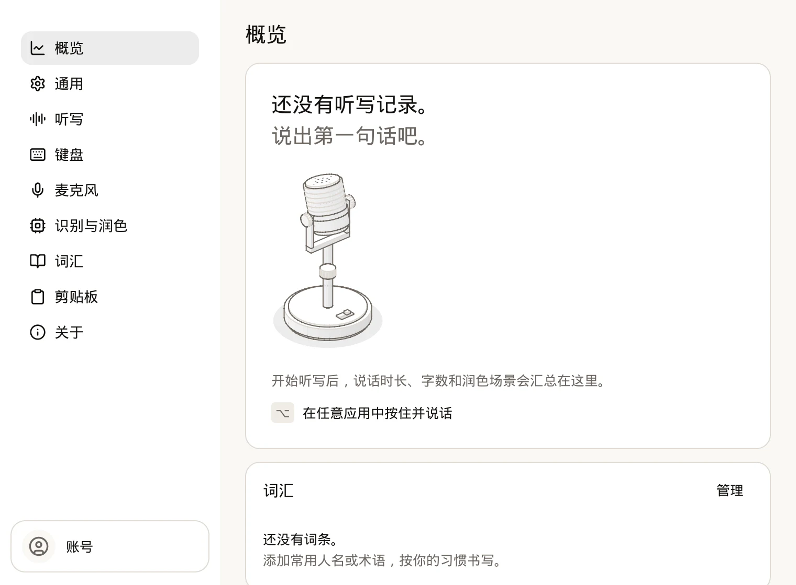

[Arion 0.1.4](/blog/arion-0-1-4/) 之后，我们为 Apple 芯片 Mac 和 Windows x64 发了 0.1.5 和 0.1.6 两个更新。0.1.5 支持第二个听写按键，麦克风打开得更早，润色回退时会说明原因，候选文字颜色可以固定，复制的文件改为主动开启才记录。0.1.6 新增划词操作、首次使用的概览页和剪贴板历史里的图片缩略图，并修复了 Windows 上反应慢的应用和 macOS 上从微信复制后的粘贴问题。

如果你还在用更早的版本，打开「设置 › 关于」，点击「检查更新」即可。

## 第二个听写按键（0.1.5）

「设置 › 听写」里，「听写按键」旁边多了一个「+」。点一下，再按下想用的键，之后两个键都能开始听写。第二个键的按住和单击方式和第一个相同，开始的都是普通听写。点「−」可以删掉它。

<embed-frame src="/blog/arion-0-1-6/stage.zh.html#shortcut" poster="./posters/shortcut.zh.webp" title="演示：添加第二个听写按键" ratio="16/10" caption="点击「听写按键」旁的「+」，按下右 Command。此后右 Option 和右 Command 都能开始听写。模拟录屏。"></embed-frame>

最多只能再加一个键。已被其他快捷键占用的键会被拒绝。[^shortcut]

## 麦克风先打开（0.1.5）

按下快捷键马上开口时，最前面的几个字可能落在准备阶段里。现在 Arion 会先打开麦克风，在查找输入框、准备识别器的同时先把你说的话排队存着，准备好后再按顺序交给识别器。感谢 [@earmer](https://github.com/earmer) 的[这次改动](https://github.com/AstraFoundry/Arion/pull/117)。

<embed-frame src="/blog/arion-0-1-6/stage.zh.html#capture" poster="./posters/capture.zh.webp" title="演示：按下快捷键就开口" ratio="16/10" caption="按住右 Option 立刻说话。草稿从第一个字开始，长草稿的末尾始终贴着胶囊的右边缘。模拟录屏，不会采集声音。"></embed-frame>

缺少模型时，会话依然在打开麦克风之前就结束。准备失败或你取消时，排队的音频会直接丢弃、不做识别；目标是密码框时也一样。[^capture]

同一次改动还修复了胶囊里的长草稿。中英文混排的长草稿，末尾会逐渐偏离右边缘，原因是 Arion 把单个字符的宽度和整行排版后的宽度混在一起计算。现在草稿末尾会一直贴着边缘。

## 润色回退时会说明原因（0.1.5）

云端润色用不了、Arion 改为插入未润色的文字时，胶囊会在听写完成后显示一条简短提示：发生了什么，下一步怎么做。同一个服务商、模型和同一类问题，在 Arion 运行期间只提示一次。

<embed-frame src="/blog/arion-0-1-6/stage.zh.html#polish" poster="./posters/polish.zh.webp" title="演示：润色提示和「必要时允许推理」" ratio="16/10" caption="模型拒绝在不推理的情况下润色。文字按原样粘贴，胶囊提示「模型需要推理」，随后在云端模型设置里打开「必要时允许推理」。模拟录屏，不会连接任何服务商。"></embed-frame>

有些模型会拒绝关闭推理的请求，包括较新的 Gemini 模型和 OpenRouter 上的 gpt-5-mini。云端模型页面新增了「必要时允许推理」开关，默认关闭。打开后，模型一旦拒绝，Arion 会先用 minimal 推理重试，再用 low，并记住这个模型接受的级别。这只会让这些模型的润色变慢。同样感谢 [@earmer](https://github.com/earmer) 的[这次改动](https://github.com/AstraFoundry/Arion/pull/107)。[^polish]

## 候选文字颜色（0.1.5）

「设置 › 键盘」里，候选栏多了「文字颜色」。选「自动」时，Arion 会根据「高亮颜色」为高亮的候选选择白色或黑色：白色与底色的对比度能保持 3:1 时用白色，否则用黑色。菜单里会写明当前选中的是哪种，比如「自动（白色）」。

<embed-frame src="/blog/arion-0-1-6/stage.zh.html#textcolor" poster="./posters/textcolor.zh.webp" title="演示：选择高亮颜色并固定文字颜色" ratio="16/10" caption="高亮颜色选紫色后，自动文字颜色变成白色。再选「黑色」把它固定下来，高亮的候选随之改变。模拟录屏。"></embed-frame>

选「黑色」或「白色」会在浅色和深色外观下都固定这个颜色。重新选「自动」或换一个高亮颜色，就会取消固定。感谢 [@cyrus-cai](https://github.com/cyrus-cai) [加入这个设置](https://github.com/AstraFoundry/Arion/pull/121)。[^textcolor]

## 复制的文件改为主动开启（0.1.5）

现在只有在「设置 › 剪贴板」里打开「记录复制的文件」后，剪贴板历史才会记录复制的文件。这个开关默认关闭，从旧版本升级的配置也一样；打开时需要点一次「开启文件记录」确认。

<embed-frame src="/blog/arion-0-1-6/stage.zh.html#files" poster="./posters/files.zh.webp" title="演示：打开「记录复制的文件」" ratio="16/10" caption="打开「记录复制的文件」并确认一次。历史只保存复制文件的引用，不会上传文件内容。模拟录屏。"></embed-frame>

开关关闭时，已有的文件记录只是隐藏，不会删除。历史保存的是文件的引用而不是副本，macOS 可能会请求访问这些文件所在的文件夹。感谢 [@gavi102803](https://github.com/gavi102803) 的[这次改动](https://github.com/AstraFoundry/Arion/commit/9fba8413)。[^files]

## Windows 上更干净的 Ctrl+V（0.1.5）

[@gialoc668](https://github.com/gialoc668) [反馈](https://github.com/AstraFoundry/Arion/issues/110)，在 Windows 11 的飞书和微信输入框里，听写的文字上不了屏。原因之一是粘贴时还有按键处于按下状态：Windows 不会为模拟的 Ctrl+V 松开 Shift、Alt 或 Windows 键，于是这个组合键可能打出一个多余的 V，或者什么都没粘贴。现在 Arion 会先松开这些键，再发送一次左 Ctrl+V。胶囊对模拟的粘贴显示「已粘贴」，因为 Arion 无法确认应用是否接收了它。[^paste]

## 划词操作（0.1.6）

在任意应用里选中文字，旁边会出现一个小工具条，上面是你启用的助手、「复制」「加入词库」和一个 X。把指针停在 Claude 或 ChatGPT 上，就会打开它的菜单：「翻译成中文」「解释」「总结要点」「润色改写」和「自定义提问…」，ChatGPT 下面还有「Ask ChatGPT」。

<embed-frame src="/blog/arion-0-1-6/stage.zh.html#selection" poster="./posters/selection.zh.webp" title="演示：让 Claude 翻译选中的文字" ratio="16/10" caption="选中一句话，停在 Claude 上，选择「翻译成中文」。Claude 应用打开，提示词和选中的文字已经填好，等你发送。模拟录屏，不会向 Claude 发送任何内容。"></embed-frame>

选择一个提示词后，Arion 会通过 `claude://` 打开 Claude，或通过 `codex://` 打开 ChatGPT，在本地对话里预先填好提示词和你选中的文字。发送由你来做，Arion 自己什么也不发。提示词是内置的英文指令，发给 Claude 的内容最多 14,000 个字符。划词操作默认关闭。可以在设置流程新增的最后一步「处理选中的文字」里打开，也可以在「设置 › 通用」里打开，并在那里选择 Claude、ChatGPT 或两者都用。

Arion 读取选中的文字时不碰剪贴板：macOS 上用辅助功能，Windows 上用 UI Automation，从不模拟 Command-C。密码框不会出现工具条，选中的文字也不会写进日志。[^selection]

点 X 会打开停用菜单：「停用 1 小时」、在当前网站停用、在当前应用中停用，或「关闭划词操作」。

<embed-frame src="/blog/arion-0-1-6/stage.zh.html#disable" poster="./posters/disable.zh.webp" title="演示：在一个网站上停用工具条" ratio="16/10" caption="点 X 打开停用菜单。选择「在 docs.example.com 停用」后，在这个网站上选中文字不再出现工具条。模拟录屏。"></embed-frame>

## 首次使用的概览页（0.1.6）

在你第一次听写之前，「概览」页面会显示一张卡片，上面画着麦克风、写着要按住的键，下面是词汇卡片，取代总量、热力图和场景统计。

0.1.6 里，设置、菜单栏面板和设置流程的界面也更平了：卡片只有一条细边框、没有阴影，只有菜单和弹出层浮在上面。[^overview]

## 剪贴板历史显示图片缩略图（0.1.6）

复制 PNG、JPEG、GIF、WebP 或 BMP 文件后，剪贴板历史会在文件名旁显示缩略图，指针停在上面会显示大图。感谢 [@gavi102803](https://github.com/gavi102803) [加入这个功能](https://github.com/AstraFoundry/Arion/commit/73b4f0b2)。

<embed-frame src="/blog/arion-0-1-6/stage.zh.html#thumbnails" poster="./posters/thumbnails.zh.webp" title="演示：剪贴板历史里的图片文件" ratio="16/10" caption="按 Command-Shift-V 打开剪贴板历史。复制的 beach.jpg 显示缩略图，指针停在上面显示大图。模拟录屏。"></embed-frame>

这一项仍然是文件引用，选中后粘贴的是文件，和以前一样。读不出来的图片不显示缩略图，也不会报错。[^thumbnails]

## 粘贴会等反应慢的 Windows 应用（0.1.6）

同一个 [Windows 问题](https://github.com/AstraFoundry/Arion/issues/110)还有第二个原因。Arion 会在粘贴 400 ms 后恢复你原来的剪贴板，而微信这类较晚才读取剪贴板的应用读到的是旧内容：输入框是空的，胶囊却显示「已粘贴」。

现在 Arion 会在粘贴前记下输入框的状态，300 ms 后再检查一次，600 ms 时恢复剪贴板。如果输入框没有变化，就在 500 ms 后再检查一次，1100 ms 时恢复。如果每次检查都没看到文字进来，Arion 会把听写的文字留在剪贴板上，胶囊显示「已复制」，这时按 Ctrl+V 就能粘贴。这个 Issue 仍然开着。[^hold]

## macOS 上从微信复制后的粘贴（0.1.6）

从微信输入框复制文字后，下一次听写可能失败，提示「无法粘贴文字」和“剪贴板已改变或暂不可用，听写内容仍可复制。”[@huwan](https://github.com/huwan) [找到了原因](https://github.com/AstraFoundry/Arion/issues/122)：微信会额外写入两种富文本剪贴板类型，macOS 无法读取它们的名字；只要有一种类型读不出数据，Arion 就放弃了剪贴板快照。现在 Arion 会跳过这些类型，粘贴可以正常完成。[^wechat]

## 其他修复（0.1.6）

- 已保存的更新和当前安装的应用对不上时（比如在用磁盘映像重新安装之前就准备好的更新），不会再让听写快捷键和菜单栏按钮失效。Arion 会忘掉它，保持听写可用。[^update]
- 一切正常时，菜单栏面板不再显示“Ready”；只有 Arion 没准备好时才显示状态。

## 还没做到的事

- 在 Windows 上，Arion 还无法判断选中的文字来自哪个应用或网站，所以停用菜单里没有按网站或按应用停用的选项。
- Windows 上的粘贴改动已经通过了跨平台测试，但还没有在 Windows 11 的微信、QQ 或飞书里手动验证，所以 [Issue #110](https://github.com/AstraFoundry/Arion/issues/110) 仍然开着。
- [0.1.1 里列出的未完成事项](/blog/arion-0-1-1/#还没做到的事)依然存在：多设备同步尚未推出，纠错学习只支持 macOS 原生编辑器，不支持 Intel Mac。

每个版本的完整说明见[桌面端更新日志](https://github.com/AstraFoundry/Arion/blob/main/apps/desktop/CHANGELOG.md)。遇到问题，可以用「问题反馈」，也可以在 [GitHub Issues](https://github.com/AstraFoundry/Arion/issues) 提交，或者到 [Discord](https://discord.com/invite/72kh465mMm)、[飞书群](https://applink.feishu.cn/client/chat/chatter/add_by_link?link_token=e05vef49-cce2-404f-9740-2fb99d17d444)找我们。

<github-people label="贡献者" logins="stvlynn, earmer, cyrus-cai, gavi102803"></github-people>

<github-people label="提交 Issue" logins="gialoc668, huwan"></github-people>

[^shortcut]: [听写快捷键](https://github.com/AstraFoundry/Arion/blob/main/docs/project/dictation-shortcuts.md)与[规范 001：桌面输入](https://github.com/AstraFoundry/Arion/blob/main/specs/001-desktop-input.md)。

[^capture]: [规范 001：桌面输入](https://github.com/AstraFoundry/Arion/blob/main/specs/001-desktop-input.md)（`DSK-08`、`DSK-A01`）与[架构概览](https://github.com/AstraFoundry/Arion/blob/main/docs/project/architecture.md)中的 Start 步骤。

[^polish]: [云端润色](https://github.com/AstraFoundry/Arion/blob/main/docs/project/cloud-polishing.md)。提示只说明问题的类别，从不包含你的文字。

[^textcolor]: [ADR 017：共享的离线拼音键盘](https://github.com/AstraFoundry/Arion/blob/main/docs/decisions/017-offline-pinyin-keyboard.md)。

[^files]: [剪贴板历史](https://github.com/AstraFoundry/Arion/blob/main/docs/project/clipboard.md#file-access-guidance)、[ADR 047：剪贴板文件访问指引](https://github.com/AstraFoundry/Arion/blob/main/docs/decisions/047-clipboard-file-access-guidance.md)与[规范 010：剪贴板历史](https://github.com/AstraFoundry/Arion/blob/main/specs/010-clipboard.md)（`CLP-09`）。

[^paste]: [ADR 003：快捷键模式的插入方式](https://github.com/AstraFoundry/Arion/blob/main/docs/decisions/003-insertion-routes.md)与 [Pull Request #118](https://github.com/AstraFoundry/Arion/pull/118)。

[^selection]: [规范 011：划词操作](https://github.com/AstraFoundry/Arion/blob/main/specs/011-selection-actions.md)（`SEL-02`、`SEL-03`）与 [ADR 048：划词操作的 URL](https://github.com/AstraFoundry/Arion/blob/main/docs/decisions/048-selection-action-urls.md)。

[^overview]: [设计系统](https://github.com/AstraFoundry/Arion/blob/main/docs/frontend/design-system.md#overview)中的 Overview 一节、[Pull Request #127](https://github.com/AstraFoundry/Arion/pull/127) 与 [ADR 049：平面与浮起的材质](https://github.com/AstraFoundry/Arion/blob/main/docs/decisions/049-sunbeam-package-and-materials.md)。

[^thumbnails]: [规范 010：剪贴板历史](https://github.com/AstraFoundry/Arion/blob/main/specs/010-clipboard.md)（`CLP-06`）。

[^hold]: [ADR 003：快捷键模式的插入方式](https://github.com/AstraFoundry/Arion/blob/main/docs/decisions/003-insertion-routes.md)与 [Pull Request #126](https://github.com/AstraFoundry/Arion/pull/126)。输入框的变化只决定何时恢复剪贴板，并不能证明粘贴成功。

[^wechat]: [Pull Request #123](https://github.com/AstraFoundry/Arion/pull/123)。

[^update]: [更新生命周期](https://github.com/AstraFoundry/Arion/blob/main/docs/project/update-lifecycle.md)与 [Pull Request #137](https://github.com/AstraFoundry/Arion/pull/137)。
