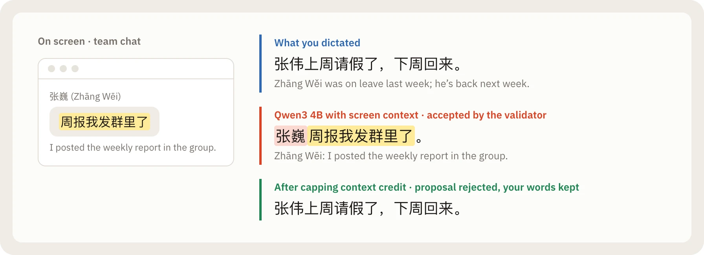
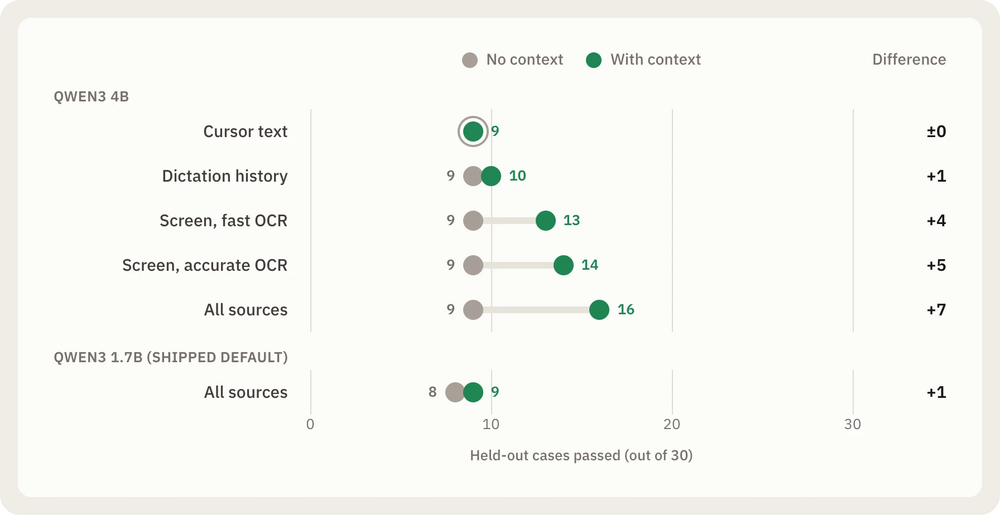
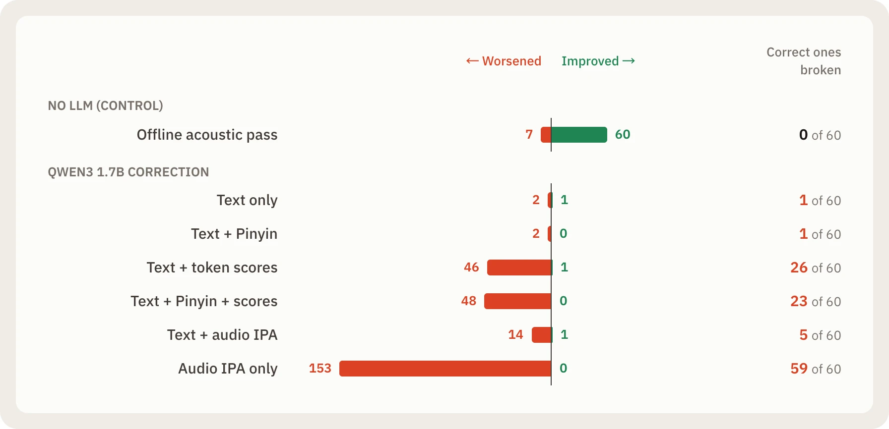
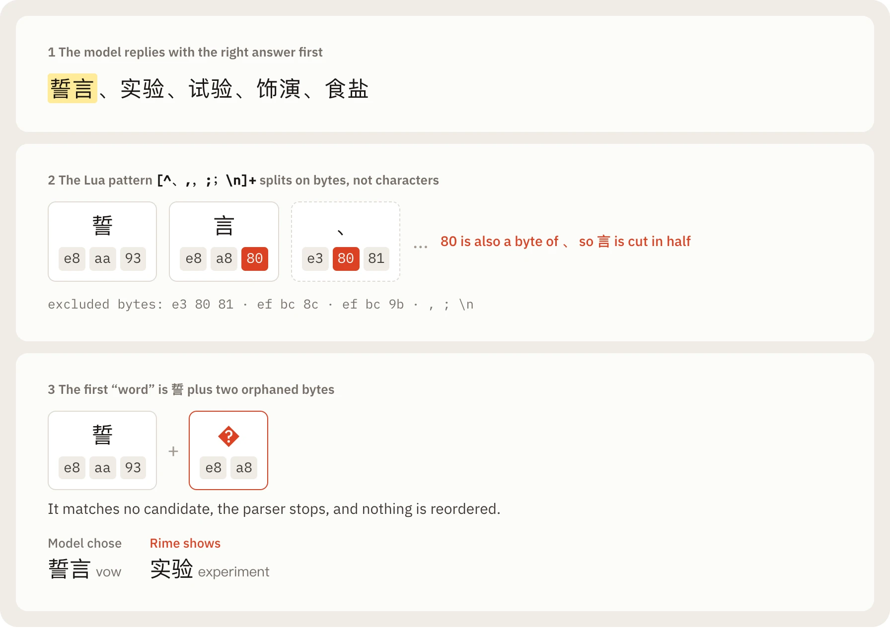

Suppose you are dictating a message about your colleague 张伟 (Zhāng Wěi). While you speak, a chat window happens to be open on your screen from someone else: 张巍 (Zhāng Wēi). Same Pinyin, different person.

To help our local voice input method spell names and technical terms accurately, we wired screen context into the polishing model. It ran OCR over the active window and passed the visible text to a local LLM. It took an afternoon to build, and on the handful of sentences we tried by hand, it corrected every name we threw at it.

If we had shipped based on that demo, the feature would have failed in two opposite ways at once.

On Qwen3 4B, the model saw 张巍's message on screen and replaced the user's dictation about 张伟 with it. Worse, our output validator accepted the replacement. And on Qwen3 1.7B, the model we ship as the default, turning on screen context, cursor text and dictation history scored 9 out of 30 on our held-out test set. Turning all context off also scored 9 out of 30.[^context]



A feature that looked convincing in a demo silently altered the speaker's meaning on the larger model, and did nothing at all on the default one.

## Three experiments where data contradicted intuition

Arion is a local-first voice and Pinyin input method. You hold a key, speak Chinese, English or a mix of both, and speech recognition plus an optional local polishing model tidy the transcript (turning "Wednesday, no wait, Thursday" into "Thursday") before inserting it at your cursor.

When you build a product like this, plausible ideas are easy to come by. The 张伟 case was only the first time measurements disagreed with our intuition. Instead of judging context polishing by a few live tries, we froze a 30-case held-out set that included 7 negative cases: distracting windows, prompt injections on screen, near-homophone names and unrelated dictation history. Then we ran an ablation, testing each context source alone before combining them:[^context]

- **Text around the cursor** added 0 passes on this set.
- **Recent dictation history** added 1 to 2 passes.
- **Screen text carried almost all the gain.** Paired with macOS Vision's `accurate` OCR (107 ms p50), it added 5 to 6 passes on the 4B model, mostly names and terms visible in the window. Switching to Vision's `fast` mode (30 ms p50) lost 2 of those cases because it cannot read Chinese.
- **Model size decided whether context helped at all.** Our default 1.7B model scored 9 of 30 in every context mode, ignoring the extra input. Only the 4B model climbed from 9 to 16, at roughly twice the latency and memory.



That single 张伟 failure led us to cap how much validation credit context spellings can earn, so on-screen text can no longer replace the main body of a dictation. Switching from raw context sections to extracted terms also reduced 4B median latency from 1.84 s to 0.86 s. And because the ablation showed 1.7B ignoring context, we avoided enabling a default setting that consumes CPU without improving accuracy.

A second experiment went against intuition even more sharply.

Speech recognizers make phonetic mistakes. It seemed reasonable that a language model could fix misheard words if we gave it pronunciation clues: Pinyin, universal IPA phones decoded from the audio, or the recognizer's own token confidence scores.

We ran six LLM correction conditions across 154 test cases (924 measured generations on Qwen3 1.7B). For a clean baseline, we included a control row that used no LLM at all: an offline acoustic second pass over the recorded audio.[^phonetic]

| Condition | Mandarin CER | English WER | Mixed MER |
| --- | --- | --- | --- |
| Raw streaming recognition | 8.17% | 7.63% | 36.39% |
| **Offline acoustic second pass (control)** | **5.82%** | **3.97%** | **22.10%** |
| Text-only LLM correction (Qwen3 1.7B) | 8.42% | 7.53% | 36.39% |
| Text + recognizer token scores | 85.77% | 39.27% | 231.27% |
| Audio IPA phones only | 314.73% | 334.69% | 275.20% |

At first glance, the bottom rows look like a bug in the scoring script. How does an error rate exceed 200%?

Our evaluation rules forbid clamping error rates at 100% or replacing a failed model output with the source transcript. When we passed raw log-softmax token scores to an unadapted 1.7B model, it began repeating words, echoing prompt field names, and copying few-shot demonstrations until it hit the 256-token output limit. It corrupted 26 of the 60 utterances that streaming recognition had transcribed without error. Even the plain text-only editor changed almost nothing, and on all 4 pure-silence test cases it emitted a pair of quotation marks instead of an empty string.

Meanwhile, the control won across every metric. Re-decoding the audio with an offline acoustic model took 0.13 s at p50, lowered all three error rates, improved 60 utterances, and corrupted none of the originally correct ones. Without that control row, we could easily have spent weeks tuning prompts on a text model for a problem the acoustic pass already solved in a tenth of the time.



In a third study, we learned to verify published numbers before adopting external designs.

On the Pinyin keyboard side, a community LLM reranker for the Rime input method reported roughly 1 ms latency for reranking candidates with a local model. We reproduced the unchanged upstream Lua filter against 100 real native Rime candidate snapshots using Qwen3.5-0.8B on local oMLX.[^rime]

Top-1 accuracy fell from 56 of 100 to 45 of 100, with 3 rescues and 14 breakages. Because real Rime candidate lists mix full-word conversions with shorter prefix candidates that consume only part of the Pinyin, the prompt promoted single-character prefixes ahead of full words: `朋友` (friend) became `彭`, `学习` (study) became `学`, and `电脑` (computer) became `点`.

Where did the 1 ms latency figure come from? In our run, HTTP calls to the local model server took 288.85 ms at the median. Reading the upstream Lua code explained the difference: its timer called `os.clock()`, which measures *process CPU time*. While LuaSocket blocked waiting for the model server to respond, the Rime process was asleep, so its CPU clock barely moved (`0.787 ms` p50) while the user waited nearly a third of a second.

 counts the Rime process's CPU time, which stops while it sleeps on the socket, so the log shows under a millisecond while the typist waits almost a third of a second.")

Inspecting the raw responses revealed a second defect. The Lua parser placed multibyte UTF-8 Chinese punctuation inside byte-level character classes (`[^...]`). Whenever an ordinary Chinese character contained a matching byte, the parser split the word in half. Given the context `婚礼上许下` ("vowed at the wedding") and Pinyin `shi yan`, the model returned the right candidate, `誓言` (vow). The parser truncated the bytes and left `实验` (experiment) on screen. Out of 89 real model responses, 38 failed to parse.[^rime]



## When code and demos are cheap, falsification is the bottleneck

Taken together, those three experiments point to the same pattern. Each idea looked sound before we measured it systematically:

- Testing a few windows by hand on the 4B model made screen context look ready to ship.
- Inspecting individual text-correction examples without an acoustic control made prompt tuning look promising.
- Reading the `os.clock()` log showed sub-millisecond numbers in the terminal.

Working with AI coding agents amplifies this risk. Much of Arion's repository is written by coding agents and reviewed by engineers in pull requests. Historically, writing code was expensive and verifying a deterministic function was cheap. With local models and coding agents, that ratio inverts. Writing a new prompt, swapping an ONNX model or adding a context source takes minutes, and every change comes with a convincing demo.

Coding agents also optimize for passing whatever check is in front of them. If you ask an agent to run an evaluation or fix a failing pipeline, the shortest path to a green check is often to fall back to the source text when the model output fails validation, retry a dropped audio buffer, or mock a missing native driver.

That observation reshaped our engineering process: **when generating code and demos is cheap, the real bottleneck is building an evaluation setup that makes it hard for you or an agent to fool yourself.**

## Designing the repository as a verifiable lab

When you treat the codebase as a safeguard against wishful thinking, Arion's rules fit together as a single system.

### 1. Freeze the held-out set before tuning the prompt

Consider how we selected the live polishing model. Before tuning the prompt, we split the cases into two sets: a 24-case development set for iteration, and a 30-case held-out set written and SHA-256 hashed beforehand, used only to compare finished candidates.[^live] Every candidate ran through the production worker and production validator on the same machine.

| Model | Held-out passes (unpolished baseline: 12 / 30) | Worsened | Final rewrite p50 / p95 |
| --- | --- | --- | --- |
| Qwen3 0.6B | 24 | 0 | 0.18 / 0.36 s |
| **Qwen3 1.7B (shipped)** | **27** | **0** | **0.50 / 1.67 s** |
| Qwen3 4B | 28 | 0 | 0.89 / 2.15 s |

Because the criteria were set in advance, the trade-off was clear. The 4B model gained one case at roughly twice the latency and memory. The 0.6B model was fastest, but it missed three cases and produced harmful edits (dropped clauses and numbers) that were only stopped by the validator. We shipped 1.7B.

Measuring the end-to-end audio pipeline in the same report also changed the architecture around the model. We tested finalizing recognition one speech segment at a time to reduce latency after key release. It lowered stop latency slightly, but raised recognition error at segment boundaries; and when streaming ASR, per-segment Qwen3-ASR and the 1.7B LLM ran concurrently, one fixture failed with an explicit `AUDIO_DISCONTINUITY` because three ONNX Runtime thread pools contended for the CPU and overflowed the capture queue.[^live]

Because our protocol forbids masking a failure with a retry, that error remained in the report and ruled out per-segment finalization. The shipped pipeline decodes the whole utterance once after you stop speaking. Later, the same evidence chain led to [ADR 023](https://github.com/AstraFoundry/Arion/blob/main/docs/decisions/023-remove-live-rewrite-preview.md), which removed mid-speech LLM previews after benchmark data showed the final pass always replaced them without changing a single inserted character.

### 2. Measure quality and latency in the same run

After ruling out the 289 ms LLM reranker for Pinyin, we still needed better homophone ordering. Instead of calling a language model on every keystroke, we built a lightweight on-device context ranker that learns from your recent commits in the same application (within 120 seconds), limiting a single confirmation to a two-place boost so a one-off selection cannot take over top-1.[^imk]

Across 50 homophone pairs and 3 seeds, first-occurrence accuracy was unchanged (14%), because nothing had been learned yet. On later occurrences, standard frequency learning alone scored **32.2%** top-1 because homophones used in different contexts kept displacing one another. With the context ranker enabled, later-occurrence top-1 rose to **88.7%** (MRR from `0.612` to `0.933`), with 47 pairs improving and **0 regressing**.

Because the benchmark measured keystroke latency in the same run, it also caught a separate performance issue. Letter-key p95 latency was 2.92 ms, even though the ranker itself took only 0.02 to 0.06 ms per key. A sampling profile showed that macOS `orderFront` (re-ordering the candidate window in the window server after every commit) accounted for most of the letter-key cost. Keeping the candidate bar transparent and click-through while idle reduced letter-key p95 to **0.81 ms**.[^imk] Measuring quality and latency together prevents one from quietly trading off against the other.

### 3. Keep failures in a 98 MB reproducible archive

An experiment is only as honest as what it is allowed to discard. Specification 008 (`specs/008-evaluation.md`) enforces three rules: failed and cancelled runs keep their status, incomplete runs cannot produce a completed report, and no failed model output is replaced with its source to make a table look cleaner.[^eval]

When a Qwen3 4B phonetic run was stopped partway, its two completed generations stayed in the archive marked `cancelled_by_user`, and the report used only the complete 1.7B checkpoint.

Benchmark corpora, raw per-case outputs, warmups, failed attempts, recorded audio fixtures and exact prompts live in the repository under `benchmarks/`, identified by byte-level SHA-256 digests: 1,062 files and about 98 MB of evidence (model weights and personal recordings stay outside Git).[^archive] Anyone can verify the archive and rebuild the reports without loading a model:

```sh
pnpm bench:archive:verify
pnpm bench:archive:report --out .workspace/archive-report-repeat
```

The evaluation protocol also fixes the statistical details that otherwise drift between runs: a single text normalization, corpus error rates computed as total errors over total reference units, and paired speaker-cluster bootstrap intervals. Test references are barred from entering inference, memory or context (`EVAL-A04`).[^method]

### 4. Turn conclusions into written rules for the next agent

A benchmark answers one question at a time. To keep future changes aligned with what we learned, each decision is recorded in three places:

1. **Specifications (`specs/`)** define what the product must do, with acceptance IDs such as `EVAL-A04` and `LRW-A05`. A feature is not complete until its scenarios pass on the target OS.
2. **Architecture decision records (`docs/decisions/`)** record why, and are superseded rather than deleted (28 so far). Polishing illustrates the sequence: ADR 008 required manual review before insertion; ADR 011 moved to live previews and automatic insertion once the held-out benchmark and validator supported it; ADR 023 removed the mid-speech preview when measurements showed it never changed the final text.
3. **Agent instructions (`AGENTS.md` and `CLAUDE.md`)** turn these findings into constraints that coding agents read before editing code: never substitute mock output for inference evidence, do not add fallback logic that hides an uninvestigated problem, and update specifications and documentation in the same change set as the code.

This last layer is essential when working with coding agents. When a driver is missing or a model fails, the test harness fails visibly, making the honest fix the most direct path for an agent to get a passing build.

## What we have not proven

A process designed to prevent self-deception has to be equally clear about its own limits. Every benchmark report in the repository opens with a `Limits` section, and today three main gaps remain:

- **Single-author corpora and synthetic speech:** Most test cases were written by one developer, and much of the audio is synthesized or read aloud. Once a test set is published in the repository, it remains useful for regression checks, but it cannot serve as a fresh blind test set again.
- **Exact-string proxies instead of human ratings:** Polishing quality is scored with normalized string matching. Blind human review of meaning preservation, style and hallucination (`LRW-A06`) remains an open release gate.
- **Single-machine measurements:** Most numbers come from one Apple M4 (32 GiB) machine. Many Windows paths are compile-checked and unit-tested rather than benchmarked end to end.

<aside>

**Checking the numbers in this post.** Every figure and failure case above comes from a benchmark report in the repository. Follow the footnotes to inspect the corpora, raw outputs and stated limits of each run.

</aside>

## What we would tell another team

If you build with local models and coding agents, writing code is no longer the main constraint. A working prototype takes minutes, and a plausible explanation is even easier to produce.

Decide what "better" means before you build, and freeze a held-out set with a hash. Change one variable at a time and include a simple control that does not use the new model. Keep failed runs, cancelled checkpoints and 231% error rates in the record, and write each conclusion into the rules the next coding agent will read before making a change. None of this makes a product good on its own, but it makes it much harder to fool yourself, which is most of the work.

[^live]: [Live rewrite pipeline results (v1)](https://github.com/AstraFoundry/Arion/blob/main/benchmarks/results/live-rewrite-v1/README.md) and [ADR 011](https://github.com/AstraFoundry/Arion/blob/main/docs/decisions/011-live-local-rewriting.md).

[^context]: [Rewrite context ablation (v1)](https://github.com/AstraFoundry/Arion/blob/main/benchmarks/results/context-ablation-v1/README.md) and [ADR 013](https://github.com/AstraFoundry/Arion/blob/main/docs/decisions/013-rewrite-context-on-device.md).

[^phonetic]: [Phonetic evidence ablation](https://github.com/AstraFoundry/Arion/blob/main/benchmarks/results/phonetic-asr-1.7b-v2/README.md).

[^eval]: [Specification 008: Evaluation and automation](https://github.com/AstraFoundry/Arion/blob/main/specs/008-evaluation.md).

[^rime]: [Rime LLM reranker reproduction](https://github.com/AstraFoundry/Arion/blob/main/benchmarks/results/rime-llm-reranker-v1/README.md).

[^archive]: [Benchmark research archive](https://github.com/AstraFoundry/Arion/blob/main/benchmarks/migration/README.md).

[^method]: [Benchmark methodology](https://github.com/AstraFoundry/Arion/blob/main/docs/research/benchmark-methodology.md).

[^imk]: [Context ranking results](https://github.com/AstraFoundry/Arion/blob/main/benchmarks/results/imk-context-v1/README.md).
