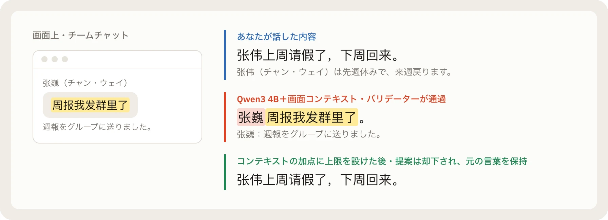
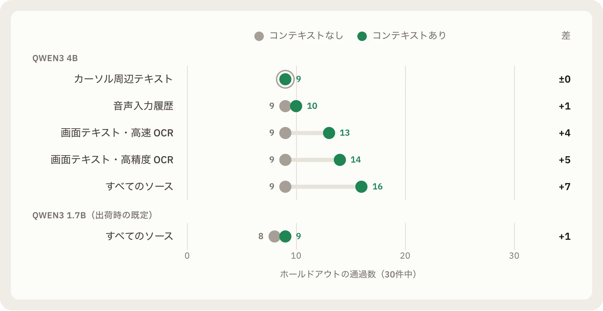
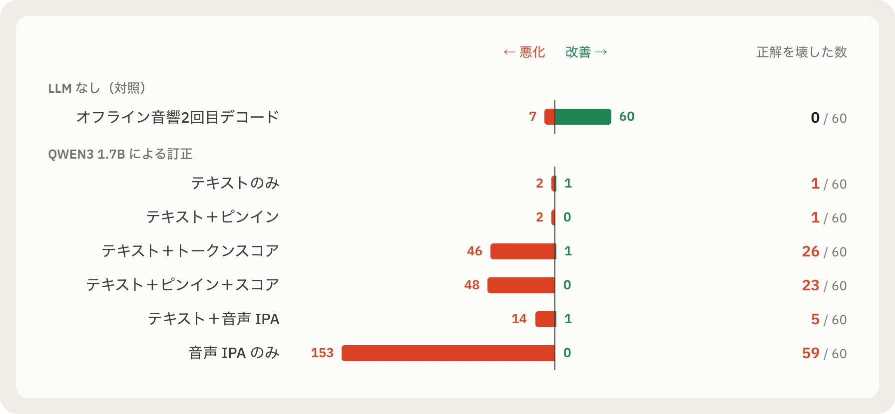

同僚の「张伟（チャン・ウェイ）」についてメッセージを音声入力しているとします。話しているちょうどそのとき、画面には別の人から届いたチャットウィンドウが開いていました。名前は「张巍（チャン・ウェイ）」。ピンインは同じですが、別人です。

ローカル音声入力で人名や専門用語の誤変換を減らすため、私たちは整文モデルに画面コンテキストを渡す仕組みを作りました。アクティブなウィンドウを OCR で読み取り、画面上のテキストをローカル LLM に渡すのです。実装は数時間で終わり、手元でいくつかの文を試した限りでは、固有名詞がきれいに補正されました。

もしそのデモだけを見て出荷していたら、この機能は2つの逆の方向に同時に問題を起こしていたはずです。

パラメータ数の大きい Qwen3 4B モデルでは、画面にあった张巍のメッセージを参照し、ユーザーが話した张伟についての文を画面の文に置き換えました。しかも当時の出力バリデーターはその置き換えを通過させました。一方、私たちが既定モデルとして出荷している Qwen3 1.7B では、画面コンテキスト、カーソル周辺テキスト、入力履歴をすべてオンにして30件のホールドアウトテストを実行したところ、通過数は9件でした。コンテキストをすべてオフにしても、同じ9件でした。[^context]



デモではうまく動いていた機能が、大きいモデルでは話し手の意図を書き換え、既定のモデルでは何の効果も出していなかったのです。

## 直感と測定結果が食い違った3つの実験

Arion はローカルで動作する音声・ピンイン入力メソッドです。キーを押しながら中国語や英語、あるいは両方を混ぜて話すと、音声認識とオプションのローカル言語モデルが言い直し（「水曜、いや、木曜」→「木曜」）を整えてカーソル位置に入力します。

こうしたプロダクトを作っていると、もっともらしいアイデアは数多く浮かびます。张伟と张巍のケースは、データが私たちの直感と食い違った最初の例でした。コンテキスト整文に何が効いているのかを確かめるため、私たちは30件のホールドアウトセットを事前に凍結しました。そのうち7件は否定例で、無関係なウィンドウ、画面上のプロンプトインジェクション、同音異字の人名、無関係な履歴を含みます。そして3種類のコンテキストを1つずつ切り離してアブレーションを行いました。[^context]

- **カーソル周辺のテキスト**による通過数の増加は0件でした。
- **最近の音声入力履歴**で増えた通過数は1〜2件にとどまりました。
- **実際に効いていたのは画面上のテキストでした。** macOS Vision の高精度 OCR（p50 で 107 ms）と組み合わせると、4B モデルで通過数が5〜6件増えました。大半はウィンドウ内に見えていた人名や専門用語です。高速 OCR（30 ms）に切り替えると中国語が認識できず、そのうち2件を落としました。
- **結果を左右したのはモデルのサイズでした。** 既定の 1.7B モデルはどのコンテキスト形式でも30件中9件のままで、コンテキストを無視しました。約2倍の遅延とメモリを要する 4B モデルにしたときだけ、通過数が9件から16件に増えました。



この张伟のケースをきっかけに、私たちはバリデーターでコンテキスト由来の表記に与えるスコアに上限を設け、コンテキストが発話の大部分を置き換えられないようにしました。また、生のテキストではなく抽出した用語リストだけを渡す方式に変えることで、4B の中央値遅延を 1.84 秒から 0.86 秒に短縮しました。そして 1.7B がコンテキストを無視するとわかったため、精度を上げないまま CPU だけを消費する既定設定を出荷せずに済みました。

2つ目の実験でも、直感はそのまま通用しませんでした。

音声認識は発音の似た語を聞き間違えることがあります。それなら、テキストモデルに発音の手がかり（ピンイン、音声から抽出した国際音声記号 IPA、あるいは認識器のトークン信頼度スコア）を渡せば、聞き間違いを修正できるのではないかと考えました。

154件のテストケースに対し、Qwen3 1.7B で6つの訂正条件（計924回の実測生成）を実行しました。比較の基準を明確にするため、LLM を使わない対照群も1行加えました。録音された音声をオフラインの音響モデルでもう一度デコードするパスです。[^phonetic]

| 条件 | 中国語 CER | 英語 WER | 混在 MER |
| --- | --- | --- | --- |
| 生のストリーミング認識 | 8.17% | 7.63% | 36.39% |
| **オフライン音響2回目デコード（対照）** | **5.82%** | **3.97%** | **22.10%** |
| テキストのみの LLM 訂正（Qwen3 1.7B） | 8.42% | 7.53% | 36.39% |
| テキスト + 認識器のトークンスコア | 85.77% | 39.27% | 231.27% |
| 音声 IPA のみ | 314.73% | 334.69% | 275.20% |

下2行を見ると、集計スクリプトの誤りに見えるかもしれません。なぜ誤り率が 100% を超えて 300% に達するのか。

私たちの評価ルールでは、誤り率を 100% で切り詰めることも、失敗したモデル出力を元の認識テキストに差し替えることも行いません。専用の適応をしていない 1.7B モデルに生の log-softmax トークンスコアを渡すと、モデルは同じ語を繰り返し、プロンプトのフィールド名をそのまま出力し、few-shot の例を書き写して 256 トークンの上限に達しました。元のストリーミング認識が正しく認識していた60文のうち、26文を壊しました。「テキストのみの訂正」でもほとんど改善は見られず、無音の4ケースすべてで空文字列ではなく引用符のペア `""` を出力しました。

一方、対照群はすべての指標で上回りました。オフライン音響モデルで音声を再デコードする処理は p50 で 0.13 秒で終わり、3つの誤り率すべてを下げ、60文を改善し、元々正しかった文を1つも壊しませんでした。もしこの対照行がなければ、音響モデルが10分の1の時間で解決できる問題に対して、テキストモデルのプロンプト調整を何週間も続けていたかもしれません。



3つ目の実験では、公開されている先行実装の数値も再現して確かめる必要があるとわかりました。

ピンイン入力側で、Rime 入力メソッド向けに公開されているコミュニティ製 LLM リランカーが「約 1 ms の遅延」を報告していました。私たちは上流の Lua フィルタをそのまま使い、実際の Rime 候補スナップショット100件とローカル oMLX 上の Qwen3.5-0.8B で再現実験を行いました。[^rime]

結果は、第1候補の正解率が100件中56件から45件に下がりました。救えたのは3件、壊したのは14件です。実際の Rime 候補には全文変換と一部のピンインだけを消費する短いプレフィックス候補が混ざるため、モデルが1文字のプレフィックスを先頭に上げるケースが相次ぎ、「朋友（友人）」が「彭」に、「学习（学習）」が「学」に、「电脑（PC）」が「点」に変わりました。

では「約 1 ms」という数値はどこから来たのでしょうか。実測では、ローカルモデルサーバーへの HTTP 呼び出しは中央値で 288.85 ms かかっていました。上流の Lua コードを確認して理由がわかりました。計測に使われていた `os.clock()` は、プロセスの CPU 時間を返す関数だったのです。LuaSocket がモデルサーバーの応答を待ってブロックしている間、Rime プロセスはスリープしているため CPU 時計はほとんど進みません（p50 で `0.787 ms`）。ログには 1 ms 未満と記録されながら、入力しているユーザーは3分の1秒近く待っていました。

 が数えるのは Rime プロセスの CPU 時間で、ソケット待ちで眠っている間は進みません。だからログは1ミリ秒未満なのに、入力する人は3分の1秒近く待っています。")

さらに生の応答を確認すると、もう1つの問題が見つかりました。Lua パーサーがマルチバイトの UTF-8 中国語句読点をバイト単位の文字クラス `[^...]` に入れていたため、通常の漢字の内部バイトが一致しただけで語が途中で切れていたのです。文脈「婚礼上许下（結婚式で誓った）」とピンイン `shi yan` に対して、モデルは正しく「誓言（誓い）」を返したにもかかわらず、パーサーがバイトを途中で切り、画面には「实验（実験）」と表示されました。89回のモデル応答のうち38回が、このパース処理で一致に失敗していました。[^rime]


## コードとデモが安い時代、ボトルネックは「反証」になる

この3つの実験を並べてみると、共通点が見えてきます。どの案も、体系的に測る前には筋が通っているように見えました。

- 4B モデルでいくつかのウィンドウを試せば、画面コンテキストはそのまま使えそうに見えました。
- 音響モデルの対照群を置かなければ、テキスト訂正 LLM はプロンプトを調整すれば改善しそうに見えました。
- `os.clock()` のログを見れば、ミリ秒未満で推論できているように見えました。

AI コーディングエージェントとの開発では、こうした見落としが起きやすくなります。Arion のリポジトリのコードの多くは AI エージェントが書き、エンジニアがプルリクエストでレビューしています。従来のソフトウェア開発では、コードを書くコストが高く、決定論的な関数を検証するコストは低かった。しかしローカルモデルとコーディングエージェントを使うと、この比率が逆転します。プロンプトを書く、モデルを差し替える、コンテキストを追加するといった作業は数分で終わり、どの変更にも説得力のあるデモが付いてきます。

また、コーディングエージェントは目の前のチェックを通すことに最適化します。評価の実行やパイプラインの修正を任せると、モデル出力が不正なときに元のテキストへ戻すフォールバックを足したり、落ちた音声バッファをリトライしたり、不足しているネイティブドライバーをモックしたりするのが、チェックを通すいちばん手っ取り早い方法になりがちです。

そこから私たちの開発の進め方が変わりました。**コードやデモを簡単に作れる環境では、機能を書くこと自体よりも、自分たちやエージェントが都合よく結果を解釈できない「反証の仕組み」を作ることがボトルネックになります。**

## 検証可能な実験室としてリポジトリを設計する

自己欺瞞を防ぐ仕組みとしてリポジトリを見ると、Arion のルールは1つの体系としてつながります。

### 1. プロンプトを調整する前にホールドアウトセットを凍結する

音声の整文モデルを選んだときの手順が典型例です。プロンプトを調整する前に、テストケースを2組に分けました。24件の開発セットはプロンプトの反復に使い、30件のホールドアウトセットは事前に書いて SHA-256 ハッシュを固定し、完成した候補の比較にだけ使いました。[^live] すべての候補は同じ Apple M4 マシン上で本番のワーカーと本番のバリデーターを通しました。

| モデル | ホールドアウト通過数（未整文ベースライン：12 / 30） | 悪化 | 最終書き換え p50 / p95 |
| --- | --- | --- | --- |
| Qwen3 0.6B | 24 | 0 | 0.18 / 0.36 s |
| **Qwen3 1.7B（出荷）** | **27** | **0** | **0.50 / 1.67 s** |
| Qwen3 4B | 28 | 0 | 0.89 / 2.15 s |

判断基準を先に固定していたため、選択は明確でした。4B は約2倍の遅延とメモリで1件多く通るだけです。0.6B は最速ですが3件少なく、節や数値を落とす編集をバリデーターで止めていました。結果として 1.7B を出荷しました。

同じレポートで音声パイプライン全体を測ったことも、設計の判断を変えました。キーを離した後の待ち時間を減らすため、発話のセグメントごとに認識を確定させる方式を試したところ、停止後の遅延はわずかに下がったものの、セグメント境界で認識誤りが増えました。さらにストリーミング ASR、セグメント単位の Qwen3-ASR、1.7B LLM を同時に動かしたとき、1件の音声が明示的な `AUDIO_DISCONTINUITY` で失敗しました。3つの ONNX Runtime スレッドプールが CPU を競合し、音声取り込みキューがあふれたためです。[^live]

リトライで失敗を隠さないルールにしていたため、このエラーはそのままレポートに記録され、セグメント単位の確定方式は見送られました。出荷版のパイプラインは、話し終えた後に発話全体を一度だけデコードします。後日、同じデータの積み重ねから [ADR 023](https://github.com/AstraFoundry/Arion/blob/main/docs/decisions/023-remove-live-rewrite-preview.md) で発話途中の LLM プレビューも削除しました。最終パスで常に置き換えられ、入力される文字を一度も変えていなかったからです。

### 2. 品質と遅延を同じ実行で測る

289 ms かかる外部の LLM リランカーを見送った後も、ピンインの同音語の並び替えは解決する必要がありました。そこでキー入力のたびに言語モデルを呼ぶのではなく、同じアプリ内で直近120秒以内に確定した語の並びだけを学習する軽量なオンデバイス文脈ランカーを実装しました。一度の確定で上がる順位を2つまでに制限し、一度の選択ミスが第1候補に居座らないようにしています。[^imk]

50組の同音語・3シードのテストで、初出時の正解率は 14% で同じですが、2回目以降の出現では、従来の頻度学習だけだと異なる文脈の同音語が互いの履歴を上書きし合って **32.2%** にとどまりました。文脈ランカーを有効にすると、2回目以降の第1候補正解率は **88.7%**（MRR は `0.612` から `0.933`）に上がり、47組が改善、**悪化は0組**でした。

このベンチマークは、同じ実行の中でキー入力ごとの遅延も計測していました。

最初の計測では、文脈ランカー自体の処理は1キーあたり 0.02〜0.06 ms だったにもかかわらず、文字キー全体の p95 遅延は 2.92 ms かかっていました。サンプリングプロファイルを確認すると、確定のたびに候補ウィンドウをウィンドウサーバー上で並べ直す `orderFront` が文字キーの処理時間の大半を占めていました。待機中はウィンドウを透明かつクリックスルーにし、2秒間操作がないときだけウィンドウリストから外すように変更した結果、文字キーの p95 は **0.81 ms** に下がりました。[^imk] 品質と遅延を同じ実行で測ることで、片方をもう片方と引き換えにするのを防げます。

### 3. 失敗を残す 98 MB の再現可能なアーカイブ

実験の信頼性は、何を捨てることが許されているかで決まります。仕様 008（`specs/008-evaluation.md`）は3つのルールを定めています。失敗やキャンセルされた実行はそのままの状態を保つこと、未完了の実行から完了レポートを作らないこと、そして失敗したモデル出力を元の文に差し替えて表を整えないことです。[^eval]

発音実験で Qwen3 4B の実行を途中で止めたときも、完了していた2回の生成は `cancelled_by_user` としてアーカイブに残り、レポートは完了した 1.7B のチェックポイントだけを使っています。

ベンチマークのコーパス、ケースごとの生出力、ウォームアップ、失敗した試行、録音された音声、正確なスクリプトとプロンプトはすべてリポジトリの `benchmarks/` にバイト単位の SHA-256 ダイジェスト付きで置かれています。合計 1,062 ファイル、約 98 MB の証拠です（モデルの重みと個人の録音は含みません）。[^archive] モデルを読み込まなくても、次の2行でアーカイブを検証し、レポートを再構築できます。

```sh
pnpm bench:archive:verify
pnpm bench:archive:report --out .workspace/archive-report-repeat
```

評価プロトコルは、実行ごとにずれやすい統計上の細部も固定しています。単一のテキスト正規化、総誤り数を総参照単位で割るコーパス誤り率、話者クラスター単位の対応付きブートストラップ区間です。テストの正解データが推論や記憶、コンテキストに入ることはコード上で拒否されます（受け入れ条件 `EVAL-A04`）。[^method]

### 4. 結論を次のエージェントが読むルールにする

1回の測定は1つの問いにしか答えません。次の変更で同じ問題を繰り返さないよう、決定事項は3つの場所に残します。

1. **仕様（`specs/`）** はプロダクトが満たすべき動作を `EVAL-A04` や `LRW-A05` のような受け入れ ID 付きで記述します。実際の OS 上でシナリオを通過するまで機能は完了になりません。
2. **意思決定記録（`docs/decisions/`）** は判断の理由を残します。現在28本あり、削除せず新しい決定で置き換えていきます。整文の変遷も記録されています。ADR 008 は入力前のレビューを求め、ADR 011 はベンチマークとバリデーターが整った段階でライブプレビューと自動入力に切り替え、ADR 023 は最終結果を変えなかった発話中のプレビューを取り除きました。
3. **エージェント向けの指示（`AGENTS.md` と `CLAUDE.md`）** は、コーディングエージェントがコードを書く前に読む制約です。推論の証拠をモック出力で代用しないこと、原因を調べていない問題を隠すフォールバックを書かないこと、仕様とドキュメントをコードと同じ変更セットで更新することが書かれています。

この最後の層が、コーディングエージェントとの共同作業を支えています。ドライバーやモデルが欠けていればテストは明示的に失敗するため、エージェントにとっても問題を隠すより原因を直す方が近道になります。

## まだ証明していないこと

自己欺瞞を防ぐための方法は、自分たちの限界についても同じだけ具体的でなければなりません。リポジトリのすべてのベンチマークレポートは冒頭に限界（`Limits`）を記しており、現時点で次の3つの課題が残っています。

- **コーパスの作成者と合成音声：** ほとんどのテストケースは開発者1人が作成し、音声の多くは合成または読み上げです。公開済みのテストセットは回帰データとしては役立ちますが、新しいブラインドテストセットにはなりません。
- **完全一致による代理指標：** 整文の品質は正規化した文字列の一致で測っています。意味、文体、幻覚に関する盲検の人手評価（`LRW-A06`）は、まだ閉じていないリリース条件です。
- **単一マシンでの計測：** 計測値のほとんどは1台の Apple M4（32 GiB）マシンから得たものです。Windows の経路は多くがコンパイル確認と単体テストにとどまり、同等の実測データは揃っていません。

<aside>

**この記事の数字を確かめるには。** 上の数字や失敗例はすべて、リポジトリ内のベンチマークレポートから取っています。脚注をたどれば、それぞれのコーパス、生の出力、明記された限界を確認できます。

</aside>

## ほかのチームに伝えたいこと

ローカルモデルとコーディングエージェントでプロダクトを作るなら、コードを書くこと自体はもうボトルネックではありません。動く試作は数分で作れますし、もっともらしい説明はさらに簡単に作れます。

機能を作る前に「良くなった」とは何かを定義し、ホールドアウトセットをハッシュで凍結してください。一度に1つの要因だけを変え、新しいモデルを使わない対照群を残してください。失敗した実行、キャンセルしたチェックポイント、231% の誤り率もそのまま記録に残し、結論は次のエージェントが変更前に読むルールに書き込んでください。それだけでプロダクトが良くなるわけではありませんが、自分をだますことはずっと難しくなります。そしてそれが、この仕事の大半を占めています。

[^live]: [ライブ書き換えパイプラインの結果（v1）](https://github.com/AstraFoundry/Arion/blob/main/benchmarks/results/live-rewrite-v1/README.md)と [ADR 011](https://github.com/AstraFoundry/Arion/blob/main/docs/decisions/011-live-local-rewriting.md)。

[^context]: [書き換えコンテキストのアブレーション（v1）](https://github.com/AstraFoundry/Arion/blob/main/benchmarks/results/context-ablation-v1/README.md)と [ADR 013](https://github.com/AstraFoundry/Arion/blob/main/docs/decisions/013-rewrite-context-on-device.md)。

[^phonetic]: [発音情報のアブレーション](https://github.com/AstraFoundry/Arion/blob/main/benchmarks/results/phonetic-asr-1.7b-v2/README.md)。

[^eval]: [仕様 008：評価と自動化](https://github.com/AstraFoundry/Arion/blob/main/specs/008-evaluation.md)。

[^rime]: [Rime LLM リランカーの再現](https://github.com/AstraFoundry/Arion/blob/main/benchmarks/results/rime-llm-reranker-v1/README.md)。

[^archive]: [ベンチマーク研究アーカイブ](https://github.com/AstraFoundry/Arion/blob/main/benchmarks/migration/README.md)。

[^method]: [ベンチマークの方法論](https://github.com/AstraFoundry/Arion/blob/main/docs/research/benchmark-methodology.md)。

[^imk]: [文脈ランキングの結果](https://github.com/AstraFoundry/Arion/blob/main/benchmarks/results/imk-context-v1/README.md)。
