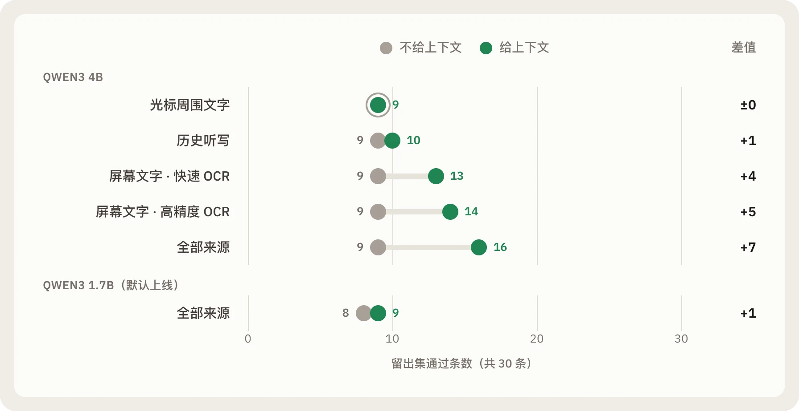
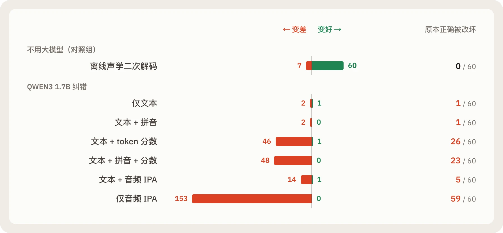

假设你正在给同事张伟口述一条消息。就在你说话的时候，电脑屏幕上刚好停着另一个人发来的聊天窗口，那个人叫张巍。两个名字拼音完全一样。

为了让本地语音输入法少写错人名和术语，我们给润色模型接上了屏幕上下文：用 OCR 读取当前窗口里的文字，交给本地语言模型参考。第一版跑通只花了几个小时，拿几句测试话一试，原本会写错的专有名词都改对了。

如果当时只看这几句演示就上线，这个功能会在两个方向同时出问题。

在参数量更大的 Qwen3 4B 模型上，它看到了屏幕上张巍发来的消息，直接把口述里关于张伟的句子替换成了屏幕上的内容，而当时的输出校验器放行了这次替换。而在我们默认上线的 Qwen3 1.7B 模型上，打开屏幕上下文、光标上下文和历史记录之后，它在 30 条留出测试里通过了 9 条。把所有上下文全部关掉，它还是通过 9 条。[^context]


同一个功能，在 4B 模型上改掉了说话人的原意，在默认的 1.7B 模型上则完全不起作用。

## 三次直觉与数据相悖的实验

Arion 是一个在本地运行的语音与拼音输入法。按住快捷键说话，中英文混杂的语音在本地完成识别，经可选的本地语言模型润色（比如把口头改口「周三，不对，周四」整理成「周四」），再输入到光标位置。

为了弄清楚润色到底该读取哪些上下文，我们没有停留在那几句演示上，而是先冻结了 30 条留出集（held-out set），其中包含 7 条反例：干扰窗口、屏幕上伪造的提示词注入、像张伟和张巍这样的同音人名，以及无关的历史听写。随后我们把三种上下文拆开，分别单独测试，再组合测试。[^context]

在这组用例里，光标周围的文字带来的提升是 0，最近的历史听写只多通过 1 到 2 条。真正起作用的是屏幕文字：配合 macOS Vision 的高精度 OCR（中位耗时 107 ms），它在 4B 模型上多通过了 5 到 6 条，大多是窗口里出现的专有名词。如果换成 30 ms 的快速 OCR，因为无法识别中文，会少通过 2 条。

但决定上限的是模型大小，而不是上下文来源。1.7B 模型不管接收哪种格式的上下文，得分都停在 9 条；只有换到约两倍延迟和内存的 4B 模型，得分才从 9 条升到 16 条。



张伟变张巍的那条用例，让我们在校验器里限制了上下文拼写能抵扣的修改额度，使上下文无法再替代听写的主体内容；同时把整段传入上下文改为只传入提取出的术语列表，将 4B 的中位耗时从 1.84 秒降到 0.86 秒。也是因为消融实验表明 1.7B 会忽略上下文，我们没有在默认设置下开启一个只消耗算力却不改善结果的功能。

第二次实验问的是另一个问题：给文本模型提供发音线索，能不能修好语音识别的同音错字？

我们测试了拼音、从原始音频提取的国际音标（IPA），以及识别器输出的 token 置信度分数。154 条语音用例跑了 6 种纠错条件，共 924 次实测生成。作为对照，我们在表格里加了一行完全不用语言模型的方案：换一个离线声学模型，把同一段音频重新解码一遍。[^phonetic]

| 条件 | 中文 CER | 英文 WER | 中英混合 MER |
| --- | --- | --- | --- |
| 原始流式识别 | 8.17% | 7.63% | 36.39% |
| **离线声学二次解码（对照）** | **5.82%** | **3.97%** | **22.10%** |
| 仅用文本纠错（Qwen3 1.7B） | 8.42% | 7.53% | 36.39% |
| 文本 + 识别器 token 分数 | 85.77% | 39.27% | 231.27% |
| 仅用音频 IPA 音标 | 314.73% | 334.69% | 275.20% |

最后两行的错误率超过了 100%，甚至达到 300%。这不是统计脚本的错误。评测规则不允许把错误率截断在 100%，也不允许在模型输出异常时退回原文。把原始的 log-softmax 置信度分数直接传给未经专门适配的 1.7B 模型后，模型开始重复输出、原样吐出提示词里的字段名，或是照抄示例，直到撞上 256 个 token 的长度上限，把原本完全正确的 60 句听写改错了 26 句。即便是表现最稳定的「仅用文本纠错」，改善也微乎其微，还在 4 条纯静音用例上全部输出了一对引号，而不是空字符串。

反观对照组，用离线声学模型对音频做一次二次解码，计算中位耗时只需 0.13 秒，三项错误率全部下降，改善了 60 句，且没有改坏任何一句原本正确的听写。如果没有这一行对照，我们很可能会对着文本纠错的微小变化继续调整好几周 prompt，去处理一个声学模型花十分之一时间就能解决的问题。



第三次实验来自外部方案的复现。

在拼音输入法一侧，社区里有一个公开的 Rime 大模型重排插件，报告了约 1 ms 的候选词重排延迟。我们保留它的原版 Lua 脚本，接上本地 oMLX 运行的 Qwen3.5-0.8B，在 100 个真实的 Rime 候选词快照上做了一次复现。[^rime]

首选准确率从 100 条中对 56 条降到了 45 条，救回 3 条，改坏 14 条。因为 Rime 第一页候选里混有完整词和只消耗部分拼音的单字前缀，模型频繁把单字前缀排到第一位，日常输入里的「朋友」变成了「彭」，「学习」变成了「学」，「电脑」变成了「点」。

那「1 ms 延迟」是怎么来的？实测中，每次模型请求的中位墙钟时间（wall time）是 288.85 ms。查看上游代码后才找到原因：脚本用了 Lua 的 `os.clock()` 记录耗时。这个函数返回的是当前进程的 CPU 时间。当 Lua 脚本阻塞在 socket 上等待模型服务返回时，Rime 进程处于休眠状态，CPU 计时器几乎不走（中位数 `0.787 ms`）。日志里印着不到 1 毫秒，打字的人实际等待了将近三分之一秒。

 统计的是 Rime 进程的 CPU 时间，进程阻塞在 socket 上休眠时它就停走，所以日志不到 1 毫秒，打字的人却等了将近三分之一秒。")

检查原始响应时，我们还发现了另一个问题：原版解析器在 Lua 的方括号字符集里直接写了多字节的中文标点。Lua 按单字节匹配字符集，普通汉字的 UTF-8 字节只要与标点中的某个字节重合，就会被当成切分符截断。在「婚礼上许下」后面输入 `shi yan`，模型输出了「誓言」，解析器却因为字节重合丢掉了它，屏幕上依然显示「实验」。89 次真实模型响应里，有 38 次因为这个解析问题未能匹配。[^rime]


## 当代码和演示变得廉价

这三个例子在完整测量之前，看起来都很合理：用 4B 模型挑几个窗口做演示，屏幕上下文每次都能生效；如果不放声学二次解码那一行对照，只看文本模型的个别成功样本，会觉得再调一调就能用；而 Rime 重排器的终端日志里，确实打印着低于 1 ms 的数字。

在我们的日常开发里，这种偏差更容易发生。Arion 仓库里有大量代码由 AI 编程智能体编写，再由人在 Pull Request 里审查。写一个新 prompt、换一个 ONNX 模型或接一种上下文来源，现在只要几分钟，每个改动都能附带一个跑得通的演示。

同时，编程智能体会倾向于让眼前的检查尽快通过。如果让智能体去跑评测或修问题，最省事的做法往往是：模型输出格式不对时加一行回退返回原文，音频推理丢帧时自动重试一次，或者在缺少本地驱动时用模拟数据让测试通过。

代码和演示变便宜了，但弄清楚一个改动是否让接下来一千句听写变得更好、有没有悄悄让其中一部分变差，并没有变便宜。如果我们不想被漂亮的演示或智能体的兜底逻辑糊弄，就得把产品问题当成实验问题来处理。

## 我们怎么跑实验

### 先写 benchmark，再调模型

回到语音润色模型的选型。在修改 prompt 之前，我们先写了两组用例：24 条开发集用于迭代 prompt，30 条留出集在写完时立刻计算 SHA-256 哈希并固定下来，只用来比较已经定型的候选方案。[^live] 每个候选都在同一台机器上跑生产环境的 worker 和生产环境的校验器。

| 模型 | 留出集通过数（不润色基线：12 / 30） | 变差用例数 | 最终改写耗时 p50 / p95 |
| --- | --- | --- | --- |
| Qwen3 0.6B | 24 | 0 | 0.18 / 0.36 s |
| **Qwen3 1.7B（已上线）** | **27** | **0** | **0.50 / 1.67 s** |
| Qwen3 4B | 28 | 0 | 0.89 / 2.15 s |

4B 多花约两倍的内存和等待时间，只多通过 1 条用例；0.6B 最快，但少通过 3 条，而且它丢掉分句和数值的改动只是靠外层校验器才拦下。我们上线了 1.7B。

同一份报告也测试了模型周围的音频流水线。逐段完成识别能让松开按键后的等待时间略微降低，但提高了分段边界处的识别错误率；而在同时运行流式识别、分段 Qwen3-ASR 和润色模型时，有一条音频直接触发了 `AUDIO_DISCONTINUITY` 错误：三个 ONNX Runtime 线程池争抢 CPU，导致音频采集队列溢出。[^live]

评测规范不允许用重试掩盖失败，这次溢出被记为失败，我们也据此放弃了分段确认。上线的流水线只在停止说话后对整句音频解码一次。后来，同样因为实测数据显示说话过程中的大模型预览在松手后总会被最终改写覆盖、从未改变过最终插入的文字，我们在 [ADR 023](https://github.com/AstraFoundry/Arion/blob/main/docs/decisions/023-remove-live-rewrite-preview.md) 中去掉了说话中途的预览。

### 同一次运行里同时测质量与延迟

放弃了耗时 289 ms 的第三方大模型重排器之后，我们在拼音键盘里实现了一个轻量的本地上下文调频器：只记录最近 120 秒内在同一应用里确认上屏的前后词搭配，单次确认最多将候选词往上提两个位置，防止一次误选就占据首位。[^imk]

在 50 对同音词、3 组随机种子的测试中，首次出现时调频器不改变原有顺序（首选率同为 14%）。从第二次出现开始，仅靠传统词频学习时，不同语境下的同音词会反复覆盖彼此的最近记录，首选率是 32.2%；启用上下文调频后，后续出现的首选率升至 88.7%（MRR 从 `0.612` 升至 `0.933`），47 对词改善，0 对变差。

同一次运行也记录了每次按键的耗时。上下文调频算法本身每次按键只占 0.02 到 0.06 ms，但第一轮测试里按下字母键的 p95 耗时达到了 2.92 ms。采样分析显示，耗时主要花在每次上屏后候选窗口调用系统窗口管理器的重排（`orderFront`）上。我们将候选窗口改为闲置时变透明并穿透点击、无操作满 2 秒后再移出窗口列表，字母键的 p95 耗时随之降到了 0.81 ms。[^imk]

### 保留失败记录，让 98 MB 原始证据可复现

我们的评测规范（`specs/008-evaluation.md`）规定：失败和取消的运行保留原状态；不完整的运行不能生成完整报告；任何失败的模型输出都不会被替换成原文来让表格好看。[^eval]

发音纠错实验中，Qwen3 4B 模型因耗时过长被中途停止。它已完成的 2 次生成标记为 `cancelled_by_user` 留在档案中，正式报告只使用完整的 1.7B 检查点。

benchmark 语料、逐条原始输出、预热记录、失败尝试、录制音频以及确切的脚本和 prompt，都放在仓库的 `benchmarks/` 下，带有字节级的 SHA-256 标识：1,062 个文件、约 98 MB 的证据（模型权重和个人录音除外）。[^archive] 不加载任何模型就能校验档案、重建报告：

```sh
pnpm --dir /path/to/Arion-evaluation bench:archive:verify
pnpm --dir /path/to/Arion-evaluation bench:archive:report --out .workspace/archive-report-repeat
```

评测协议固定了容易在不同运行之间漂移的细节：统一的文本归一化、按总错误数除以总参考单位计算的语料错误率、按说话人分簇的配对 bootstrap 区间。测试参考答案不会进入推理、记忆或上下文，从测试数据学到的记忆会被直接拒绝（`EVAL-A04`）。[^method]

### 把结论写成规则

一次测量只回答一个问题。为了让结论留下来，每个决定都会写进三处地方。

`specs/` 里的规范写明产品必须做到什么，每条都有验收编号（如 `EVAL-A04`、`LRW-A05`），功能要在真实操作系统上通过对应场景才算完成。`docs/decisions/` 里的决策记录写明为什么，目前有 28 篇，旧决定会被新决定取代而不是删除。润色就经历了从插入前审阅（ADR 008）、实时预览自动插入（ADR 011）到去掉中途预览（ADR 023）的完整过程，每一步都链接到支撑它的证据。`AGENTS.md` 和 `CLAUDE.md` 则把这些经验变成编程智能体写代码前会读的约束：不用模拟输出代替推理证据，不写掩盖未理解问题的兜底逻辑，文档和代码在同一次变更里更新。

当驱动或模型缺失时，运行会直接报错，缺失的能力不会被报告为通过的测试。对智能体来说，让检查通过最省事的路径，就是把真问题修好。

## 我们还没有证明的事

每份 benchmark 报告开头都写明了局限。目前还有三处主要缺口：

大多数语料由一位开发者编写，许多语音是合成或朗读音频。已经公开的测试集仍然是有用的回归数据，但不能再当成全新的盲测集。

改写质量目前用精确字符串匹配的代理指标衡量。对语义保持、风格和幻觉的盲评人工审查（`LRW-A06`），仍是一个未关闭的发布关卡。

大多数数字来自一台 Apple M4（32 GiB）机器。Windows 路径很多只做了编译检查和单元测试，还没有同等级别的实测数据。

<aside>

**查证文中的数字。** 上面的每个数字和失败案例都来自仓库里的 benchmark 报告；顺着脚注可以看到每份报告的语料、原始输出和写明的局限。

</aside>

## 给同样用模型和智能体做产品的团队

用本地模型和编程智能体做产品，瓶颈已经不是写代码了。动手之前先定义什么叫「变好」，并用哈希冻结一个留出集。一次只改一个变量，保留一行不用新模型的对照组。像记录成功一样记录失败，把决定写在下一个智能体会读到的地方，用新决定取代旧决定而不是抹掉它。这些做法本身不会让产品变好，但会让自欺变得难得多。

[^live]: [实时改写流水线结果（v1）](https://github.com/AstraFoundry/Arion/blob/43586d3277719eec7ebdfcaa377fbfd4b649bd81/benchmarks/results/live-rewrite-v1/README.md)与 [ADR 011](https://github.com/AstraFoundry/Arion/blob/main/docs/decisions/011-live-local-rewriting.md)。

[^context]: [改写上下文消融（v1）](https://github.com/AstraFoundry/Arion/blob/43586d3277719eec7ebdfcaa377fbfd4b649bd81/benchmarks/results/context-ablation-v1/README.md)与 [ADR 013](https://github.com/AstraFoundry/Arion/blob/main/docs/decisions/013-rewrite-context-on-device.md)。

[^phonetic]: [发音证据消融](https://github.com/AstraFoundry/Arion/blob/43586d3277719eec7ebdfcaa377fbfd4b649bd81/benchmarks/results/phonetic-asr-1.7b-v2/README.md)。

[^eval]: [规范 008：评测与自动化](https://github.com/AstraFoundry/Arion/blob/main/specs/008-evaluation.md)。

[^rime]: [Rime LLM 重排器复现](https://github.com/AstraFoundry/Arion/blob/43586d3277719eec7ebdfcaa377fbfd4b649bd81/benchmarks/results/rime-llm-reranker-v1/README.md)。

[^archive]: [benchmark 研究档案](https://github.com/AstraFoundry/Arion/blob/43586d3277719eec7ebdfcaa377fbfd4b649bd81/benchmarks/migration/README.md)。

[^method]: [benchmark 方法论](https://github.com/AstraFoundry/Arion/blob/main/docs/research/benchmark-methodology.md)。

[^imk]: [上下文调频结果](https://github.com/AstraFoundry/Arion/blob/43586d3277719eec7ebdfcaa377fbfd4b649bd81/benchmarks/results/imk-context-v1/README.md)。
