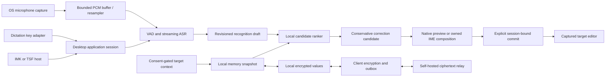
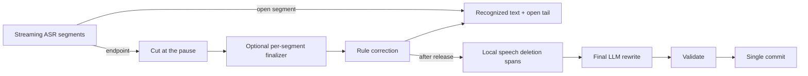

# Architecture

## Data flow

This is Arion's design, not a verified competitor call graph. Ranking requires real alternatives from its producer; a single ASR hypothesis remains a single candidate. Rule correction and ranking are separate operations. Streaming drafts are never treated as committed target content.

## Live local rewriting

The optional live pipeline ([ADR 011](../decisions/011-live-local-rewriting.md), [009](../../specs/009-contextual-rewrite.md)) edits text while the user speaks:

When a session starts with **Match the app** on, the coordinator decides its scene from the captured target after capture (`domain.DecideScene`: search field, then the web page's host, then the bundle ID; see [009 scene selection](../../specs/009-contextual-rewrite.md#scene-selection)). The macOS target adapter reads the field's AX role and, only while polishing and Match the app are on, the host of the enclosing `AXWebArea`'s URL. Each request preserves its work, email, coding-prompt or chat scene for the selected staged recipe; explicit lists use a dedicated numbered-list recipe and search uses chat plus `domain.FinishScene` after the punctuation mode ([009 LRW-14](../../specs/009-contextual-rewrite.md#live-rewriting-pipeline)). The punctuation control sits in the Polish card under Settings › Model and is enabled only while polish is on. Work and prompt scenes default to natural prose; application identity does not authorize bullets or headings. New list formatting requires a clear spoken enumeration or an explicit list request. Scenes the user chose on the menu bar panel's scene card (`features/scene`) are stored by place in the preferences and beat the built-in tables; the panel reads the frontmost app's field with `Targets.Peek` when it opens, without creating an insertion target.

With rewrite context on ([ADR 013](../decisions/013-rewrite-context-on-device.md)), `application/context.go` reads the session's context after capture: the target adapter's `ReadContext` returns text around the cursor and visible text from the captured window (`infrastructure/macos/accessibility.m`: macOS Accessibility; `infrastructure/windows/accessibility.go`: UI Automation, compile-checked only), and `application.History` supplies recent dictations per place. The final request carries sanitized window text plus the separately bounded cursor/history sections. The selected worker uses context only to select bounded source-relative spelling edits, then formats the edited source with no OCR/context. Over-budget requests fail explicitly. See [local rewrite configuration](../operations/local-rewrite.md).

`domain.CleanSpeech` implements a separate local deletion stage (`speech-spans-v2`) before model organization. Rule correction (`arion-rules-v4`) leaves the standalone hesitation list in place; this stage deletes it, and the formatter receives that cleaned text. The worker sends its cleaned text to the selected spelling and scene-formatting stages and returns the original-offset spans for private evaluation. Final organization rejection, timeout or unavailability retains completed cleanup with the failure outcome; recognized original and rule-corrected source remain independently available. The production delivery check validates transport completeness and control markup without semantic overlap rejection, while keeping the recognized original independently available. This follows the stage separation observed in Doubao; its speech annotation model was not recovered ([evidence](../research/competitor-disfluency.md)).

`application/live.go` owns this schedule per session. Segment units flow from the pump to a per-session worker through a bounded queue. While the user is speaking, closed segments stay recognized text: the worker does not send them to the rewrite model and does not show a polished preview. Release runs one final rewrite of the full recognized text. `domain.ValidateRewriteDelivery` checks whether that proposal may be inserted; a rejected final organization retains the completed local cleanup and the event records the failure outcome.

The acoustic finalizer can change a word that was correct during capture. The final rewrite therefore carries the current session's earlier rule-corrected stable recognition as separate `PreviousText` evidence, together with approved vocabulary relevant to either recognized source within one recall budget. The GGUF selector can use independently confirmed names in the same local frame to nominate a bounded spelling alternative; it never uses generated text as recognition evidence. The final request's text is the recognized source. Changed source or context reruns selection and formatting. See [stage-preservation evidence](../../benchmarks/reproduction/rewrite-stage-preservation-v1/README.md).

The model runs in the `arion-llm` pipe worker, which owns a pinned offline llama.cpp child through a private Unix socket (no TCP listener). The Qwen3.5-2B Q4_K_M artifact is provisioned by catalog digest. The native runtime owns one Metal slot, whose state is erased at session boundaries; the client process group cleans up descendants when the worker exits. `infrastructure/rewriting` provisions the model, owns worker lifecycle and reports readiness; `infrastructure/llm/client` adapts the existing pipe transport, including its optional prior-recognition field, to the core `Rewriter` port. Selected templates and resource provenance are documented in [local rewriting](../operations/local-rewrite.md).

## Modules

- `apps/desktop`: composition root (`bootstrap`), MyGo UI, OS adapter wiring and packaging. FSD packages are under `ui/`; native/platform code is under `infrastructure/`. Hosted-sync sign-in lives in `internal/account` ([account sign-in](account-signin.md)).
- `packages/core`: framework-free Go domain, transport-neutral value contracts, domain-owned ports and the dictation coordinator. No MyGo, CGo, SQL, OS permissions, HTTP client, or vendor model SDK imports.
- `models`: a Go module embedding the reviewed catalog (`catalog.json`): artifact provenance, file digests, licenses, bundles and evaluation summaries. Weights, user corpora and commercial app binaries are never committed.
- `services/updates`: implemented Go DDD update-channel service on the center origin. It serves the channel manifests, summaries and downloads that the AstraFoundry admin publishes in the release bucket; the app verifies every archive signature itself ([ADR 019](../decisions/019-center-update-channels.md), [deploy/center](../../deploy/center/README.md)).
- `services/sync`: implemented Go DDD ciphertext relay (`cmd/sync`, PostgreSQL migrations, [deploy/sync](../../deploy/sync/README.md)). One account-unaware core for self-hosted and hosted deployments; the `AccountGate` port (`noop` or `oidc`) maps requests to tenants on top of device authentication, and the hosted edition receives security events ([ADR 015](../decisions/015-hosted-relay-account-authorization.md)).
- `apps/site`: static Next.js marketing site for `arion.astrafoundry.si`; not part of the desktop shell and never reads sessions ([ADR 016](../decisions/016-marketing-site.md)).
- `packages/contracts`: language-neutral examples and contract ownership; portable Go DTOs live in core rather than duplicate type implementations.

## Runtime shape (shortcut mode)

One process. The menu bar app owns six kinds of native windows: a click-through overlay that never takes focus and hosts the dictation pill, the menu bar popover panel, settings, onboarding, the tray hint, and on macOS the consent guide ([DSK-11](../../specs/001-desktop-input.md)). The tray hint (`pages/trayhint`) is a nonactivating tray flyout shown when onboarding completes; it reuses the guide card through `kit.Callout`, points its arrow toward the icon, and closes on dismissal or when the tray icon is clicked. The guide is a nonactivating tray flyout that `bootstrap/guide.go` places under the System Settings window: a worker reads the window server (`infrastructure/macos/guide.m`, no Accessibility needed) and consent at 30 Hz while the guide is open and posts only changes to the main thread; the view (`features/permissions.Guide`) drags Arion's bundle as a file URL. Microphone settings and pending Screen Recording consent reuse the same shell in a compact, non-draggable form, each tracking its own grant; initial native permission requests are preserved. The same guide window and shared `kit.SettingsGuide` shell support explicit Keyboard settings navigation with non-draggable add-source instructions (`features/keyboard.Guide`); source enablement is checked once per second. Onboarding offers optional input-method setup after Accessibility, reuses `keyboard.Setup`, and requires actual selection and completed activation for Continue while allowing deferral. The shared input-source feature exposes enable/retry and switch actions; first installation continues into cancellable, bounded registration/enablement/selection and expected-build connection verification. Leaving setup cancels continuation; periodic state refresh only observes. The dictation key (`infrastructure/holdkey`, a native key-down/key-up listener) is the only global activation: holding dictates until release and a tap toggles the coordinator. Escape is held globally only while a session can be cancelled.

The macOS overlay's native window policy is applied by `infrastructure/macos.ConfigureOverlay` before its first show. It replaces MyGo's `fullScreenNone` with `fullScreenAuxiliary`, joins all Spaces, stays out of window cycling, and on macOS 13+ uses `canJoinAllApplications` for other apps' fullscreen Spaces and Stage Manager sets. It retains the floating level, click-through behavior and `ShowInactive`; the application remains an accessory. Settings and onboarding keep their normal window policies.

1. **Start:** a new generation and session; the platform adapter captures the focused editor (Accessibility trust required on macOS) and chooses one insertion route. macOS shortcut mode always uses a guarded system-paste transaction; AX captures and validates the target/selection and performs authorized reading, without selecting a write route ([ADR 003](../decisions/003-insertion-routes.md)). The resident recognizer opens a stream; the microphone starts. A known secure field or missing permission ends the session before the microphone opens.
2. **Capture:** miniaudio delivers 20 ms mono 16 kHz frames to a bounded queue; overflow or device loss ends the session with `AUDIO_DISCONTINUITY`. One session goroutine owns the recognizer, emits level events and revisioned drafts, and retains session audio in RAM.
3. **Finish:** the stream is flushed; the bundle's acoustic finalizer re-decodes the retained audio; conservative rules and approved vocabulary produce the reviewed text; with polishing on, the final LLM rewrite replaces it if it passes validation; audio is dropped.
4. **Commit:** the session claims its single commit; the adapter revalidates focus and inserts once. Outcomes map to "Inserted" (verified), "Typed"/"Pasted" (unknown) or a failure with the text kept for copying.
5. **Learn** ([ADR 014](../decisions/014-edit-learning.md)): with learning on, a readable non-secure field stays followed after the commit. `application.EditTracker` polls a bounded excerpt every 0.4 s, each read with its own 250 ms budget. It settles after 15 s without change, on focus loss, a cleared field, the next dictation or 60 s. `domain.ExtractCorrections` diffs the insertion against the settled text, using the local `domain.WordSegmenter` port for both sides' word boundaries (`infrastructure/wordseg`: Core Foundation on macOS); ambiguous single-character boundaries are skipped rather than widened arbitrarily; the composition root stores the pairs in the encrypted vocabulary and shows them on the pill with an undo. Approved entries correct later dictations in one pass of `domain.Vocabulary`, and only the relevant ones reach the rewrite prompt.

Coordinator events cross to the UI through a non-blocking queue drained onto the main thread, so worker goroutines never wait on the UI. The model runtime swaps bundles only while no session holds a recognizer.

See [repository ownership](repository.md) for import rules and [contract](../../specs/004-contracts.md) for versioning.

## Input ownership

Shortcut mode captures a target capability token at start, previews in Arion, and commits once through the platform delivery path. A focus change or unsupported editor stops automatic insertion. macOS external-editor delivery always uses system paste with per-transaction snapshots and ownership-checked restoration. Posted paste remains `unknown`; it is never retried automatically. System IME delivery retains its owned client.

IME mode uses host-owned composition ranges. IMK and TSF manage provisional marked text, candidate selection and final commit. The UI process and recognition worker must not access client pointers across process boundaries. The composition root samples the actual OS input-source state once per session: selected Arion uses its owned IME client; other sources use external-editor delivery. The route is session-bound and is not a preference or UI control. Losing an IME client invalidates only its IME session and clears owned composition; no failed route is retried through another transport. Legacy stored `mode` is ignored and removed on the next save.

## Process and execution constraints

MyGo and OS UI calls run on their required UI thread. Capture callbacks enqueue bounded frames and never run inference or network calls. ASR, ranker and correction workers are cancellable and tagged with session/revision/generation. A stopped session cannot receive a late write. Speech inference stays in-process; the LLM runs in the `arion-llm` worker process, whose protocol is documented in `infrastructure/llm/protocol`, with a private GGUF child separate from the speech runtime.

IMK/TSF integration must be proven with small OS-native harnesses before linking the production host. Windows TSF may require a small native COM host/in-process DLL; a Go/MyGo process is not automatically a TSF text service. macOS input source packaging similarly requires an IMK server bundle. These adapters are separate from the normal shortcut app lifecycle.

## Offline keyboard input

[ADR 017](../decisions/017-offline-pinyin-keyboard.md) adds a standalone full-Pinyin path inside `ArionInput.app`: native keys enter the pinned librime runtime, which owns parsing, selected segments, the input caret and the candidate list. `ime/macos/keyboard.m` copies a revision's preedit, candidates by global index and actual commit; `typing.m` owns its native client range separately from voice `composition.m`, and owns the candidate menu: `ranking.m` may reorder the leading candidates by the previous commit (context ranking, stored encrypted beside Rime's learning), and Arion pages, highlights and selects by engine index. Only actual commits call host `insertText`. `candidate_panel.m` draws Arion's own horizontal candidate bar (not `IMKCandidates`) with page-relative indices and revision-scoped click and next-page callbacks. The app's Settings › Keyboard writes `keyboard.json` (with the dictation key), which the input method reads on activation. The input menu's first item, Voice input, is titled with that key and sends `dictate` to `infrastructure/imebridge`, whose callback posts the tray's dictation toggle to the UI thread; it is disabled while the app is not connected (IME-06). Short standalone Shift release, Shift+Space and the input menu switch Chinese/English. The input menu also offers copying pending text, resetting learned words and opening the app named by the bundle's `ArionAppIdentifier` ([input menu items](../research/input-menu.md)); unconfirmed text is discarded before mode/focus/owner changes. The input menu and Ctrl+. switch Chinese-mode width and punctuation through Rime's `full_shape`/`ascii_punct` options; the input method persists them itself in `keyboard/options.json`.

`learning.mm` implements the pinned engine's private userdb interface with in-memory records and transactions. `learning_crypto.swift` supplies public CryptoKit AES-256-GCM and immutable-data SHA-256 checks. Persisted learning consists of atomic ciphertext snapshots with a separate this-device Keychain key; the default plaintext userdb and text backup/sync routes are not used. Explicit reset finalizes sessions, removes learned snapshots under exclusive locking and preserves the key. Learning errors are sticky and visible as keyboard unavailability; an actual text commit already produced by the engine is still delivered once, while pending text remains available for explicit copying.

The host verifies staged immutable data against its bundled manifest before provisioning a key or opening a session. The signed bundle contains the relocatable universal engine, precompiled schema/dictionaries and licenses. Runtime activation neither deploys schemas nor downloads assets. `scripts/stage-keyboard-runtime.mjs` prepares the reviewed closure; `scripts/build-input-method.mjs` compiles both architectures and the CryptoKit boundary. Private C++/Boost SDK headers remain build-only. Engine/text-store tests and storage tests are separate from real IMK registration/event-dispatch acceptance.

## Cloud polishing

The coordinator's `Rewriter` is `bootstrap.polishRouter`: per request it calls the local worker (`infrastructure/rewriting`) or `infrastructure/cloudpolish`, as `Preferences.PolishEngine` says ([ADR 022](../decisions/022-cloud-polishing.md)). Both engines invoke `infrastructure/llm/rewrite` for cleanup, context-backed spelling selection and scene formatting ([ADR 024](../decisions/024-shared-polishing-pipeline.md)). `rewritePolicy` applies the same context switches to both; both engines use `FinalOnly` (no previews, ADR 023), and cloud execution adds a 15 s deadline for all stages. The cloud selector receives enabled context, recalled terms and earlier recognized source through Republic; its formatter receives only the edited source and scene/script profile; the result is validated locally like a local proposal. The ChatGPT sign-in shares `internal/oauthloopback` (PKCE, state, one-shot loopback listener) with the account sign-in. The call surface is [cloud polishing](cloud-polishing.md).

## Account sign-in

`bootstrap.New` builds `internal/account` after the system proxy is installed on the default HTTP transport, and leaves it idle. Views call `SignIn`, `CancelSignIn`, `RefreshAccount`, `SignOut`, `JoinHostedSyncWaitlist`, and `CheckStoredAccount`. The last one reads the credential store without network, and only while an account view is on screen. Those return immediately. `runtime.State.Account` receives the profile, the hosted-sync entitlement flag, the waitlist outcome, and content-free error codes. The access token stays on `App.Account().Session()` for a future sync client in the composition root. The refresh token is a Keychain or Credential Manager item separate from the vocabulary key ([ADR 005](../decisions/005-local-encryption.md)). Sign-out revokes it and deletes that item. The call surface is [account sign-in](account-signin.md); the rules are [ADR 015](../decisions/015-hosted-relay-account-authorization.md) and SYNC-10.

## Privacy and sync

Model provisioning, update checks ([ADR 010](../decisions/010-in-app-updates.md)) and encrypted memory sync are explicit network surfaces; downloads and update checks use `HTTP(S)_PROXY` when set and otherwise the macOS system proxy; Hugging Face files fall back silently to hf-mirror.com when huggingface.co is unreachable, verified by the same pinned digests (`infrastructure/netproxy`; PAC files are not evaluated, Windows honors environment variables only); dictation and ranking have no cloud inference route except cloud polishing, which the user chooses explicitly and whose shared spelling stage receives the final source, recalled terms, earlier recognized source and enabled context ([ADR 022](../decisions/022-cloud-polishing.md)). Audio is memory-only by default. Context is bounded, expires with the session and is excluded from logs/sync. Vetted encryption seals allowed memory before it enters the outbox; the relay cannot access plaintext. Optional account sign-in (system browser, loopback PKCE, refresh token in the OS credential store) only authorizes the hosted relay; it never grants key access ([ADR 015](../decisions/015-hosted-relay-account-authorization.md)). Failure never downgrades to plaintext or remotely processed speech.

See [privacy](../../specs/005-privacy.md), [memory sync](../../specs/003-memory-sync.md), [account sign-in](account-signin.md), and [ADRs](../decisions/README.md).

Input-method updates use a staged filesystem transaction plus host handover: cancel owned dictation, switch away, verify old-process exit, promote/register, restore prior selection and await the expected executable handshake. The IMK host connects at startup independently of client activation; input-source selection, transport readiness and text-range ownership are distinct. macOS listener ownership and orphaned-endpoint recovery are described in [ADR 006](../decisions/006-macos-input-method-host.md).

Recognition runs in resident native workers behind the core recognition ports: Swift MLX on Apple silicon and speech.cpp Q8_0 on Windows x64. Future macOS releases support Apple silicon only ([ADR 021](../decisions/021-apple-silicon-only-macos.md)). Go owns audio buffering, chunked preview scheduling, identities and tail flushing; no ONNX/X-ASR backend remains. See [ADR 020](../decisions/020-native-qwen-asr.md).
