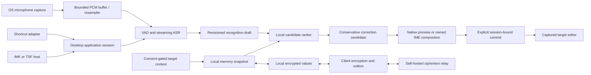

# Architecture

## Data flow

This is Arion's design, not a verified competitor call graph. Ranking requires real alternatives from its producer; a single ASR hypothesis remains a single candidate. Rule correction and ranking are separate operations. Streaming drafts are never treated as committed target content.

## Modules

- `apps/desktop`: composition root, MyGo UI, OS adapter wiring and packaging. FSD packages are under `ui/`; native/platform code is under `infrastructure/`.
- `packages/core`: framework-free Go domain, transport-neutral value contracts, domain-owned ports and application use cases. No MyGo, CGo, SQL, OS permissions, HTTP client, or vendor model SDK imports.
- `services/sync`: reserved service boundary for Go DDD relay code. No implemented relay in this foundation.
- `packages/contracts`: language-neutral examples and contract ownership; portable Go DTOs live in core rather than duplicate type implementations.
- `models`: reviewed model metadata only. Weights, user corpora and commercial app binaries are never committed.

See [repository ownership](repository.md) for import rules and [contract](../../specs/004-contracts.md) for versioning.

## Input ownership

Shortcut mode captures a target capability token at start, previews in Arion, and commits once through a verified insertion path. A focus change or unsupported editor stops automatic insertion. Clipboard delivery is a visible, explicit operation with restoration and ownership checks, not a silent bypass.

IME mode uses host-owned composition ranges. IMK and TSF manage provisional marked text, candidate selection and final commit. The UI process and recognition worker must not access client pointers across process boundaries. User switching modes invalidates the old generation, clears owned composition safely, and requires a new session.

## Process and execution constraints

MyGo and OS UI calls run on their required UI thread. Capture callbacks enqueue bounded frames and never run inference or network calls. ASR, ranker and correction workers are cancellable and tagged with session/revision/generation. A stopped session cannot receive a late write. The core does not require a process split; isolate native inference crashes where supported and document IPC before introducing a worker process.

IMK/TSF integration must be proven with small OS-native harnesses before linking the production host. Windows TSF may require a small native COM host/in-process DLL; a Go/MyGo process is not automatically a TSF text service. macOS input source packaging similarly requires an IMK server bundle. These adapters are separate from the normal shortcut app lifecycle.

## Privacy and sync

Model provisioning and encrypted memory sync are explicit network surfaces; dictation and ranking have no cloud inference route. Audio is memory-only by default. Context is bounded, expires with the session and is excluded from logs/sync. Vetted encryption seals allowed memory before it enters the outbox; the relay cannot access plaintext. Failure never downgrades to plaintext or remotely processed speech.

See [privacy](../../specs/005-privacy.md), [memory sync](../../specs/003-memory-sync.md), and [ADRs](../decisions/README.md).
