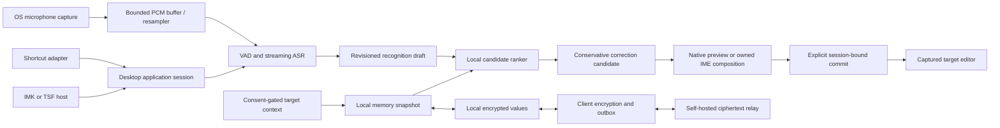
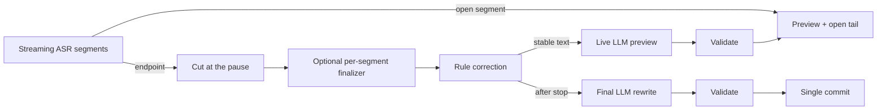

# Architecture

## Data flow

This is Arion's design, not a verified competitor call graph. Ranking requires real alternatives from its producer; a single ASR hypothesis remains a single candidate. Rule correction and ranking are separate operations. Streaming drafts are never treated as committed target content.

## Live local rewriting

The optional live pipeline ([ADR 011](../decisions/011-live-local-rewriting.md), [009](../../specs/009-contextual-rewrite.md)) edits text while the user speaks:

When a session starts with **Match the app** on, the coordinator decides its scene from the captured target after capture (`domain.DecideScene`: search field, then the web page's host, then the bundle ID; see [009 scene selection](../../specs/009-contextual-rewrite.md#scene-selection)). The macOS target adapter reads the field's AX role and, only while polishing and Match the app are on, the host of the enclosing `AXWebArea`'s URL. Each request asks the model for one of the layouts its prompt teaches (`domain.ModelScene`: chat, email, or numbered lines when a work message or coding prompt enumerates points), and `domain.FinishScene` applies mechanical layout such as a search query's missing final punctuation to the delivered text. The prompt never changes when a scene is added. Scenes the user chose on the menu bar panel's scene card (`features/scene`) are stored by place in the preferences and beat the built-in tables; the panel reads the frontmost app's field with `Targets.Peek` when it opens, without creating an insertion target.

With rewrite context on ([ADR 013](../decisions/013-rewrite-context-on-device.md)), `application/context.go` reads the session's context after capture: the target adapter's `ReadContext` returns text around the cursor and the focused window's recognized text (`infrastructure/macos/context.m`: ScreenCaptureKit + Vision; `infrastructure/windows/ocr.go`: `PrintWindow` + `Windows.Media.Ocr`), and `application.History` supplies recent dictations per place. `domain.ContextTerms` turns it into spellings for the prompt's terms; the full context is validation evidence.

`application/live.go` owns this schedule per session. Segment units flow from the pump to a per-session worker through a bounded queue; a newly closed segment cancels the running preview (latest wins), and a preview computed for older text is never displayed. Stop cancels previews before the final request. `domain.ValidateRewrite` decides whether a proposal may be shown or inserted; a rejected final rewrite inserts the rule-corrected text and the event records the outcome.

The model runs in the `arion-llm` worker process: ONNX Runtime GenAI loaded with purego, JSON lines over pipes (`infrastructure/llm/protocol`). One greedy KV state is reused by longest common token prefix: the instruction prefix is computed at load, each preview extends the transcript, and a session's end rewinds to the shared prefix. `infrastructure/rewriting` provisions the model, starts and stops the worker and reports readiness; `infrastructure/llm/client` adapts the worker to the core `Rewriter` port. Field-text context capture and the strict [rewrite evaluator](../research/rewrite-evaluation.md) protocol remain separate, unimplemented gates.

## Modules

- `apps/desktop`: composition root (`bootstrap`), MyGo UI, OS adapter wiring and packaging. FSD packages are under `ui/`; native/platform code is under `infrastructure/`.
- `packages/core`: framework-free Go domain, transport-neutral value contracts, domain-owned ports and the dictation coordinator. No MyGo, CGo, SQL, OS permissions, HTTP client, or vendor model SDK imports.
- `models`: a Go module embedding the reviewed catalog (`catalog.json`): artifact provenance, file digests, licenses, bundles and evaluation summaries. Weights, user corpora and commercial app binaries are never committed.
- `services/sync`: Go DDD ciphertext relay. One account-unaware core for self-hosted and hosted deployments; the `AccountGate` port (`noop` or `oidc`) maps requests to tenants on top of device authentication, and the hosted edition receives security events ([ADR 015](../decisions/015-hosted-relay-account-authorization.md)).
- `apps/site`: static Next.js marketing site for `arion.astrafoundry.si`; not part of the desktop shell and never reads sessions ([ADR 016](../decisions/016-marketing-site.md)).
- `packages/contracts`: language-neutral examples and contract ownership; portable Go DTOs live in core rather than duplicate type implementations.

## Runtime shape (shortcut mode)

One process. The menu bar app owns five kinds of native windows: a click-through overlay that never takes focus and hosts the dictation pill, the menu bar popover panel, settings, onboarding, and on macOS the consent guide ([DSK-11](../../specs/001-desktop-input.md)). The guide is a nonactivating tray flyout that `bootstrap/guide.go` places under the System Settings window: a worker reads the window server (`infrastructure/macos/guide.m`, no Accessibility needed) and consent at 30 Hz while the guide is open and posts only changes to the main thread; the view (`features/permissions.Guide`) drags Arion's bundle as a file URL. A global shortcut toggles the coordinator; Escape is held globally only while a session can be cancelled.

The macOS overlay's native window policy is applied by `infrastructure/macos.ConfigureOverlay` before its first show. It replaces MyGo's `fullScreenNone` with `fullScreenAuxiliary`, joins all Spaces, stays out of window cycling, and on macOS 13+ uses `canJoinAllApplications` for other apps' fullscreen Spaces and Stage Manager sets. It retains the floating level, click-through behavior and `ShowInactive`; the application remains an accessory. Settings and onboarding keep their normal window policies.

1. **Start:** a new generation and session; the platform adapter captures the focused editor (Accessibility trust required on macOS) and chooses one insertion route; the resident recognizer opens a stream; the microphone starts. A known secure field or missing permission ends the session before the microphone opens.
2. **Capture:** miniaudio delivers 20 ms mono 16 kHz frames to a bounded queue; overflow or device loss ends the session with `AUDIO_DISCONTINUITY`. One session goroutine owns the recognizer, emits level events and revisioned drafts, and retains session audio in RAM.
3. **Finish:** the stream is flushed; the bundle's acoustic finalizer re-decodes the retained audio; conservative rules and approved vocabulary produce the reviewed text; with polishing on, the final LLM rewrite replaces it if it passes validation; audio is dropped.
4. **Commit:** the session claims its single commit; the adapter revalidates focus and inserts once. Outcomes map to "Inserted" (verified), "Typed"/"Pasted" (unknown) or a failure with the text kept for copying.
5. **Learn** ([ADR 014](../decisions/014-edit-learning.md)): with learning on, a readable non-secure field stays followed after the commit. `application.EditTracker` polls a bounded excerpt every 0.4 s, each read with its own 250 ms budget. It settles after 15 s without change, on focus loss, a cleared field, the next dictation or 60 s. `domain.ExtractCorrections` diffs the insertion against the settled text; the composition root stores the pairs in the encrypted vocabulary and shows them on the pill with an undo. Approved entries correct later dictations in one pass of `domain.Vocabulary`, and only the relevant ones reach the rewrite prompt.

Coordinator events cross to the UI through a non-blocking queue drained onto the main thread, so worker goroutines never wait on the UI. The model runtime swaps bundles only while no session holds a recognizer.

See [repository ownership](repository.md) for import rules and [contract](../../specs/004-contracts.md) for versioning.

## Input ownership

Shortcut mode captures a target capability token at start, previews in Arion, and commits once through a verified insertion path. A focus change or unsupported editor stops automatic insertion. Clipboard delivery is a visible, explicit operation with restoration and ownership checks, not a silent bypass.

IME mode uses host-owned composition ranges. IMK and TSF manage provisional marked text, candidate selection and final commit. The UI process and recognition worker must not access client pointers across process boundaries. User switching modes invalidates the old generation, clears owned composition safely, and requires a new session.

## Process and execution constraints

MyGo and OS UI calls run on their required UI thread. Capture callbacks enqueue bounded frames and never run inference or network calls. ASR, ranker and correction workers are cancellable and tagged with session/revision/generation. A stopped session cannot receive a late write. Speech inference stays in-process; the LLM runs in the `arion-llm` worker process, whose protocol is documented in `infrastructure/llm/protocol`, so its ONNX Runtime never shares an address space with sherpa's.

IMK/TSF integration must be proven with small OS-native harnesses before linking the production host. Windows TSF may require a small native COM host/in-process DLL; a Go/MyGo process is not automatically a TSF text service. macOS input source packaging similarly requires an IMK server bundle. These adapters are separate from the normal shortcut app lifecycle.

## Privacy and sync

Model provisioning, update checks ([ADR 010](../decisions/010-in-app-updates.md)) and encrypted memory sync are explicit network surfaces; downloads and update checks use `HTTP(S)_PROXY` when set and otherwise the macOS system proxy; Hugging Face files fall back silently to hf-mirror.com when huggingface.co is unreachable, verified by the same pinned digests (`infrastructure/netproxy`; PAC files are not evaluated, Windows honors environment variables only); dictation and ranking have no cloud inference route. Audio is memory-only by default. Context is bounded, expires with the session and is excluded from logs/sync. Vetted encryption seals allowed memory before it enters the outbox; the relay cannot access plaintext. Optional account sign-in (system browser, loopback PKCE, refresh token in the OS credential store) only authorizes the hosted relay; it never grants key access ([ADR 015](../decisions/015-hosted-relay-account-authorization.md)). Failure never downgrades to plaintext or remotely processed speech.

See [privacy](../../specs/005-privacy.md), [memory sync](../../specs/003-memory-sync.md), and [ADRs](../decisions/README.md).
