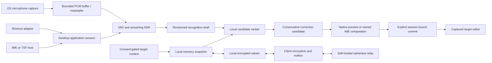

# Architecture

## Data flow

This is Arion's design, not a verified competitor call graph. Ranking requires real alternatives from its producer; a single ASR hypothesis remains a single candidate. Rule correction and ranking are separate operations. Streaming drafts are never treated as committed target content.

## Contextual rewrite evaluation boundary

An optional local generative stage is specified in [009](../../specs/009-contextual-rewrite.md) and [proposed ADR 008](../decisions/008-contextual-rewrite-evaluation.md). Its evaluation path is source/rule text + declared scene + bounded opted-in context + approved memory → pinned prompt/tokenizer → local prefill/decode → preservation checks → revision-owned native candidate preview. It shares the existing final commit gate; model tokens never write directly to a target. This stage is not implemented in the production runtime. The dedicated [rewrite evaluator](../research/rewrite-evaluation.md) measures it separately from ASR and Laya ranking.

## Modules

- `apps/desktop`: composition root (`bootstrap`), MyGo UI, OS adapter wiring and packaging. FSD packages are under `ui/`; native/platform code is under `infrastructure/`.
- `packages/core`: framework-free Go domain, transport-neutral value contracts, domain-owned ports and the dictation coordinator. No MyGo, CGo, SQL, OS permissions, HTTP client, or vendor model SDK imports.
- `models`: a Go module embedding the reviewed catalog (`catalog.json`): artifact provenance, file digests, licenses, bundles and evaluation summaries. Weights, user corpora and commercial app binaries are never committed.
- `services/sync`: reserved service boundary for Go DDD relay code. No implemented relay.
- `packages/contracts`: language-neutral examples and contract ownership; portable Go DTOs live in core rather than duplicate type implementations.

## Runtime shape (shortcut mode)

One process. The menu bar app owns five kinds of native windows: a click-through overlay that never takes focus and hosts the dictation pill, the menu bar popover panel, settings, onboarding, and on macOS the consent guide ([DSK-11](../../specs/001-desktop-input.md)). The guide is a nonactivating tray flyout that `bootstrap/guide.go` places under the System Settings window: a worker reads the window server (`infrastructure/macos/guide.m`, no Accessibility needed) and consent at 30 Hz while the guide is open and posts only changes to the main thread; the view (`features/permissions.Guide`) drags Arion's bundle as a file URL. A global shortcut toggles the coordinator; Escape is held globally only while a session can be cancelled.

The macOS overlay's native window policy is applied by `infrastructure/macos.ConfigureOverlay` before its first show. It replaces MyGo's `fullScreenNone` with `fullScreenAuxiliary`, joins all Spaces, stays out of window cycling, and on macOS 13+ uses `canJoinAllApplications` for other apps' fullscreen Spaces and Stage Manager sets. It retains the floating level, click-through behavior and `ShowInactive`; the application remains an accessory. Settings and onboarding keep their normal window policies.

1. **Start:** a new generation and session; the platform adapter captures the focused editor (Accessibility trust required on macOS) and chooses one insertion route; the resident recognizer opens a stream; the microphone starts. A known secure field or missing permission ends the session before the microphone opens.
2. **Capture:** miniaudio delivers 20 ms mono 16 kHz frames to a bounded queue; overflow or device loss ends the session with `AUDIO_DISCONTINUITY`. One session goroutine owns the recognizer, emits level events and revisioned drafts, and retains session audio in RAM.
3. **Finish:** the stream is flushed; the bundle's acoustic finalizer re-decodes the retained audio; conservative rules and approved vocabulary produce the reviewed text; audio is dropped.
4. **Commit:** the session claims its single commit; the adapter revalidates focus and inserts once. Outcomes map to "Inserted" (verified), "Typed"/"Pasted" (unknown) or a failure with the text kept for copying.

Coordinator events cross to the UI through a non-blocking queue drained onto the main thread, so worker goroutines never wait on the UI. The model runtime swaps bundles only while no session holds a recognizer.

See [repository ownership](repository.md) for import rules and [contract](../../specs/004-contracts.md) for versioning.

## Input ownership

Shortcut mode captures a target capability token at start, previews in Arion, and commits once through a verified insertion path. A focus change or unsupported editor stops automatic insertion. Clipboard delivery is a visible, explicit operation with restoration and ownership checks, not a silent bypass.

IME mode uses host-owned composition ranges. IMK and TSF manage provisional marked text, candidate selection and final commit. The UI process and recognition worker must not access client pointers across process boundaries. User switching modes invalidates the old generation, clears owned composition safely, and requires a new session.

## Process and execution constraints

MyGo and OS UI calls run on their required UI thread. Capture callbacks enqueue bounded frames and never run inference or network calls. ASR, ranker and correction workers are cancellable and tagged with session/revision/generation. A stopped session cannot receive a late write. The core does not require a process split; isolate native inference crashes where supported and document IPC before introducing a worker process.

IMK/TSF integration must be proven with small OS-native harnesses before linking the production host. Windows TSF may require a small native COM host/in-process DLL; a Go/MyGo process is not automatically a TSF text service. macOS input source packaging similarly requires an IMK server bundle. These adapters are separate from the normal shortcut app lifecycle.

## Privacy and sync

Model provisioning, update checks ([ADR 010](../decisions/010-in-app-updates.md)) and encrypted memory sync are explicit network surfaces; dictation and ranking have no cloud inference route. Audio is memory-only by default. Context is bounded, expires with the session and is excluded from logs/sync. Vetted encryption seals allowed memory before it enters the outbox; the relay cannot access plaintext. Failure never downgrades to plaintext or remotely processed speech.

See [privacy](../../specs/005-privacy.md), [memory sync](../../specs/003-memory-sync.md), and [ADRs](../decisions/README.md).
