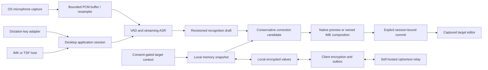
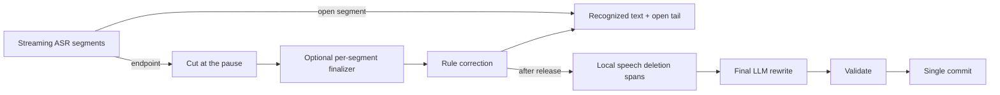

# Architecture

## Data flow

This is Arion's design, not a verified competitor call graph. Ranking requires real alternatives from its producer; a single ASR hypothesis remains a single candidate. Rule correction and ranking are separate operations. Streaming drafts are never treated as committed target content.

## Live local rewriting

The optional live pipeline ([ADR 011](../decisions/011-live-local-rewriting.md), [009](../../specs/009-contextual-rewrite.md)) edits text while the user speaks:

When a session starts with **Match the app** on, the coordinator decides its scene from the captured target after capture (`domain.DecideScene`: search field, then the web page's host, then the bundle ID; see [009 scene selection](../../specs/009-contextual-rewrite.md#scene-selection)). The macOS target adapter reads the field's AX role and, only while polishing and Match the app are on, the host of the enclosing `AXWebArea`'s URL. Each request preserves its work, email, coding-prompt or chat scene for the selected staged recipe; explicit lists use a dedicated numbered-list recipe and search uses chat plus `domain.FinishScene` after the punctuation mode ([009 LRW-14](../../specs/009-contextual-rewrite.md#live-rewriting-pipeline)). The punctuation control sits in the Polish card under Settings › Speech & Polish and is enabled only while polish is on. Work and prompt scenes default to natural prose; application identity does not authorize bullets or headings. New list formatting requires a clear spoken enumeration or an explicit list request. Scenes the user chose on the menu bar panel's scene card (`features/scene`) are stored by place in the preferences and beat the built-in tables; the panel reads the frontmost app's field with `Targets.Peek` when it opens, without creating an insertion target.

With rewrite context on ([ADR 013](../decisions/013-rewrite-context-on-device.md)), `application/context.go` reads the session's context after capture: the target adapter's `ReadContext` returns text around the cursor and visible text from the captured window (`infrastructure/macos/accessibility.m`: macOS Accessibility; `infrastructure/windows/accessibility.go`: UI Automation visible-window extraction verified with owned standard EDIT controls; cursor extraction remains unsupported), and `application.History` supplies recent dictations per place. The final request carries sanitized window text plus the separately bounded cursor/history sections. The selected worker uses context only to select bounded source-relative spelling edits, then formats the edited source with no OCR/context. Over-budget requests fail explicitly. See [local rewrite configuration](../operations/local-rewrite.md).

`domain.CleanSpeech` implements a separate local deletion stage (`speech-spans-v3`) before model organization. It deletes a clear spoken self-repair, including a same-type revision such as `十二月…十一月` and `不是A是B`, so the shared formatter sees only the final span. Cleanup-rules-v2 keeps the speaker's wording and names an ASR mishear fix a correction. Closed segments during speech stay on screen; release commits one rewrite of the full recognized text. Rule correction (`arion-rules-v4`) leaves the standalone hesitation list in place; this stage deletes it, and the formatter receives that cleaned text. The worker sends its cleaned text to the selected spelling and scene-formatting stages and returns the original-offset spans for private evaluation. Final organization rejection, timeout or unavailability retains completed cleanup with the failure outcome; recognized original and rule-corrected source remain independently available. The production delivery check validates transport completeness and control markup without semantic overlap rejection, while keeping the recognized original independently available. This follows the stage separation observed in Doubao; its speech annotation model was not recovered ([evidence](../research/competitor-disfluency.md)).

`application/live.go` owns this schedule per session. Segment units flow from the pump to a per-session worker through a bounded queue. While the user is speaking, closed segments stay recognized text: the worker does not send them to the rewrite model and does not show a polished preview. Release runs one final rewrite of the full recognized text. `domain.ValidateRewriteDelivery` checks whether that proposal may be inserted; a rejected final organization retains the completed local cleanup and the event records the failure outcome.

The acoustic finalizer can change a word that was correct during capture. The final rewrite therefore carries the current session's earlier rule-corrected stable recognition as separate `PreviousText` evidence, together with approved canonical vocabulary relevant to either recognized source within one recall budget. Multiple aliases for one exact correct spelling share a slot; only correct spellings enter the spelling selector, and no vocabulary/context block reaches the formatter. The GGUF selector can use independently confirmed names in the same local frame to nominate a bounded spelling alternative; it never uses generated text as recognition evidence. The final request's text is the recognized source. Changed source or context reruns selection and formatting. See [stage-preservation evidence](https://github.com/AstraFoundry/Arion-evaluation) (`benchmarks/reproduction/rewrite-stage-preservation-v1/README.md`).

The model runs in the `arion-llm` pipe worker, which owns a pinned offline llama.cpp child through a private Unix socket (no TCP listener). The Qwen3.5-2B Q4_K_M artifact is provisioned by catalog digest. The native runtime owns one Metal slot, whose state is erased at session boundaries; the client process group cleans up descendants when the worker exits. `infrastructure/rewriting` provisions the model, owns worker lifecycle and reports readiness; `infrastructure/llm/client` adapts the existing pipe transport, including its optional prior-recognition field, to the core `Rewriter` port. Selected templates and resource provenance are documented in [local rewriting](../operations/local-rewrite.md).

## Repository boundary

The [public and private repository contract](repository-split.md) keeps product code, normal tests, minimal licensed fixtures and product-driver transport public. Full research corpora, scoring and original observations are versioned in private Git. Private execution selects one public commit and reuses the public driver implementation; public build and checks have no private-repository dependency.

## Modules

- `apps/desktop`: composition root (`bootstrap`), MyGo UI, OS adapter wiring and packaging. FSD packages are under `ui/`; native/platform code is under `infrastructure/`. Hosted-sync sign-in lives in `internal/account` ([account sign-in](account-signin.md)).
- `packages/core`: framework-free Go domain, transport-neutral value contracts, domain-owned ports and the dictation coordinator. No MyGo, CGo, SQL, OS permissions, HTTP client, or vendor model SDK imports.
- `models`: a Go module embedding the reviewed catalog (`catalog.json`): artifact provenance, file digests, licenses, bundles and evaluation summaries. Weights, user corpora and commercial app binaries are never committed.
- `services/updates`: implemented Go DDD update-channel service on the center origin. It serves the channel manifests, summaries and downloads that the AstraFoundry admin publishes in the release bucket; the app verifies every archive signature itself ([ADR 019](../decisions/019-center-update-channels.md), [deploy/center](../../deploy/center/README.md)).
- `services/sync`: implemented Go DDD ciphertext relay (`cmd/sync`, PostgreSQL migrations, [deploy/sync](../../deploy/sync/README.md)). One account-unaware core for self-hosted and hosted deployments; the `AccountGate` port (`noop` or `oidc`) maps requests to tenants on top of device authentication, and the hosted edition receives security events ([ADR 015](../decisions/015-hosted-relay-account-authorization.md)).
- `apps/site`: static Next.js marketing site for `arion.astrafoundry.si`; not part of the desktop shell and never reads sessions ([ADR 016](../decisions/016-marketing-site.md)).
- `packages/contracts`: language-neutral examples and contract ownership; portable Go DTOs live in core rather than duplicate type implementations.

## Clipboard history

[Clipboard history](clipboard.md) is an independent opt-in local workflow ([010](../../specs/010-clipboard.md), [ADR 034](../decisions/034-clipboard-history.md)). Its native picker captures a destination before activation. The collector shares the dictation clipboard transaction gate and excludes internal revision/marker identities. Encrypted history never enters rewrite context, diagnostics or account sync. The per-content MyGo text-copy hook also marks application-owned selection/edit-menu copying, preserving native editing behavior.

## Runtime shape (shortcut mode)

One process. The menu bar app owns native windows for the clipboard picker and passive hover preview in addition to these existing surfaces: a click-through overlay that never takes focus and hosts the dictation pill, the menu bar popover panel, settings, onboarding, the tray hint, the update reminder card ([DSK-15](../../specs/001-desktop-input.md); [update lifecycle](update-lifecycle.md)), and on macOS the consent guide ([DSK-11](../../specs/001-desktop-input.md)). The tray hint (`pages/trayhint`) is a nonactivating tray flyout shown when onboarding completes; it reuses the guide card through `kit.Callout`, points its arrow toward the icon, and closes on dismissal or when the tray icon is clicked. The guide is a nonactivating tray flyout that `bootstrap/guide.go` places under the System Settings window: a worker reads the window server (`infrastructure/macos/guide.m`, no Accessibility needed) and consent at 30 Hz while the guide is open and posts only changes to the main thread; the view (`features/permissions.Guide`) drags Arion's bundle as a file URL. Microphone settings and pending Screen Recording consent reuse the same shell in a compact, non-draggable form, each tracking its own grant; initial native permission requests are preserved. The same guide window and shared `kit.SettingsGuide` shell support explicit Keyboard settings navigation with non-draggable add-source instructions (`features/keyboard.Guide`); source enablement is checked once per second. Onboarding offers optional input-method setup after Accessibility, reuses `keyboard.Setup`, and requires actual selection and completed activation for Continue while allowing deferral. The shared input-source feature exposes enable/retry and switch actions; first installation continues into cancellable, bounded registration/enablement/selection and expected-build connection verification. Leaving setup cancels continuation; periodic state refresh only observes. The dictation and translation shortcuts ([configuration](dictation-shortcuts.md); `infrastructure/holdkey`, a native key-down/key-up listener) are the global keyboard activations: holding dictates (or translates into `Preferences.TranslateLanguage` when started with `Preferences.TranslateKey`) until release and a tap toggles the coordinator. Escape is held globally only while a session can be cancelled.

After onboarding, Settings opens when the user starts Arion: a quit and launch, a version-update `Relaunch`, or an explicit open from Spotlight, Launchpad, Finder, the Dock, the Start menu, taskbar or search. A second open while the process is already running uses the same window: macOS delivers it through `OnActivate` (`applicationShouldHandleReopen`), and Windows through `OnSecondInstance`. A login-item start (`WasOpenedAtLogin`) stays in the menu bar or system tray. A notification activation keeps its own destination. Unfinished onboarding stays in front. See [DSK-14](../../specs/001-desktop-input.md).

The macOS overlay's native window policy is applied by `infrastructure/macos.ConfigureOverlay` before its first show. It replaces MyGo's `fullScreenNone` with `fullScreenAuxiliary`, joins all Spaces, stays out of window cycling, and on macOS 13+ uses `canJoinAllApplications` for other apps' fullscreen Spaces and Stage Manager sets. It retains the floating level, click-through behavior and `ShowInactive`; the application remains an accessory. Settings and onboarding keep their normal window policies.

1. **Start:** a new generation and session; the platform adapter captures the focused editor (Accessibility trust required on macOS) and chooses one insertion route. macOS shortcut mode always uses a guarded system-paste transaction; AX captures and validates the target/selection and performs authorized reading, without selecting a write route ([ADR 003](../decisions/003-insertion-routes.md)). The resident recognizer opens a stream; the microphone starts. A known secure field or missing permission ends the session before the microphone opens.
2. **Capture:** miniaudio delivers 20 ms mono 16 kHz frames to a bounded queue; overflow or device loss ends the session with `AUDIO_DISCONTINUITY`. One session goroutine owns the recognizer, emits level events and revisioned drafts, and retains session audio in RAM.
3. **Finish:** the stream is flushed; the bundle's acoustic finalizer re-decodes the retained audio; conservative rules and approved vocabulary produce the reviewed text; with polishing on, the final LLM rewrite replaces it if it passes validation; audio is dropped.
4. **Commit:** the session claims its single commit; the adapter inserts once at the caret focused at commit time. A caret move, field switch, or edit in the captured field still inserts there. No editable focus leaves the text on the system clipboard (`copied`). Outcomes map to "Inserted" (verified), "Typed"/"Pasted" (unknown), "Copied", or a failure with recognition retained in the active session.
5. **Learn** ([ADR 014](../decisions/014-edit-learning.md)): with learning on, a readable non-secure field stays followed after the commit. `application.EditTracker` polls a bounded excerpt every 0.4 s, each read with its own 250 ms budget. It settles after 15 s without change, on focus loss, a cleared field, the next dictation or 60 s. `domain.ExtractCorrections` diffs the insertion against the settled text, using the local `domain.WordSegmenter` port for both sides' word boundaries (`infrastructure/wordseg`: Core Foundation on macOS); ambiguous single-character boundaries are skipped rather than widened arbitrarily; the composition root stores the pairs in the encrypted vocabulary and shows them on the pill with an undo. Approved entries correct later dictations in one pass of `domain.Vocabulary`, and only the relevant ones reach the rewrite prompt.

Coordinator events cross to the UI through a non-blocking queue drained onto the main thread, so worker goroutines never wait on the UI. The model runtime swaps bundles only while no session holds a recognizer.

See [repository ownership](repository.md) for import rules and [contract](../../specs/004-contracts.md) for versioning.

## Input ownership

Shortcut mode captures a target capability token at start, previews in Arion, and commits once through the platform delivery path. Commit inserts at the caret focused then. A caret move, a switch to another editable field, or an edit in the captured field still inserts there. A secure field is refused. No editable focus leaves the final processed text on the system clipboard, for both polishing and translation. The adapter checks editor capability even when focus has not changed; a focused noneditable element is not an insertion point, and an empty editable field remains a valid destination. macOS external-editor delivery into a focused field uses system paste with per-transaction snapshots and ownership-checked restoration. The transient paste item carries `org.nspasteboard.TransientType`, and Windows paste adds `ExcludeClipboardContentFromMonitorProcessing`, so clipboard managers, clipboard history and Windows cloud clipboard do not record dictated text; a Windows paste whose exclusion cannot be set restores the previous text and fails. The explicit `copied` outcome is an ordinary clipboard write. Posted paste remains `unknown`; it is never retried automatically. System IME delivery retains its owned client. Losing that client still drops the owned composition.

A positive native no-input observation before non-shortcut acquisition may select native copy delivery while Arion is the selected input source; unknown capability retains the selected route. This does not change the global-shortcut routing in ADR 033. Only a confirmed no-input result that was successfully copied may enter enabled clipboard history.

IME mode uses host-owned composition ranges. IMK and TSF manage provisional marked text, candidate selection and final commit. The UI process and recognition worker must not access client pointers across process boundaries. Global dictation and translation shortcuts use external-editor delivery through `Coordinator.StartShortcut`, including when Arion is selected as the OS input source ([ADR 033](../decisions/033-voice-shortcut-delivery.md)). For other entry points, the composition root samples the actual OS input-source state once per session: selected Arion uses its owned IME client; other sources use external-editor delivery. The route is session-bound and is not a preference or UI control. Losing an IME client invalidates only its IME session and clears owned composition; no failed route is retried through another transport. Legacy stored `mode` is ignored and removed on the next save.

## Process and execution constraints

MyGo and OS UI calls run on their required UI thread. Capture callbacks enqueue bounded frames and never run inference or network calls. ASR, ranker and correction workers are cancellable and tagged with session/revision/generation. A stopped session cannot receive a late write. Native speech inference runs in a private stdio worker. Its stable Go engine serializes requests across process generations. Cancellation drains its terminal acknowledgement for up to five seconds; if it cannot drain, that owned process is terminated and reaped. Only this explicit cancellation-timeout retirement permits a later request to reload the same fixed worker path and copied model specification. The cancelled request is never retried, ordinary worker/protocol failures stay explicit, and permanent Close prevents replacement even during model loading. Cancelling a replacement load reaps that incomplete process and ends that request; a subsequent live request may still load the retired generation's replacement. Streaming stop can therefore retire an obsolete preview and flush its complete tail through the same engine owner. The LLM runs in the `arion-llm` worker process, whose protocol is documented in `infrastructure/llm/protocol`, with a private GGUF child separate from the speech runtime.

IMK/TSF integration uses OS-native harnesses separately from the shell. Windows uses a fixed `ArionTSFLoader.dll` COM facade and a protected hash-versioned `ime/windows/ArionTSF.dll` core, with apartment-dispatched edit sessions and a same-user/session/integrity-bound named pipe to `infrastructure/imebridge`; `infrastructure/tsf` owns bundle validation, explicit UAC installation and source observation. The facade releases its delegate on deactivation; a later activation resolves the published core only when prior core references permit safe unload. A MyGo process is not itself a TSF service. macOS uses an IMK server bundle. The [Windows runbook](../operations/windows-input-method.md) defines supported text stores and remaining acceptance gates.

## Offline keyboard input

[ADR 017](../decisions/017-offline-pinyin-keyboard.md) adds a standalone full-Pinyin path inside `ArionInput.app`: native keys enter the pinned librime runtime, which owns parsing, selected segments, the input caret and the candidate list. `ime/macos/keyboard.m` copies a revision's preedit, candidates by global index and actual commit; `typing.m` owns its native client range separately from voice `composition.m`, and owns the candidate menu: `ranking.m` may reorder the leading candidates by the previous commit (context ranking, stored encrypted beside Rime's learning), and Arion pages, highlights and selects by engine index. Only actual commits call host `insertText`. `candidate_panel.m` draws Arion's own horizontal candidate bar (not `IMKCandidates`) with page-relative indices and revision-scoped click and next-page callbacks. The app's Settings › Keyboard writes `keyboard.json` (with the dictation key), which the input method reads on activation. The input menu's first item, Voice input, is titled with that key and sends `dictate` to `infrastructure/imebridge`, whose callback posts the tray's dictation toggle to the UI thread; it is disabled while the app is not connected (IME-06). Short standalone Shift release, Shift+Space and the input menu switch Chinese/English. The input menu also offers copying pending text, resetting learned words and opening the app named by the bundle's `ArionAppIdentifier` ([input menu items](../research/input-menu.md)); standalone Shift from Chinese to English commits raw pending input through the shared engine operation and owned client range before enabling pass-through. Shift+Space, menu switching, focus loss and owner changes discard unconfirmed text. The input menu and Ctrl+. switch Chinese-mode width and punctuation through Rime's `full_shape`/`ascii_punct` options; the input method persists them itself in `keyboard/options.json`.

Chinese Pinyin uses the shared `arion_bilingual` producer (KBD-09). Pinned ESDB70/CSpell membership, original display forms and observed FrequencyWords counts generate grouped TSV v2. The strict loader builds disjoint minimum-prefix rank indexes for exact lookup, admitted suggestions and complete deferred lookup. Automatic suggestions require observed frequency and sufficient spelling coverage. The producer reuses the packaged Rime Prism/Syllabifier and a real full-range Chinese phrase to distinguish complete Pinyin from abbreviation. Strong Chinese spelling keeps weak English lookup behind Chinese; otherwise exact English and admitted completions precede abbreviated/partial Chinese, then evidence-qualified tails interleave. No fixed English preview or uncalibrated cross-language scores remain. Original candidate identity, engine-index selection, stale-revision checks and Chinese-only learning are unchanged. See [English candidate admission](../research/english-candidate-admission.md) for industrial sources, policy settings and evaluation limits.

The bilingual producer keeps the same ESDB/CSpell data and standalone exact/suggestion/lookup ordering. It wraps the shared `arion_pinyin` translator, which adds opt-in typo correction, eleven independent fuzzy pairs and explicitly approved personal readings to the original Chinese engine. Uppercase input remains in composition; English lookup folds ASCII while display follows the consumed raw span. Only an unmatched, non-normal-Pinyin whole input requests bounded exact English word prefixes from the same lexicon. Their shorter engine ranges enable both mixed orders; Rime owns suffix conversion, rollback and the single final commit. Consumed-range metadata gates native context ranking while English slots and Emoji protection remain intact. Normal Chinese sentence/homophone defaults are retained.

Approved keyboard readings are additive fields on the encrypted vocabulary records, independent of correction aliases and ASR hotword eligibility. Bootstrap derives one complete current projection and delivers it through the publisher-verified IME capability in [ADR 030](../decisions/030-keyboard-vocabulary-transport.md). Native sessions restore encrypted projected snapshots, reject busy/stale revisions and persist before applying a publication. The settings surface reports pending/failed delivery without discarding saved records. This is separate from ordinary encrypted Rime learning and does not authorize cloud processing.

The shared `arion_emoji` filter expands eligible full-word Pinyin candidates using a checked-in index generated from pinned CLDR Chinese annotations and Unicode Emoji sequences. Reviewed Arion overrides handle common ambiguous words. Emoji candidates retain their own type and engine index; both platforms render their Unicode text with installed fonts, while the Chinese context ranker and encrypted word learning ignore Emoji selections. The index and generator are owned under `ime/shared`; `scripts/data/emoji` holds the offline regeneration sources and the native runtime carries their license/provenance notice. Windows reads typed metadata through the validated keyboard DLL, checks installed Segoe UI Emoji shaping/color coverage before candidate generation, and draws Emoji using DirectWrite/Direct2D DC interop in the existing native window. Its TSF commit path retains Emoji provenance through mixed commits and clears Chinese context learning for those commits.

`learning.mm` implements the pinned engine's private userdb interface with in-memory records and transactions. `learning_crypto.swift` supplies public CryptoKit AES-256-GCM and immutable-data SHA-256 checks. Persisted learning consists of atomic ciphertext snapshots with a separate this-device Keychain key; the default plaintext userdb and text backup/sync routes are not used. Explicit reset finalizes sessions, removes learned snapshots under exclusive locking and preserves the key. Learning errors are sticky and visible as keyboard unavailability; an actual text commit already produced by the engine is still delivered once, while pending text remains available for explicit copying.

The host verifies staged immutable data against its bundled manifest before provisioning a key or opening a session. The signed bundle contains the relocatable universal engine, precompiled schema/dictionaries and licenses. Runtime activation neither deploys schemas nor downloads assets. `scripts/stage-keyboard-runtime.mjs` prepares the reviewed closure. The GPL-3.0 notice is the checked-in `scripts/licenses/GPL-3.0.txt`. Staging reads that file and checks its digest. Other closure files stay URL-pinned. `scripts/build-input-method.mjs` compiles both architectures and the CryptoKit boundary. Private C++/Boost SDK headers remain build-only. Engine/text-store tests and storage tests are separate from real IMK registration/event-dispatch acceptance.

## Cloud polishing

The coordinator's `Rewriter` is `bootstrap.polishRouter`: per request it calls the local worker (`infrastructure/rewriting`) or `infrastructure/cloudpolish`, as `Preferences.PolishEngine` says ([ADR 022](../decisions/022-cloud-polishing.md)). Both engines invoke `infrastructure/llm/rewrite` for cleanup, context-backed spelling selection and scene formatting ([ADR 024](../decisions/024-shared-polishing-pipeline.md)). `rewritePolicy` applies the same context switches to both. Both engines run one rewrite after release (ADR 023). Cloud execution adds a 15 s deadline for all stages. The cloud selector receives enabled context, recalled terms and earlier recognized source through Republic; its formatter receives only the edited source and scene/script profile; the result is validated locally like a local proposal. The ChatGPT sign-in shares `internal/oauthloopback` (PKCE, state, one-shot loopback listener) with the account sign-in. The call surface is [cloud polishing](cloud-polishing.md).

## Account sign-in

`bootstrap.New` builds `internal/account` after the system proxy is installed on the default HTTP transport, and leaves it idle. Views call `SignIn`, `CancelSignIn`, `RefreshAccount`, `SignOut`, and `CheckStoredAccount`. They do not offer the hosted-sync waitlist. `JoinHostedSyncWaitlist` stays on the account service. The last one reads the credential store without network, and only while an account view is on screen. Those return immediately. `runtime.State.Account` receives the profile, the hosted-sync entitlement flag, the waitlist outcome, and content-free error codes. The access token stays on `App.Account().Session()` for a future sync client in the composition root. The refresh token is a Keychain or Credential Manager item separate from the vocabulary key ([ADR 005](../decisions/005-local-encryption.md)). Sign-out revokes it and deletes that item. The call surface is [account sign-in](account-signin.md); the rules are [ADR 015](../decisions/015-hosted-relay-account-authorization.md) and SYNC-10.

## Privacy and sync

Model provisioning, update checks ([ADR 010](../decisions/010-in-app-updates.md)) and encrypted memory sync are explicit network surfaces; downloads and update checks use `HTTP(S)_PROXY` when set and otherwise the macOS system proxy; Hugging Face files fall back silently to hf-mirror.com when huggingface.co is unreachable, verified by the same pinned digests (`infrastructure/netproxy`; PAC files are not evaluated, Windows honors environment variables only); dictation and ranking have no cloud inference route except cloud polishing, which the user chooses explicitly and whose shared spelling stage receives the final source, recalled terms, earlier recognized source and enabled context ([ADR 022](../decisions/022-cloud-polishing.md)). Audio is memory-only by default. Context is bounded, expires with the session and is excluded from logs/sync. Vetted encryption seals allowed memory before it enters the outbox; the relay cannot access plaintext. Optional account sign-in (system browser, loopback PKCE, refresh token in the OS credential store) only authorizes the hosted relay; it never grants key access ([ADR 015](../decisions/015-hosted-relay-account-authorization.md)). Failure never downgrades to plaintext or remotely processed speech.

See [privacy](../../specs/005-privacy.md), [memory sync](../../specs/003-memory-sync.md), [account sign-in](account-signin.md), and [ADRs](../decisions/README.md).

Input-method updates share application state, deferral and retry policy, with separate native transactions. macOS controls its standalone IMK host: cancel owned dictation, switch away, verify host exit, promote/register, restore prior selection and await the expected executable handshake. The IMK host connects at startup independently of client activation. Windows stages a protected versioned TSF payload and atomically publishes `CorePath` through its stable loader, preserving selected profiles and active compatible cores. Direct pre-loader registrations require an unused-source migration; already loaded legacy objects retain their original lifetime. Windows voice connections authenticate the actual claimed loaded core and its compatible protocol separately from the latest installed version, including when COM retains another legacy mapping. Input-source selection, transport readiness and text-range ownership remain distinct on both platforms. macOS listener ownership and orphaned-endpoint recovery are described in [ADR 006](../decisions/006-macos-input-method-host.md); Windows transactions and compatibility are described in [Windows input method](../operations/windows-input-method.md).

Recognition runs in resident native workers behind the core recognition ports: Swift MLX on Apple silicon and speech.cpp Q8_0 on Windows x64. Future macOS releases support Apple silicon only ([ADR 021](../decisions/021-apple-silicon-only-macos.md)). Go owns audio buffering, chunked preview scheduling, identities and tail flushing; no ONNX/X-ASR backend remains. See [ADR 020](../decisions/020-native-qwen-asr.md).

## Opt-in local keyboard ranking

[ADR 031](../decisions/031-local-keyboard-neural-ranking.md) connects default-off local keyboard ranking to the resident polishing worker through the verified input-method bridge. `application.KeyboardRanking` coalesces revisions through one active and one pending request and rejects stale or incompatible proposals. The local menu remains available immediately; only validated promotions of existing eligible candidate IDs can update the untouched page. Navigation, selection, edits, cancellation and activation changes invalidate pending replies. Voice preparation preempts keyboard inference.

Generic completion uses its own runtime operation and does not run speech rewrite recipes. Enabling keyboard ranking does not select cloud execution or grant credential access. Product lifecycle and protocol tests remain public. The [general alignment study](../research/llm-ime-alignment.md), raw runtime smoke and broader quality scoring remain private evidence with their original limitations.

## Update maintenance

[Update lifecycle](update-lifecycle.md) keeps staged installation and notification transport in desktop/MyGo adapters. Core `Coordinator.TryMaintenance` excludes new sessions and waits for asynchronous session resource ownership; desktop bootstrap drains managed writes and acquires IME ownership before applying and relaunching. UI projects state and invokes actions; no OS notification handles enter core contracts.

[Product notifications](product-notifications.md) keeps notification policy in an SDK-free desktop internal package, HTTPS/persistence in infrastructure and account/native composition in bootstrap. General and About have no notification preferences. Bootstrap schedules a one-time unknown OS permission request at a natural idle point after sign-in or an eligible update, and respects denial without repeated prompts. Account-hashed durable action lookup and current-server receipt authorization prevent stale notification buttons from carrying commands or launching previous-account URLs.

### ASR vocabulary context

The composition root derives approved canonical hotwords from encrypted memory with `domain.ASRHotwords`. Explicit hotwords and eligible learned corrections participate; manual correction pairs alone do not. The coordinator freezes an owned snapshot when creating a recording's recognizer and propagates it to preview, segment refinement and full-audio finalization. Memory updates affect subsequent recordings. The ASR adapter validates the bounded list and sends a space-separated per-request `prompt`, including empty context, to capability-advertising native workers. MLX maps it to Qwen3 `context`; speech.cpp maps its prompt option to the engine context. The later one-pass correction and eight-term rewrite recall remain separate stages. See SPH-11/12, MEM-07 and [ADR 020](../decisions/020-native-qwen-asr.md).

The compact clipboard picker uses the captured native input geometry and revalidates input identity/security before paste. Polling excludes all internal revisions. A completed dictation with a positive native `CommitResult.NoInput` observation and successful copying explicitly enters opt-in history through bootstrap; generic delivery fallbacks cannot authorize it. See [clipboard history](clipboard.md).

### Keyboard ranking troubleshooting

The local neural ranker uses only the same activation’s recent confirmed text, not arbitrary text already present in an editor. A first composition without that context does not request inference. The untouched first page must contain at least two eligible Han candidates with equal consumed ranges; English/Emoji and shorter-prefix candidates cannot be promoted by this path. Ongoing edits replace the pending request, and navigation freezes it. A valid model answer may keep the existing first candidate. Thus enabling the option does not imply visible movement on every word.

Check the persisted keyboard option and local model readiness, then confirm a context phrase and pause while composing the next ambiguous word. [Content-free diagnostics](../backend/logging.md#keyboard-model-ranking) distinguish proposals, unchanged output, cancellation, deadline and unavailable-model outcomes. Go/model smoke tests and isolated Rime/AppKit promotion tests verify different boundaries; neither alone proves installed-editor quality.
