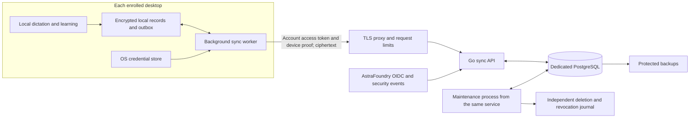

# Central sync server and data selection

Status: **design proposal**, with the standard AstraFoundry center and source-build override policy accepted in SYNC-11. This document specifies the recommended service and implementation details; the public build-profile injection is implemented, while desktop synchronization remains pending. [003 Memory sync](../../specs/003-memory-sync.md), [005 Privacy](../../specs/005-privacy.md) and [ADR 015](../decisions/015-hosted-relay-account-authorization.md) remain normative. P0 below fits the approved memory scope. P1/P2 additions need their corresponding specification changes before implementation. The implemented profile selects account destinations without enabling sign-in or synchronization automatically.

## Decision

Build on `services/sync`: one Go ciphertext-relay service, its own PostgreSQL 17 database, and the existing account authorization layer. Clients own learning, encryption, decryption and semantic conflict review. The server owns authorization, device membership, durable ordering, deduplication, bounded storage, delivery and deletion. Local dictation remains independent of all server availability.

Use one personal vault per account initially, containing multiple enrolled devices. A self-hosted vault uses the same core with device authorization and no hosted account requirement. Team sharing, cloud inference, cloud term mining, arbitrary document storage and clipboard transfer are outside this service.

## Distribution and build-time center profile

The standard packaged application targets AstraFoundry. Self-hosters compile the same open-source desktop with a custom public center profile supplied through build environment variables. A server picker in ordinary settings is not required for this distribution policy. The profile is compiled into the app; it is not a launch-time environment override and is independent of whether the user enables sync.

The build/dev entry point implements the public configuration contract below. It validates the profile, compiles it through an isolated Go source overlay and verifies the packaged executable reports the same profile/fingerprint. Desktop enrollment, encryption transport and outbox remain unimplemented; selecting a center does not provide a working sync client.

| Build variable | Standard package value | Custom build rule |
| --- | --- | --- |
| `ARION_CENTER_URL` | `https://api.arion.astrafoundry.si` | Base URL for this center, including any supported path prefix |
| `ARION_CENTER_AUTH_MODE` | `oidc` | `device` for a server using the `noop` account gate; `oidc` for a server with its own account gate |
| `ARION_CENTER_OIDC_ISSUER` | `https://astrafoundry.si` | Required explicitly for custom OIDC; never inferred from the center URL |
| `ARION_CENTER_OIDC_CLIENT_ID` | `arion-desktop` | Required explicitly for custom OIDC; public client only |
| `ARION_CENTER_OIDC_RESOURCE` | `https://api.arion.astrafoundry.si` | Required explicitly for custom OIDC; token resource/audience is distinct from the HTTP base URL |
| `ARION_CENTER_OIDC_SCOPES` | `openid profile offline_access arion.sync waitlist:join` | Required explicitly for custom OIDC; space-separated supported scopes |
| `ARION_CENTER_OIDC_ENTITLEMENT` | `arion.sync.hosted` | Required explicitly for custom OIDC and must match that relay's required entitlement |

Example root `.env` values for `make build desktop` or `make desktop-dev`:

```dotenv
ARION_CENTER_URL=https://sync.example.org
ARION_CENTER_AUTH_MODE=device
```

For device-only mode, omit all OIDC variables and reject conflicting OIDC values. This mode still signs and verifies device requests; it does not turn off authentication. The server retains its existing self-host default `ARION_SYNC_ACCOUNT_GATE=noop`. Its `ARION_SYNC_*` deployment variables and secrets are a different configuration surface and are never copied into a desktop package.

The build entry point reads optional untracked repository-root `.env` values; explicit process environment wins, and no center overrides selects the complete standard profile. Changing the center requires explicit auth-mode selection. Unset standard profile values select documented defaults; explicitly empty, malformed or incomplete custom values are errors. Read only the public configuration names in this allowlist, reject credentials in URLs, and allow plaintext HTTP only for explicit loopback development. A public OIDC client has no embedded client secret.

Official release CI supplies or verifies the exact standard profile and rejects inherited custom values. Source build and development entry points share the same loader; generated bundles carry the resolved profile and a reproducible profile fingerprint. Starting a package from Finder or the Windows shell does not depend on `.env` files being present.

Custom device-only builds use local/device setup directly and do not construct the AstraFoundry sign-in or waitlist flow. Custom OIDC builds use only their explicit issuer/profile and do not assume the AstraFoundry catalog or waitlist API exists. Account credential-store entries, enrollment, ciphertext caches, checkpoints and outboxes are namespaced by the center/profile and vault identity. A changed profile does not imply consent to upload existing data; explicit protected export/import or migration is required. Local vocabulary and its separate local encryption key remain usable.

A custom-center build disables the standard AstraFoundry automatic update channel by default. A maintainer may distribute its own signed packages using a separately configured trusted update source; updates must preserve the center fingerprint or require an explicit supported migration. Never let a generic official updater replace a self-host build with a package that silently selects AstraFoundry again. Model downloads and their verified public artifact sources remain independent of center selection.

## Implemented profile boundaries

- `apps/desktop/internal/center/default.json` is the standard profile. Build/dev replaces only `embedded.go` using a temporary Go overlay under `.workspace/`; no tracked source is rewritten. `GOFLAGS` overlays supplied externally are rejected to prevent conflicting injection.
- `--print-center-profile` prints the compiled public profile and SHA-256 fingerprint without opening the app or accessing accounts. Package verification runs this command with no center environment and compares it with the build inputs.
- The account service uses the compiled issuer/client/resource/scopes/entitlement. Device-only builds skip the account onboarding step and hide the account settings entry; service guards also reject credential reads, sign-in, refresh, sign-out and waitlist calls. Custom OIDC builds never call AstraFoundry catalog/waitlist routes. Account and privacy copy is provider-neutral.
- Refresh-token items use `account-refresh-token/<profile fingerprint>` in the OS credential store. Legacy unscoped tokens are left untouched and are not read or migrated; existing users sign in again. Local vocabulary and its encryption key retain their original storage. Enrollment/cache/outbox/vault isolation is still pending with those client features.
- Any nonstandard profile removes the official updater configuration and disables updater activation at runtime, even if an update signing key is present. Official tagged builds reject nonstandard profiles before packaging. No custom update channel is implemented.

## Recommended synchronization contents

Competitor columns summarize the inspected macOS artifacts in [the evidence report](../research/competitor-cloud-sync.md), not guarantees for every platform. “Unconfirmed” means the inspected evidence did not establish synchronization.

| Data | Typeless | Doubao IME | Chatterfly | Arion recommendation |
| --- | --- | --- | --- | --- |
| User-created vocabulary | Account-backed | Personal dictionary sync documented | Personal-term account API and typing-dictionary sync | **P0:** encrypted entries, language/scope, user approval and removals |
| Corrections learned from edits | Server receives edits and may add dictionary terms | Edits processed remotely, pairs stored locally; pair sync unconfirmed | Server mines terms; full edit-log sync unconfirmed | **P0:** only locally learned, undoable approved pairs; no source field excerpts |
| Per-entry reinforcement/recall metadata | Exact sharing unclear | Local counters; sharing unclear | Exact sharing unclear | **P0:** encrypted per-record/device activity needed for shared memory maintenance; not product usage telemetry |
| User-selected app/site style | Personalization/account preferences; exact learned-style sharing unclear | Selected input settings | General settings sync unconfirmed | **P0:** explicit scene/style choice and scope; identifiers remain inside ciphertext |
| General preferences | Selected language/output/personalization controls | Five recovered macOS setting mappings | General settings sync unconfirmed | **P1 opt-in category:** an enumerated portable-settings allowlist; never upload a whole preferences file |
| Privacy deny rules | Exact sharing unconfirmed | Context/word-use switches are among mapped settings | General settings sync unconfirmed | **P1:** encrypted explicit deny rules; receiving a remote setting must never grant new local collection permission |
| Complete transcript history | Optional text and metadata sync; may include selected source text | Unconfirmed | Local history; sync unconfirmed | **P2, excluded initially:** consider final committed text only under a separate history specification and separate opt-in |
| Original audio, partial drafts | Audio excluded from recovered history push | Backup unconfirmed | Backup unconfirmed | **Never in this service** |
| Cursor text, selections, screen/OCR, clipboard, recent contextual text | Remote processing surfaces | Remote processing/transfer surfaces | Remote processing surfaces | **Never synchronized or automatically persisted** |
| Complete before/after correction examples, prompts and model caches | Some used in remote learning/processing | Some used in remote processing | Some used in remote processing | **Never in memory sync:** learn locally, retain only allowed pairs |
| Product usage totals and diagnostics | Separate usage/diagnostic surfaces | Separate telemetry/feedback | Separate statistics/diagnostic surfaces | **Local only:** preserve PRV-05/08; no analytics upload as a side effect of enabling sync |
| Hotkeys, microphone, permissions, startup, paths, models, credentials | Many explicitly local | Not implied by generic sync types | General settings sync unconfirmed | **Device-local:** OS identifiers and secrets are not portable preferences |

All synchronization is off until the user enables it. Enabling P0 memory sync includes only eligible records. Learning can be disabled independently; disabling learning keeps already approved memory. “Approved” includes the existing ADR 014 correction-learning flow with immediate notice and undo, not an additional per-entry confirmation dialog.

Candidate P1 settings are interface language and explicit output-format choices that actually exist in the product. Translation, arbitrary instructions and inferred personality profiles are not introduced by this proposal. Device-specific model selection, microphone selection, OS permissions, synchronization enablement and learning/context collection grants stay local. Unsupported preference values are retained without applying them and reported as incompatible; no silent reinterpretation across operating systems.

## Topology and trust boundaries



The account platform handles sign-in, entitlement and account lifecycle. It shares neither its database nor refresh tokens with the relay. Hosted requests require both account authorization and device signatures, scoped to the same tenant. The account subject cannot decrypt or sponsor a new device by itself. Self-hosting substitutes the existing `noop` account gate while retaining device authentication.

The server may see account linkage, opaque vault/device/record IDs, operations, parents, epochs, IP addresses, timing and sizes. Vocabulary, correction pairs, app/site scopes, device display labels and settings values are encrypted. Operational identifiers needed for routing are not claimed to be hidden. Support tooling can view membership/status and request IDs, not decrypt records or offer a plaintext editor.

## Client record model

One logical vocabulary entry, correction pair, style override or portable setting is one record. A settings document containing every preference would create unnecessary conflicts and leak unrelated values. Stable record IDs are random and do not contain words, domains, app names or account identifiers.

The encrypted body contains `content_kind`, `content_schema_version`, approved content, language, scope, provenance and applicable lifecycle metadata. Local-only adapters never construct synchronization records from context/history structs. The allowlist is enforced when creating an operation, before any upload. The server cannot verify a plaintext allowlist it cannot read.

The authenticated outer envelope binds protocol version, opaque tenant/vault binding, vault generation, record/device/operation IDs, schema, key epoch, algorithm suite, operation kind, logical revision and parents/base revision. No content timestamps select a conflict winner. Server-assigned sequence and receipt fields are outside the client-created AEAD input and authenticated by the response transport; do not require encrypting against a sequence unknown at operation creation.

Store each content record and its encrypted outbox operation in one local transaction, including the exact serialized operation bytes. Learning never waits for network. A crashed or offline client resumes those bytes with the same operation ID. An `unknown` insertion outcome is never retried through synchronization.

### Memory activity and pruning

Per-entry `uses`, `recalls` and last-use information are memory metadata, distinct from the daily product usage file. Represent activity as encrypted sidecar records owned by a device incarnation; each device advances only its own monotonic counters. Content edits do not share a hot counter field. Clients compute totals from the latest causal version of each sidecar; never add a retried delta twice or resolve content siblings by comparing counters.

Keep the current 90-day learned-entry expiry and 2,000-entry local bound, with manual entries protected. In a shared vault, global automatic expiry requires a synchronized activity frontier acknowledged by all active devices. Unknown activity from an offline device or unreliable client clock defers global deletion. Local bounded cache eviction may still occur but must not create a cloud tombstone or discard unsent edits; exclude locally evicted unchanged records from immediate rehydration until their revision changes or the user requests them. Explicit user deletion and undo always create tombstones. This shared-maintenance policy needs a client acceptance fixture before P0 enablement; a device's local inactivity must not delete another device's actively used memory.

## Encryption, pairing and recovery

Keep device request-signing keys, device key-delivery keys, vault content keys and account credentials separate. Local storage keys are not uploaded or reused as shared vault keys. OS credential stores protect private keys and refresh tokens locally.

For a production crypto profile, use a reviewed AEAD implementation for record encryption and a reviewed public-key recipient-encryption implementation for device key packages. [RFC 9180 HPKE](https://www.rfc-editor.org/rfc/rfc9180.html) is a candidate for the latter; it supplies an encryption construction, not a complete pairing or recovery protocol. The provider, suite, nonce allocation, canonical encoding, authenticated membership format and recovery-package format still require the crypto/pairing ADR and interoperability fixtures required by SYNC-02. This proposal does not authorize writing a new key-exchange primitive.

Recommended enrollment flow:

1. The first device creates its private keys and initial vault epoch locally, enables sync, enrolls and uploads allowed ciphertext records.
2. A new device signs in, creates separate local keys and presents a short-lived pairing request. Login alone reveals no vault content keys.
3. An existing authorized device verifies an out-of-band binding, such as scanning the new device's full public-key fingerprint in a QR invitation. A short display code is not an encryption key or sufficient identity verification by itself.
4. The sponsor approves a membership statement binding the vault/generation, both new public keys, sponsor, expiration, unique invitation and current epoch. It encrypts the permitted vault keyset to the verified recipient. The relay can store/deliver that package but cannot open it.
5. The server consumes the invitation atomically; the recipient checks the sponsor statement and current membership before decrypting a validated initial snapshot. Requests waiting across an epoch change are rejected and restarted explicitly.

Recovery requires a separately protected recovery package and a high-entropy recovery secret controlled by the user. Resetting an account password does not restore content keys. Loss of all devices and the recovery secret makes old ciphertext unrecoverable. Current enrollment explicitly returns `RECOVERY_UNSUPPORTED`; recovery must remain unavailable until the reviewed format and tests land.

Revocation atomically blocks the target device, advances the epoch and records the event. An active client generates fresh content keys, distributes packages only to remaining authorized devices, and re-encrypts live records before granting a new device access. An integer epoch bump alone does not rotate a key. Rotation is resumable, rejects new writes under old epochs and explicitly reports a pending-key state. A pending invitation for a revoked sponsor is invalidated; snapshots for new-device enrollment cannot cross an epoch barrier. Existing devices may read older permitted ciphertext to finish rotation, while newly enrolling devices wait for its completion. Previously copied plaintext or keys cannot be remotely erased; historical ciphertext is not given a forward-secrecy claim.

## Delivery protocol and state

Existing `/v1/sync` routes are a useful foundation. The stronger generation, key-package, receipt and snapshot semantics below require reviewed **v2 wire fixtures and a migration ADR** before release; they must not be silently grafted onto v1. The desktop has no integrated v1 sync client today, but existing self-host consumers must not be assumed absent.

| Operation | Existing foundation | Proposed production behavior |
| --- | --- | --- |
| Enroll/revoke | Device signatures, sponsor enrollment, epoch increment | Expiring single-use invitation, signing/encryption-key binding and resumable rotation |
| Push | Bounded atomic batch, dedup receipts, sibling revisions | Complete operation digest, tenant/vault mutation locks, generation and replay-frontier checks |
| Pull | Server-ordered envelopes and opaque cursor | Cursor bound to tenant/vault/generation and retention frontier; stable high-water mark |
| Snapshot | Current log-from-start path | Materialized immutable current-state snapshot, bounded pages, tombstone fences and delta handoff |
| Acknowledge | Tombstone acknowledgments | Durable verified-apply checkpoint, compaction frontier and stale-device rules |
| Manage server data | Account-purge security event | Explicit user vault-deletion job with generation barrier and restore-safe deletion journal |
| Pairing keys | Not implemented | Recipient-encrypted key packages; relay never holds an unwrap secret |

Proposed route families are `/v2/sync/devices`, `/v2/sync/push`, `/v2/sync/pull`, `/v2/sync/snapshots`, `/v2/sync/ack`, `/v2/sync/pairings`, `/v2/sync/key-packages` and `/v2/sync/vault`. Individual methods and canonical bytes belong in fixtures. Preserve the separately versioned security-event contract in ADR 015.

### Local edit and retry

After a local transaction commits, the worker debounces eligible operations and batches by both operation count and encoded bytes. Acknowledgment means durable server commit, not successful application by every device. The client marks its outbox delivered only after validating the receipt.

Delivery is at least once with an idempotent durable effect. Lost responses retry the same bytes and operation ID. A complete canonical request digest covers every operation field, including parents, epoch, algorithm and AAD; changing any of those under the same ID is an explicit mismatch. A digest of ciphertext alone is insufficient. Transport timestamp/signature can refresh without changing the stored operation.

After an uncertain write during key rotation, first resolve the original operation's receipt. A previously accepted operation returns its original outcome; a known-unaccepted stale-epoch operation can be re-encrypted as a new operation. Do not blindly issue a second operation for an uncertain first write.

Use background pull on enablement, reconnect, app resume, after a push and while online on a bounded jittered interval. Exponential retry applies only to retryable transport/server failures; entitlement, conflict, revoked-device, schema and key failures become explicit client states. Opening a device with sync off initiates no sync I/O. Notifications are optional content-free invalidation hints; correctness always comes from pull.

### Verified pull and initial snapshot

Validate tenant/vault/generation, membership, supported schema, epoch, AEAD and plaintext allowlist before applying a remote record. Commit records and the applied cursor in one local transaction. Store opaque encrypted payloads for unsupported content schemas without applying or overwriting them; if a page cannot be durably preserved, do not acknowledge or advance it. Repeated invalid data is visible and does not trigger a plaintext fallback.

A full snapshot is reconciliation, not a replacement of the local file. Quarantine unsent operations, verify the snapshot, and reconcile each against the current heads and deletion fences before retrying. Preserve local-only records and unrelated vaults. Absence from a snapshot is not permission to upload a stale local copy as a new record.

For bounded memory vaults, create an immutable snapshot manifest and items in a single short database transaction while holding the vault mutation lock. Items capture head/fence metadata and reference immutable ciphertext rows, avoiding a bulk ciphertext copy under the lock. Persist its high-water mark `H`. Page by immutable snapshot item ordinal, then pull deltas strictly after `H`. Retain referenced rows and the required delta tail while a snapshot token is valid; an expired token causes explicit restart without clearing local state. Bound manifest item count and transaction duration, rejecting oversized snapshots explicitly rather than holding an unbounded lock.

Do not keep a database transaction open across user-paced HTTP pagination. PostgreSQL exported snapshots require the exporting transaction to remain open; independently started transactions do not share a stable view. The materialized snapshot is this design's choice for bounded memory, not a claim that repeated v1 GETs already have that property. [PostgreSQL snapshot documentation](https://www.postgresql.org/docs/17/functions-admin.html#FUNCTIONS-SNAPSHOT-SYNCHRONIZATION).

AEAD prevents unauthorized record modification, not omission by a malicious relay. Existing devices reject a generation/sequence rollback below their durable checkpoint. Pairing transfers a trusted checkpoint where available; completeness against a malicious relay and isolated-client forks is not claimed without a separately reviewed transparency mechanism.

## Conflicts, deletion and stale devices

Retain causal parents and concurrent content siblings. Independent records never conflict; the same word/rule changed on two devices requires client review. Independently created IDs can still describe the same correction source: the client detects overlapping normalized scopes and sources and suppresses ambiguous replacements pending review. The ciphertext relay cannot enforce word-level uniqueness. Identical normalized content may be offered as a resolution, but resolution is a new descendant naming all heads, not wall-clock last-writer-wins. Consolidating duplicate identities explicitly preserves one and tombstones the others. Delete versus edit suppresses the record until review; remote arrival must not silently reactivate it.

Distinguish these user actions:

| Action | Local effect | Server effect |
| --- | --- | --- |
| Turn off sync | Keep local records/keys; stop uploads and pulls; retain unsent work locally | Existing ciphertext remains |
| Sign out | Revoke/remove refresh credential; keep local memory/keys | No automatic content purge |
| Delete an entry / undo learning | Suppress locally immediately and queue a tombstone | Propagate delete and retain its causal fence |
| Clear local cache | Remove selected local cache data under explicit UX | No server deletion; never presented as cloud erasure |
| Delete server data | Keep local memory unless separately requested; disable this vault's sync | Invalidate vault generation, revoke delivery, delete live ciphertext/key packages/snapshots and journal the purge |

Keep a minimal opaque deletion fence after reclaiming tombstone payloads, together with device checkpoints and a compaction frontier. Fences survive for the vault generation; deleting the vault removes them after that generation has been permanently retired. Receipts outlive retry windows within the active generation. An active device must durably apply and acknowledge a delete before payload collection; an expired lease is marked stale and cannot write until validated resync. Lease expiry alone does not authorize tombstone collection while the device can still write.

On resync, stale pending edits to deleted IDs remain suppressed for review; deliberate restoration is an explicit new descendant or new record identity with visible provenance. Deleting a vault retires its generation permanently. Re-enabling creates a new vault identity/generation after explicit user action, so old devices and outboxes cannot repopulate erased server data. These checks apply even if the old record rows have been physically removed.

## Server persistence and concurrency

Keep existing account, security-event and device foundations, and add versioned migrations for these proposed structures:

| Structure | Stored contents |
| --- | --- |
| Tenant/account link and controls | Quota, lifecycle state and authorization binding; no vocabulary |
| Vault | Opaque identity, generation, epoch/rotation state, durable high-water mark and compaction frontier |
| Device | Public keys, membership/status, incarnation, verified-apply checkpoint and lease; encrypted display label |
| Revision and current head | Authenticated ciphertext envelopes and causal routing; index by vault and record |
| Operation receipt | Device/operation identity, complete digest and immutable durable result |
| Deletion fence | Opaque record identity and deletion frontier; no former plaintext or ciphertext payload |
| Snapshot manifest/items | Immutable bounded ciphertext snapshot and delta-retention lease |
| Pairing/key package | Expiring invitation state, sponsor proof and recipient ciphertext |
| Purge job | Idempotent state and durable external-journal receipt |

Serialize a tenant's quota-changing mutations with its quota row, then the vault row, then record rows in deterministic order. Under PostgreSQL Read Committed, acquire `FOR UPDATE` before reading device status, current epoch, heads, quota and generation. Push, revoke, enrollment activation, snapshot construction, account lifecycle events, deletion and collection participate in the same lock discipline. Recheck authorization lifecycle state inside that transaction; do no external network I/O while holding those locks. Allocate per-vault server order within it and atomically commit envelope, heads, receipt and accounting. Independent tenants/vaults do not contend on a global revision-counter row. [PostgreSQL row locking](https://www.postgresql.org/docs/17/explicit-locking.html#LOCKING-ROWS).

Deadlock/serialization retries repeat the whole bounded transaction with the same operation identities. They are database retry handling, not semantic conflict resolution. [PostgreSQL transaction isolation](https://www.postgresql.org/docs/17/transaction-iso.html).

## Deployment, limits and operations

Start with the existing Go image, TLS proxy, dedicated PostgreSQL and a maintenance process using the same codebase. No message broker, distributed cache or user-content object store is necessary for the initial memory-only payloads. Multiple API replicas use database coordination and shared authoritative quotas; an in-process limiter is only a secondary defense. Use a pre-authentication IP/request budget at the edge and authenticated tenant/device budgets after verification, rather than trusting arbitrary device-ID headers.

Keep initial transport ceilings at the existing foundation's 32 operations, 256 KiB ciphertext per operation and 1 MiB encoded HTTP body. All ceilings apply simultaneously: 32 maximum-sized records cannot fit one request. Size batches using the actual base64/JSON encoding. Enforce total stored bytes including metadata, retained revisions, receipts and snapshots; reserve a bounded control-plane allowance so a full quota cannot prevent deletion, acknowledgment or revocation. Provision the tenant quota explicitly; the current configurable default is not a product pricing promise.

Backups contain ciphertext and necessary metadata but remain protected operational data. Keep database credentials, TLS secrets and backup credentials outside source configuration; none can unwrap vault records. Log route templates, numeric timings/counts, request IDs and stable errors without bodies, Bearer headers, signatures, keys, plaintext or content-bearing query strings. Keep usage analytics separate and disabled as required by 005.

Proposed retention policy: bounded operational logs for seven days and ciphertext backups for at most 30 days, disclosed before enabling hosted sync. These are design retention values, not schedule estimates or current deployed guarantees. The live purge completes before reporting live deletion; final backup expiry is reported separately. Purge/revocation journal entries survive independently of the database backup being restored. Restore into quarantine, replay that journal and epoch/generation barriers, invalidate stale delivery checkpoints, then verify isolation before serving. Never restore a pre-purge database directly to a public endpoint.

A purge job is complete only after live deletion and durable journal recording are confirmed; retries reuse its identity. Account-purge events use the same deletion machinery and preserve ADR 015 token/control rules. Retain only the minimal security controls needed to reject stale authorization; content retention and mandated security metadata are distinct. No restore workflow grants revoked devices access again.

## Existing implementation and required work

This is a design gap assessment from source inspection, not a completed security audit or a claim of reproduced production faults.

| Area | Present foundation | Required before desktop sync release |
| --- | --- | --- |
| Account authorization | OIDC/noop gate, tenant mapping, security events | Preserve contracts and tenant isolation during v2 rollout |
| Desktop data path | Encrypted local vocabulary; account UI | Transactional encrypted outbox/inbox, typed allowlist, worker and sync controls |
| Pairing and recovery | Ed25519 sponsor registration; recovery rejected | Reviewed key-delivery/pairing ADR, fixtures and OS-kept key lifecycle |
| Concurrent writes | Domain sibling/conflict policy | Lock before policy reads; existing `Group` SELECT has no lock and revision allocation occurs later |
| Ordering | Global database counter and row-derived max revision | Durable vault watermark independent of content deletion; coordinated per-vault order |
| Retry identity | Receipt and ciphertext fingerprint | Digest all operation fields; reject metadata-only mutation under a reused ID |
| Revocation | Server epoch increment | Actual fresh client keys, packages, re-encryption and pending-rotation states |
| Snapshot | Read the existing log from its beginning | Immutable paged snapshot, consistent delta handoff and local reconciliation |
| Delete collection | Remove record envelopes after acknowledgments | Persist anti-resurrection fences/frontier; test stale outboxes and restored backups |
| Scale and quota | Per-process limiter; ciphertext-byte accounting | Shared enforcement, full storage accounting and reserved deletion budget |
| Explicit purge | Issuer account-purge event | User server-delete action, idempotent jobs and restore-safe journal |

### Dependency order

- **Implemented:** SYNC-11 build-profile validation/injection, namespaced account credentials and custom-build update policy. Packaged configuration is verified without enabling automatic sync; real custom-provider and Windows host acceptance remain open.
- **P0:** approve crypto/pairing profile and v2 canonical fixtures; settle SQLite driver and sensitive-value/WAL boundary.
- **P0:** harden relay transaction, receipt, generation, watermark, deletion-fence and snapshot behavior; build deterministic fixtures and real PostgreSQL concurrency checks.
- **P0:** implement typed client records, memory activity/maintenance rules, transactional outbox/inbox, pairing and key rotation; retain offline dictation independence.
- **P0:** wire native sync, conflict, device-revoke and server-delete workflows; verify them on both target operating systems before claiming platform support.
- **P1:** specify portable settings and restrictive deny-rule synchronization; adopt only enumerated supported fields.
- **P2:** evaluate a separate final-text-history feature only after its scope, quotas, retention, UI and privacy specification are accepted. Audio/context remain excluded.

### Acceptance scenarios

1. Enable sync on A, pair B, and recover exactly the approved records; an account token alone cannot decrypt or enroll B.
2. Write offline, restart, lose a successful push response and retry; one durable effect and the original receipt result remain.
3. Mutate only parents, epoch, algorithm or AAD under a reused operation ID; reject the mismatch.
4. Concurrent A/B content edits produce siblings; delete/edit remains suppressed until an explicit resolution.
5. Revoke concurrently with push/enrollment; no post-revocation admission under the old epoch, and future keys are unavailable to the revoked device.
6. A paged snapshot under concurrent writes/deletes plus deltas converges without gaps and preserves local pending work.
7. Collect a delete, reconnect a stale device with an old outbox, and restore a pre-delete backup; no silent resurrection.
8. Fill quota, then delete/revoke; control operations still succeed and storage remains bounded.
9. Inject transcript, clipboard, selected-text, window-title, token and path canaries; none enter relay records, logs or backups through the allowlisted client.
10. Synchronize a context preference onto a device lacking local consent; no new context read occurs. Device-local deny rules continue to override remote style choices.
11. Pause sync or sign out while dictating; local capture, correction, learning and delivery continue without network dependency.
12. Use an entry on B while A would expire it; A's local maintenance cannot globally delete it without a valid shared activity frontier.
13. Build the standard profile and a custom device-only profile, launch both without build env, and verify destination/auth isolation. Reject malformed or incomplete custom OIDC input before packaging; refuse cross-profile updates or credential/outbox reuse (MEM-A18–20).

These are release gates, not assertions that this documentation change executed them.
