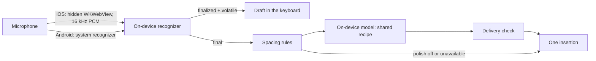

# Mobile apps

The iOS keyboard extension and the Android input method, their layout and what has been verified. Requirements are in [012 Mobile input](../../specs/012-mobile-input.md); the scope decision is [ADR 051](../decisions/051-native-mobile-keyboards.md).

## Layout

| Path | Contents |
| --- | --- |
| `apps/ios/project.yml` | XcodeGen project: the `Arion` app, the `ArionKeyboard` extension, unit and UI test targets. `Arion.xcodeproj` is generated and not committed |
| `apps/ios/ArionKit` | Swift package shared by the app and the keyboard: `Design` (Sunbeam tokens, `FaceButton`, `VoiceMark`), `Domain` (draft, phases, rules, recipe, validation), `Storage` (App Group preferences, vocabulary, history), `Capture` (WebKit microphone), `Speech` (on-device recognizer), `Polish` (Foundation Models), `Application` (`DictationSession`), `Keyboard` (`VoiceKeyboardView`), `Localization` |
| `apps/ios/Arion` | The app: onboarding, the settings home with a practice field, detail lists |
| `apps/ios/ArionKeyboard` | `KeyboardViewController`: connects the keyboard view to the session and the editor |
| `apps/android/core` | Kotlin/JVM domain: draft, phases, rules, recipe, validation, text joining |
| `apps/android/design` | Sunbeam for Compose (`SunbeamTheme`, `Face`, `VoiceMark`) and the generated string resources |
| `apps/android/app` | Activity (onboarding and settings), `ArionInputMethodService`, `DictationController`, on-device recognizer and model adapters, stores |
| `packages/mobile-strings/strings.json` | All user-facing copy of both apps, English and Simplified Chinese |

The iOS app follows the desktop's layer intent within UIKit: pages compose views from `ArionKit`; domain types have no UI; storage and platform adapters sit behind the session. Android mirrors it with modules: `core` has no Android dependency.

## Dictation flow

| Step | iOS | Android |
| --- | --- | --- |
| Capture | `WebMicrophone`: `getUserMedia` in a hidden web view, heartbeat-guarded | `SpeechRecognizer.createOnDeviceSpeechRecognizer` captures itself |
| Recognition | `DictationTranscriber` (`SpeechAnalyzer`), volatile results, vocabulary as `contextualStrings` | Partial results, `EXTRA_BIASING_STRINGS`, model download on `ERROR_LANGUAGE_UNAVAILABLE` |
| Polishing | `SystemLanguageModel` with permissive content-transformation guardrails, greedy, 15 s | ML Kit Prompt API (Gemini Nano), temperature 0, 15 s |
| Insertion | `textDocumentProxy.insertText` | `InputConnection.commitText` |
| Generation guard | `DictationGeneration` per dictation | generation counter per dictation |

`format.json` reaches iOS as a symlink in `ArionKit/Sources/ArionKit/Resources` and Android through a Gradle copy into generated assets.

## Interaction

Mobile keeps the desktop's model (one dictation, drafts apart from the editor, one commit, explicit failures) and adapts the controls to touch:

- Tap the microphone to start and again to finish, or hold it and speak. While holding, cancel and translate appear on either side; releasing over one does that. This replaces the desktop's dictation and translation keys.
- While listening the side keys become cancel and translate; at rest they are the language key and delete. Nothing else changes shape.
- Space drags move the caret. Return follows the field's action (go, search, send…).
- The language key cycles the chosen recognition languages; it is absent with one.

## Design

Sunbeam tokens are generated (`pnpm mobile:generate`) from the Sunbeam MyGo package the desktop pins; see [design system](../frontend/design-system.md#mobile). The app is flat: background, white cards with a hairline, ink switches and checks, one yellow primary button. The keyboard is raised: keys have Sunbeam's raised face, edge and shadow; the microphone is the app icon (the voice mark on yellow) and turns to the substrate ink while listening, its bars following the voice. Text is the system typeface at Sunbeam's sizes; onboarding headlines use the system serif. The app icon comes from `arion-icon -mobile`.

## Verification

| Check | Result |
| --- | --- |
| `pnpm mobile:check` | Generated tokens and strings match their sources |
| iOS unit tests (`pnpm ios:test`, ArionKitTests) | Pass on the iOS 26.4 simulator: rules, recipe routing and budgets, every translation target, validation, PCM decoding, text joining |
| iOS UI test (`ArionUITests`) | Walks onboarding on the simulator (welcome, microphone, keyboard steps, focused practice field) |
| iOS keyboard states | Rendered through the development preview (`-keyboardPreview idle|listening|polishing|failed`) |
| Android unit tests (`pnpm android:test`) | Pass: the same cases as iOS against the same recipe file |
| Android emulator (Pixel Fold, API 35) | Onboarding advances after enabling and selecting the keyboard; the on-device recognizer starts, listening shows cancel and translate, silence ends with “Didn't catch that.” |

Not verified:

- Speech end to end with a live microphone on either platform. The headless emulator had no host microphone, and the simulator test ran without the keyboard enabled.
- The iOS keyboard inside a real editor. The simulator's Settings did not list the extension under Add New Keyboard during automation; enabling it on a device or through the Settings UI by hand remains open.
- WebKit capture on a device, Foundation Models and Gemini Nano polishing, and whether ML Kit refuses inference from an input method (see ADR 051).
- Hardware: no physical iPhone or Android phone, and no vphone guest (vphone Launchpad is installed; host setup is pending the owner).

## Not on mobile

Account and sync, cloud polishing, clipboard history, selection actions, the desktop's typing keyboards (Pinyin), contextual spelling selection, speech-cleanup spans, scene detection by app, and edit learning.
