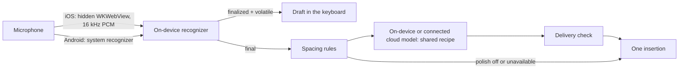

# Mobile apps

The iOS keyboard extension and the Android input method, their layout and what has been verified. Requirements are in [012 Mobile input](../../specs/012-mobile-input.md); the scope decisions are [ADR 051](../decisions/051-native-mobile-keyboards.md) and [ADR 052](../decisions/052-mobile-account-overview-cloud.md).

## Layout

| Path | Contents |
| --- | --- |
| `apps/ios/project.yml` | XcodeGen project: the `Arion` app, the `ArionKeyboard` extension, unit and UI test targets. `Arion.xcodeproj` is generated and not committed |
| `apps/ios/ArionKit` | Swift package shared by the app and the keyboard: `Design` (Sunbeam tokens, generated `Icon`, `FaceButton`, `VoiceMark`), `Domain` (draft, phases, rules, recipe, validation), `Storage` (App Group preferences, vocabulary, history), `Usage` (`UsageLedger`, word count), `Account` (`AccountService`: OIDC, consent, usage report), `Cloud` (`CloudService`, `CloudModel`), `Capture` (WebKit microphone), `Speech` (on-device recognizer), `Polish` (Foundation Models), `Application` (`DictationSession`), `Keyboard` (`VoiceKeyboardView`), `Localization` |
| `apps/ios/Arion` | The app: Overview, Dictation, Polish, Vocabulary and Account tabs, the cloud pages, stepped onboarding, detail lists |
| `apps/ios/ArionKeyboard` | `KeyboardViewController`: connects the keyboard view to the session and the editor |
| `apps/android/core` | Kotlin/JVM domain: draft, phases, rules, recipe, validation, text joining, usage log and word count, cloud request building and default models, OIDC and consent parsing |
| `apps/android/design` | Sunbeam for Compose (`SunbeamTheme`, `Face`, `VoiceMark`, `IconView`), the generated icons (`ArionIcon`) and string resources |
| `apps/android/app` | Activity (onboarding and the five tabs), `ArionInputMethodService`, `DictationController`, on-device recognizer and model adapters, `AccountService` with `AuthCallbackActivity`, `CloudService`, `UsageLedger`, Keystore-encrypted `Secrets`, stores |
| `packages/mobile-strings/strings.json` | All user-facing copy of both apps, English and Simplified Chinese |
| `packages/mobile-icons` | The icon list and the SVGs the desktop does not vendor; the generated assets come from it ([README](../../packages/mobile-icons/README.md)) |

The iOS app follows the desktop's layer intent within UIKit: pages compose views from `ArionKit`; domain types have no UI; storage and platform adapters sit behind the session. Android mirrors it with modules: `core` has no Android dependency.

## Dictation flow

| Step | iOS | Android |
| --- | --- | --- |
| Capture | `WebMicrophone`: `getUserMedia` in a hidden web view, heartbeat-guarded | `SpeechRecognizer.createOnDeviceSpeechRecognizer` captures itself |
| Recognition | `DictationTranscriber` (`SpeechAnalyzer`), volatile results, vocabulary as `contextualStrings`; Apple's model for a missing language downloads through `AssetInventory` from the keyboard, with its progress shown in place of the draft | Partial results, `EXTRA_BIASING_STRINGS`, model download on `ERROR_LANGUAGE_UNAVAILABLE` |
| Polishing | `SystemLanguageModel` with permissive content-transformation guardrails, greedy, 15 s; or `CloudModel` | ML Kit Prompt API (Gemini Nano), temperature 0, 15 s; or `CloudService.run` |
| Insertion | `textDocumentProxy.insertText` | `InputConnection.commitText` |
| Generation guard | `DictationGeneration` per dictation | generation counter per dictation |

`format.json` reaches iOS as a symlink in `ArionKit/Sources/ArionKit/Resources` and Android through a Gradle copy into generated assets.

## App

Both apps have five tabs, the sections of the desktop's Settings window that apply to a phone:

- **Overview** sums the per-day counts the keyboard records after each committed dictation (`UsageLedger`: day, listening time, word count by the desktop's rule, the scene of a polished or translated dictation; never text). Four totals, daily words for up to 26 weeks shaded by rank, words by scene for today, the last 7 days or all time, and the latest vocabulary. Before the first dictation, a first-run card with a field to try the keyboard in.
- **Dictation**: recognition languages, the translation target, the speech model (iOS) and keyboard setup.
- **Polish**: Off, This device or Cloud; while Cloud is chosen, the cloud model with its provider mark.
- **Vocabulary**: the terms, with history behind the history button.
- **Account** signs in to AstraFoundry with the mobile public clients `arion-ios` and `arion-android` and the redirect `arion://auth/callback` (`ASWebAuthenticationSession`; the Android browser and `AuthCallbackActivity`). Signed in, it shows the profile, the usage-sharing switch, the account portal and Sign out; the app version follows. The refresh token is in the keychain, or encrypted with an Android Keystore key; consent and the daily usage report follow the desktop ([account sign-in](account-signin.md)).
- **Cloud model** lists the API-key providers with their marks; connecting lists models before saving and starts on the fast tier, as the desktop ([cloud polishing](cloud-polishing.md)). iOS keys are in a keychain group the keyboard shares.
- **The microphone step (iOS).** `VoiceprintFigure` draws a phone lying on its back, its screen showing the yellow microphone button (the generated Lucide mic, with a ring that swells with the voice) and a voiceprint whose syllables enter at the left and flow to the right. It is an isometric solid with the Anatomy kit's camera and shading (the same port the desktop's `ui/shared/iso` makes). It turns half a revolution as it grows into place; under Reduce Motion it is still. The system asks for the microphone, then speech recognition, as soon as the phone has turned into place; the button stays for when the prompt was dismissed, and reads Continue once access is granted.
- **Speech model (iOS).** Arion ships no recognition model. `DictationTranscriber` needs Apple's on-device model for the language, which the system downloads once per language. The app and the keyboard each hold their own `AssetInventory` reservation, so the keyboard checks `AssetInventory.status` for the exact transcriber it runs, and a missing model downloads from the keyboard on the first tap. The draft line shows the language and percentage, then that the keyboard is ready; the tap does not start listening by itself. A download error has its own message.
- **Bundle identifiers (iOS).** The app is `com.astrafoundry.arion.ios` and the keyboard `com.astrafoundry.arion.ios.keyboard`, with the App Group `group.com.astrafoundry.arion`. iOS leaves a keyboard whose bundle identifier starts with `si.` out of its third-party keyboards (Add New Keyboard, and the Keyboards row on the app's Settings page), so the iOS targets do not use the `si.astrafoundry` prefix the desktop and Android apps use. Found on the iOS 26.4 simulator by swapping identifiers on one build: `dev.`, `en.` and `com.` prefixes list the keyboard, `si.astrafoundry` and `si.example` do not.
- **The Settings app page (iOS).** `apps/ios/Arion/Settings.bundle` puts the setup steps on Arion's page in the Settings app, under the system's Keyboards row: turn on Arion, Allow Full Access for the microphone, and what to do when the Keyboards row is missing (close Settings from the app switcher and reopen it). Its `Root.plist` and `Root.strings` are generated from the `iosSettings.*` keys of the string catalog. Onboarding's keyboard step says where the steps are, shows what the user will do there as the Settings app itself (`SettingsPreview`: Arion's page with the note, a tap on Keyboards, then the Keyboards page with the Arion and Allow Full Access switches turning on; drawn in the system's grouped-list style and colors with localized labels, static under Reduce Motion), opens the page, and keeps it one tap away after returning ([competitor keyboard setup](../research/competitor-keyboard-setup.md)).
- **Onboarding** shows its progress and a back control: welcome with sign-in, the terms box (checked) and the usage box (unchecked), or Continue locally; microphone; keyboard (Android: enable, then select); polishing, which opens the provider pages when Cloud has no model; practice.

## Interaction

Mobile keeps the desktop's model (one dictation, drafts apart from the editor, one commit, explicit failures) and adapts the controls to touch:

- Tap the microphone to start and again to finish, or hold it and speak. While holding, cancel and translate appear on either side; releasing over one does that. This replaces the desktop's dictation and translation keys.
- While listening the side keys become cancel and translate; at rest they are the language key and delete. Nothing else changes shape.
- Space drags move the caret. Return follows the field's action (go, search, send…).
- The language key cycles the chosen recognition languages; it is absent with one.

## Design

Sunbeam tokens are generated (`pnpm mobile:generate`) from the Sunbeam MyGo package the desktop pins; see [design system](../frontend/design-system.md#mobile). The app is flat: background, white cards with a hairline, ink switches and checks, one yellow primary button. The keyboard is raised: keys have Sunbeam's raised face, edge and shadow; the microphone is the app icon (the voice mark on yellow) and turns to the substrate ink while listening, its bars following the voice. Text is the system typeface at Sunbeam's sizes; onboarding headlines use the system serif. The app icon comes from `arion-icon -mobile`.

## Verification

| Check | Result |
| --- | --- |
| `pnpm mobile:check` | Generated tokens, strings and icons match their sources |
| iOS unit tests (`pnpm ios:test`, ArionKitTests) | Pass on the iOS 26.4 simulator: rules, the keyboard's model-download line and failure, recipe routing and budgets, every translation target, validation, PCM decoding, text joining, word count and usage days (the desktop's cases), default cloud models (the desktop's cases), compatible addresses, request bodies with thinking off, completion parsing, PKCE (RFC 7636 vector) and the authorize URL |
| iOS UI test (`ArionUITests`) | Walks onboarding on the simulator (welcome, microphone, keyboard steps, focused practice field) |
| iOS keyboard states | Rendered through the development preview (`-keyboardPreview idle|listening|polishing|failed`) |
| Android unit tests (`pnpm android:test`) | Pass: the same cases as iOS against the same recipe file, plus consent and usage-report answers |
| Android emulator (Pixel Fold, API 35) | Onboarding advances after enabling and selecting the keyboard; the on-device recognizer starts, listening shows cancel and translate, silence ends with “Didn't catch that.” Welcome with sign-in, the five tabs and Overview with sample counts render with the generated icons |
| iOS simulator (iPhone 17 Pro) | Onboarding steps, the five tabs, the cloud provider list and form, Overview (first-run card and with sample counts) render with the generated icons |

Not verified:

- The keyboard's download progress on a device. On the iOS 26.4 simulator the reservation completed at once, and `SpeechAnalyzer.bestAvailableAudioFormat` then returned nil for every transcriber configuration (including Apple's `progressiveShortDictation` preset) while `AssetInventory.status` reported `installed`, so the keyboard shows that recognition is not ready yet.
- Speech end to end with a live microphone on either platform. The headless emulator had no host microphone, and the simulator test ran without the keyboard enabled.
- The iOS keyboard inside a real editor. The simulator's Settings did not list the extension under Add New Keyboard during automation; enabling it on a device or through the Settings UI by hand remains open.
- WebKit capture on a device. Every competitor studied switches to its app to record instead ([mobile voice keyboards](../research/mobile-voice-keyboards.md)), so this is the first device check.
- Foundation Models and Gemini Nano polishing, whether ML Kit refuses inference from an input method, and Chinese polishing through the Prompt API, which publishes no language list (see ADR 051).
- Opening Arion's Settings page from onboarding: the app opens `UIApplication.openSettingsURLString`, and the iOS 26.4 simulator's Settings receives it as Apps › Arion but stays on its main page. A minimal app with only a Settings bundle behaves the same there, so the landing page needs a device check.
- Sign-in, consent and usage reporting against astrafoundry.si: `arion-ios` and `arion-android` are not registered with the `arion://auth/callback` redirect yet. Cloud polishing against real providers (no keys were used), and usage recorded by the keyboard from a real dictation.
- Hardware: no physical iPhone or Android phone, and no vphone guest (vphone Launchpad is installed; host setup is pending the owner).

## Not on mobile

Sync, the ChatGPT subscription sign-in, clipboard history, selection actions, the desktop's typing keyboards (Pinyin), contextual spelling selection, speech-cleanup spans, scene detection by app, and edit learning.
