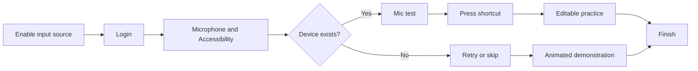

# Competitor onboarding and Arion first success

## Finding and scope

Arion already has a seven-page first-run shell. Its missing implementation is the **verified first-use loop**: registration is accepted as a shortcut test, an empty practice page can advance while the recognition model is still loading, and Finish persists completion without any successful practice session. The current headless test deliberately passes that path. The immediate task is to make completion truthful and recoverable, then improve teaching and resume.

This investigation covers installed Typeless 2.8.1, installed **Doubao Input Method** 1.0.2 (not the Doubao chat app), and the supplied Chatterfly 1.0.6.13398 installer plus its packaged input-method apps. Shipped code/resources and official vendor documents were inspected; competitor apps were not launched, permissions were not reset, and user databases/accounts/audio were not read. Findings are static observations or explicitly labeled inferences, not an executed usability comparison. Existing uncommitted Arion changes were treated as the current implementation and left intact.

The [sanitized ledger](evidence/competitor-onboarding.json) preserves hashes, exact source ranges and native call locations. TO/CO-CF/DO identifiers denote ordinary local observations; only the separately named `ev_…` references are actual REA Evidence. Complete REA records, commercial source/disassembly and intermediate notes remain private in `.workspace/`.

## Comparison

| Product | First-use structure | Useful mechanism | Limits |
| --- | --- | --- | --- |
| Typeless | Account → Accessibility/Microphone → microphone test → feature shortcut tests and guided exercises → overview → optional commercial/survey branches | Separate setup and experience groups; actual shortcut detection; internal app-like exercises; stored progress and lightweight permission repair | Microphone bars are self-confirmed; earlier progress can unlock exercises; account completion includes an unobserved server update |
| Doubao Input Method | Native microphone/shortcut/try-speaking pages plus input-source setup and capability-specific permission guides | Teach the actual activation gesture, give an example, and let the user choose/check a microphone | Exact ordered transitions and completion enforcement are scoped below; an auxiliary global-voice guide is not automatically a required basic-voice step |
| Chatterfly | Install/enable input method → login → speech permissions → microphone detection → shortcut detection → practice → finish | Installer teaches the actual product; missing-device remediation; shortcut test resets after a change; real editable practice surface | Practice gates nonempty text, not proven speech delivery; skip/demo paths exist; durable completion remains unknown |
| Arion now | Welcome → microphone → Accessibility → model → shortcut → Try → Finished | Real permissions, meter, automatic provisioning, shortcut conflicts, localized copy | The last three steps do not enforce successful first use; checkpoint resume and practice-local recovery are missing |

The transferable pattern is **readiness → gesture rehearsal → useful result → clear next action**. Account gates, subscriptions, surveys, translation and voice commands are competitor product choices. Arion's documented offline/local model provisioning is its own readiness step.

## Typeless: setup followed by feature teaching

TO-01 defines default and lite step tables. The default flow contains:

1. Sign up, permissions and microphone test.
2. Dictate introduction, shortcut test and four exercises styled as Slack, Gmail, Google Docs and Notes.
3. Translate introduction, shortcut, target-language selection and a WhatsApp exercise.
4. Ask Anything introduction, shortcut and selected-text editing/question/action exercises.
5. Overview; optional invite-code entrance, pricing with a free continuation, and acquisition/profession/industry surveys. The overview primary action jumps to pricing, so the invite page's position in the table does not make it compulsory. Pro/account-data branches skip some later pages.

Lite removes the feature exercises and retains permissions, microphone and the Dictate shortcut. Startup sends an unauthenticated user to login, an incomplete authenticated user to the default flow, and a completed user missing permissions to lite repair (TO-15). These are static routing branches, not observations of a particular account.

| Detail | Evidence and interpretation |
| --- | --- |
| Permission progression | TO-04/05: Accessibility first; microphone controls collapsed until it is granted. Both must be granted to continue. A one-second poll and a child-process Accessibility check exist. Do not import competitor permission reset/restart behavior without an Arion requirement. |
| Microphone check | TO-06: live bars, a device picker and user confirmation. Continue requires a device; it does not measure transcription accuracy or prove audible speech. |
| Shortcut test | TO-11: actual feature-specific `shortcutHit` unlocks continuation, with already-passed/replay exceptions. Editing the shortcut is part of this step. |
| Safe practice | TO-02/10: internal fields carry synthetic app/context metadata and allow the feature being taught. Success/refined output or nonempty input and prior progress affect continuation. App-like cards do not prove that those external apps ran. |
| Resume | TO-09: current/max reached step restore the default flow; lite starts from its computed entry. |
| Completion | TO-14/16: wizard completion clears progress and opens the hub/bar; the hub has a platform/version account-completion update. Successful server persistence and offline retries are unverified. |

The current [official setup guide](https://www.typeless.com/help/installation-and-setup) corroborates login, the two permissions, microphone bars/device switching and guided Dictate/Translate/Ask Anything exercises. The [permission troubleshooting guide](https://www.typeless.com/help/troubleshooting/permission-issues) documents manual recovery. These are vendor descriptions, not evidence that the installed flow executed.

## Doubao Input Method

The selected installed IMK package contains a separate native settings app (`com.bytedance.inputmethod.doubaoime.settings`, 1.0.2). Its settings binary ships these basic voice-onboarding surfaces:

| Surface | Evidence | What remains unknown |
| --- | --- | --- |
| Microphone permission | DO-permission: native page type, requesting/denied/granted states, System Settings deep link and return-attempt state | Actual forward gate and return/advance policy |
| Shortcut configuration | DO-shortcut: native page, `_canProceed`, key recorder, hold/click modes and Fn input-source conflict guidance | Default active key; whether actual detection is required |
| Try speaking | DO-practice: sample utterance, native editable text view, transcription/focus state, microphone picker/meter and completion callback | Whether nonempty text or successful ASR is required; skip policy |
| Completion/reentry | DO-completion: `hasCompletedOnboarding`, `--show-onboarding`, completion notification and already-completed skip diagnostic | Durable write moment, checkpoint resume and close behavior |
| Optional capabilities | DO-optional: independent `GlobalVoiceGuideModal` / `SmartTextPermissionGuideModal`, Accessibility and input-source switching prerequisites | Relationship to a fresh user's enabled capabilities |

**Inference:** the candidate basic journey is microphone authorization → shortcut configuration → in-app speaking practice → settings. Page types and content establish these components, but the native `_currentPage` dispatch was not recovered, so their order is not presented as confirmed. Input-source installation/selection belongs to a separate OS/installer layer. Account UI elsewhere does not prove a compulsory login gate for basic speech.

REA successfully retained native OnboardingWindow method search (`ev_731210eaeb6d41d66b4703c9561801520666fa5b2f530dd38fc716fa5015a859`) and completion-string search (`ev_45dbd19b6897eb5099570396a8676a7ed22b387adb7b9cb063e20a13bd97d148`). Two focused decompilations selected neighboring code/settings serialization and were excluded from transition conclusions. The owned native session was closed. Static byte coordinates and digests are in the ledger; complete records are private under `.workspace/research/doubao-onboarding/`. No current official desktop first-run guide was independently recovered.

## Chatterfly: onboarding lives in the installer

The supplied outer app is `com.tencent.ChatterflyInstaller`, not the running IMK host. Its archive contains `com.tencent.inputmethod.chatterfly` and companion preference/service apps. Existing REA inventory and extraction are reused; this pass follows **the installer's own `YBMainWindowController`**, which was outside the earlier rewriting investigation. Twenty focused arm64 bodies are independently byte-verified against the original universal installer. These are ordinary LLVM instruction observations, not successful REA native decompilation.

| Transition or gate | Evidence |
| --- | --- |
| Input source enabled → login | CO-CF-09 calls `showLoginPage`. CO-CF-08 tests `isLogin`; an already logged-in user goes to speech authorization. Login success calls that page (CO-CF-10). |
| Authorize the actual input-method process | CO-CF-11/20 use IPC permission status, not the installer's own microphone permission. Both microphone and Accessibility results gate completion. Already-granted and upgrade branches can bypass teaching pages. |
| Device routing | CO-CF-19 reads available devices/count, then selects AudioDetect or NoMicrophone. CO-CF-12 sends the microphone test's Next to HotkeyDetect. The test's copy asks users to observe the blue response or switch devices; this is not a proved quantitative audio threshold. |
| Shortcut detection | CO-CF-06 initially disables Next; CO-CF-05 enables it when the hotkey callback reports a hit and lights the key illustration. Custom-key completion clears the visual and disables Next again (CO-CF-07). |
| Shortcut → real practice | CO-CF-15 constructs AsrDetect and notifies the product process of the current installer page. The native text-view surface and copy teach start/stop with the shortcut. |
| Practice criterion | CO-CF-01 initially disables Next; CO-CF-02 checks `recognizedTextView.string.length != 0`; CO-CF-03 checks enabled state before continuing. This is a nonempty text criterion, not session-bound insertion verification. Next and explicit Skip both reach Finish (CO-CF-16/17). |
| No-device alternative | CO-CF-13 moves Skip to SpeechDemo, whose bundled APNG demonstrates input; its Skip reaches Finish (CO-CF-14). This is an educational alternative, not a successful microphone test. |
| Final action | CO-CF-18 closes the installer window. CO-CF-04 shows a separate experience-improvement preference write; it does not prove durable onboarding completion. Exact completion persistence and resume remain unresolved. |

Packaged explanatory text says microphone use occurs during speech functions and discusses local transcript/audio history; this is product copy and does not verify retention or inference locality. The [official product site](https://chatterfly.tencent.com/) identifies the vendor/product but exposes no usable detailed first-run sequence through this research tool. A packaged microphone-help URL was inaccessible, so its contents are not used as evidence.

## Arion: confirmed implementation gaps

| Priority | Gap | Current source |
| --- | --- | --- |
| P0 | Try always passes, even without a ready model or speech | `ui/entities/onboarding/onboarding.go:32–45`: Model permits provisioning/loading, while Try has no readiness branch. Its own comment says Try waits, contradicting the implementation. |
| P0 | Shortcut only needs registration | Same file:42–43; `ui/pages/onboarding/onboarding.go:248–275` uses a post-entry press for visual feedback only. |
| P0 | Practice is only a local editable string | `ui/pages/onboarding/onboarding.go:38–46,278–285`: no current session/generation, delivery outcome, persistent error/retry or success predicate. |
| P0 | Completion and practice lifecycle are unowned | `bootstrap/actions.go:212–218` unconditionally persists completion; page release at `onboarding.go:169–181` stops meter/test/recorder but has no practice-session ownership/cancellation. Existing core focus checks still protect insertion. |
| P0 | Test passes the incomplete path | `ui/app/app_test.go:716–785` advances with ModelProvisioning and no practice result. Targeted `go test ./ui/app -run '^TestOnboardingFlow$' -count=1` passed; this is a headless fake-action test. |
| P1 | No checkpoint/resume or visible reopen setup action | `Flow` is local to each new Page; preferences only persist `OnboardingCompleted`. The bounded bootstrap/tray/Settings search finds no user-facing reopen action. |
| P1 | Platform/capability mismatch | Fixed Accessibility step on Windows, whose platform adapter reports granted and performs no request; English copy refers to Mac/System Settings/menu bar. Actual capture failure is a separate runtime event. |
| P1 | Optional polish readiness disappears during Try | Model shows polish status; Try shows recognition status only. A recognition-only success needs to be described truthfully if optional polish is still preparing. |
| P1 | Native tests cover the window, not first success | `e2e/native_test.go:175–186` checks lifecycle; product scenario driver starts with completion already set. Historical manual completion does not establish enforcement. |

Paths above are under `apps/desktop/` unless qualified. References describe the inspected working tree, including pre-existing edits.

The MyGo practice editor is **not established to be incompatible**: native target capture permits the current app, and MyGo provides focused text/value accessibility. The adapter can choose keyboard insertion and readable-value verification. Only `Peek`, not `Capture`, excludes Arion itself. A packaged real macOS practice test is still needed; Windows requires its actual host. Do not invent a mock insertion, update practice from a global last-result value, or equate `Unknown` delivery with verified success.

## Proposed Arion implementation, in dependency order

These are research recommendations, not new normative requirements or implemented behavior. Resolve explicit skip/confirmation semantics in the spec before changing completion policy.

1. **P0 — Specify first success and own the scenario.** Define current-check shortcut detection and a current practice session/generation with nonempty finalized speech and delivery into its owned practice field. Choose how an unverified delivery can be explicitly confirmed; never silently label it verified. If setup can be skipped, persist a deferred practice state separately from successful completion.
2. **P0 — Finish the practice loop.** Keep automatic model provisioning running during consent/shortcut steps; require actual readiness before starting practice. Show recording, processing, result, persistent failure and retry near the editor. Reuse the production coordinator, provisioner, error projection and insertion contracts. Prevent advancement during capture/finalization; leaving/closing cancels and invalidates only the owned practice session.
3. **P0 — Prove and enforce it.** Replace the click-through assertion with negative readiness cases, no shortcut hit, manual text, empty speech, stale results, focus changes, cancellation and unverified delivery. Add a packaged native test with isolated preferences, a real owned MyGo target, actual recognition fixtures and independent text readback. Keep human permission-flow checks separate; Windows needs a real Windows run.
4. **P1 — Resume and repair.** Persist a versioned minimal checkpoint; re-read permissions, device/model availability and shortcut status when resuming. Do not persist practice audio/text. Add a reopen action and a focused repair path after permission/device changes. Surface failed completion saves instead of reporting success.
5. **P1 — Teach the supported product.** Present one localized short utterance showing actual Arion transcription, then an optional cleanup/example if local polish is ready. Explain the tested shortcut and where to find Settings. Platform-specific pages should request only required consent. IME installation, hold-key Input Monitoring and context collection remain explicit optional capability flows.

Suggested first-use sequence:

**Welcome/language → required consent + microphone/device check → automatic model progress → actual shortcut hit → one owned dictation → truthful completion.** Model preparation can overlap earlier steps. A short sample should demonstrate a supported benefit; the success criterion must accept the user's own words rather than require a memorized phrase. A later external-editor exercise can validate transfer, but cannot silently certify broad app compatibility.

Implementation ownership follows existing FSD/DDD: the page composes; an onboarding practice feature owns the scenario; entity/model code owns state transitions; bootstrap wires existing ports. Preserve privacy, cancellation, exactly-once delivery and catalog-based copy. Update the relevant desktop acceptance criteria, handoff and E2E documentation alongside any subsequent implementation.

## Checklist and remaining evidence

| Question | Status |
| --- | --- |
| Resolve all three intended products and artifact identities | Answered; Doubao scope is the input method |
| Recover Typeless flow, gates, branches and progress surfaces | Answered statically; durable account writes/runtime remain unverified |
| Recover Doubao basic speech onboarding | Partially answered: components and completion surfaces confirmed; dispatch/order and success gate unresolved |
| Recover Chatterfly normal order, gates and skip paths | Answered statically; visible execution, exact microphone gate and durable completion remain unverified |
| Explain why Arion first use is incomplete | Answered through source and the existing headless test |
| Define an implementation order and acceptance gaps | Answered as a proposal; no product code changed |
| Verify clean-install dialogs, actual practice and interruption on each OS | Unresolved; no competitor consent/account state was reset and no fresh native run was performed |
