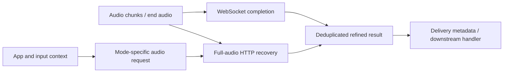

# Typeless and Doubao: contextual rewriting boundaries

## Evidence and scope

This is a focused follow-up to [Typeless](typeless.md) and [Doubao](doubao.md), addressing semantic rewriting rather than repeating capture and host-insertion inventories. Installed Typeless remains **2.8.1 (2.8.1.130)** and Doubao IME **1.0.2 (1)**. Their ASAR/main-executable SHA-256 values match the previous ledgers, so matching REA Evidence was reused. New locations, digests and bounded observations are in [competitor-rewrite.json](evidence/competitor-rewrite.json).

Typeless's prior REA application Evidence is `ev_17708dd83c71fab9ced0d18a4df9036551e5e4aca46326f121f929f1cbaa2ccb`. Its partial graph coverage and native-companion digest contradictions remain limitations; none were erased by this follow-up. Doubao's prior actual decompiled delivery evidence includes `ev_7813c9cf5cfd974f88db927e1d3ec7e857a490b646f2b4d8968d44ded8cdb348` and `ev_3af76376fc6472a824bed1678d3f5b5a2975d70d8a2733140195b4be57bbb3c7`.

New `CR-*` IDs are **locally assigned ordinary-shell observations**, not invented REA Evidence. The Typeless main bundle uses a rotated literal array. A Python-only inert parser solved the declared numeric rotation uniquely and substituted direct literal-lookup aliases for inspection; it never executed target JavaScript. Original member byte ranges are retained, rather than presenting transformed offsets as shipped offsets. This aids reading and does not establish runtime equivalence. REA's source-recovery operation reported an unavailable Wakaru Linux x64 provider on this Mac; no engine or client configuration was installed.

Only shipped package bytes were examined. No application was launched, microphone used, private endpoint requested, user database read or runtime traffic intercepted. Source-level calls can establish a branch's construction; strings and Swift reflection names establish surfaces with weaker attribution. Neither establishes active defaults, backend models, server prompts or observed execution.

## Typeless: scenario information travels with the audio

The inspected context collector assembles `device_environment`, `active_application`, `text_insertion_point` and `context_metadata`. It captures one focused-app identity before collecting application and input information in parallel. Application fields include app name/identifier, window title, native/browser classification, browser page title/URL/domain and optional visible content. Input fields include editability, accessibility role, Markdown capability, selection, text before/after the cursor and optional surrounding input-area content (`CR-TL-context`, `CR-TL-context-shape`).

These fields provide **inputs from which a service could infer a writing scenario**. They do not demonstrate a recovered client classifier such as “email → formal prompt” or “chat → casual prompt.” The blacklist decision is passed into both collectors and suppresses visible/related-content branches. The inspected cursor-state read is a separate branch; this follow-up does not establish a universal deny-before-read privacy gate.

The concrete main-process IPC handler `audio:ai-voice-flow` reads session metadata by audio ID and constructs a multipart request to `/ai/voice_flow`. Its fields include an Ogg audio file, mode, wrapped `audio_context`, audio metadata and mode-specific parameters (`CR-TL-http`):

| Stored client mode | Request mode | Additional parameters observed |
| --- | --- | --- |
| `voice_transcript` | `transcript` | No additional mode-specific field in this switch |
| `voice_command` | `ask_anything` | `selected_text`, when present |
| `voice_translation` | `translation` | `output_language`, from an override or stored mode metadata |

The handler's response extraction keeps `refine_text` separate from `delivery`, `user_prompt`, `web_metadata` and `external_action`. These returned fields indicate that result routing is richer than an unconditional string insertion. Their existence does not reveal the exact action policy or prove external actions are executed. The selected-text path supports a voice-command/refinement scenario, but the server's prompt construction and distinction between editing and answering remain unknown.

The renderer distinguishes streaming transcription chunks from a completed refined result. `handleTranscriptionChunk` appends text/chunk-index/audio-ID records; `handleRefineCompleted` consumes `refined_text` and invokes or resolves the refinement handler (`CR-TL-results`). Therefore, **streaming ASR is established as a client surface; token-streaming LLM rewriting was not established**.

On `end_audio`, `sendMessage` enters `startRefineRace`: WebSocket completion and a full-audio IPC/HTTP recovery request race through `Promise.race`. A weak-network branch chooses the HTTP recovery route without sending that end message through the normal branch. Completion is deduplicated by audio ID, a WebSocket winner cancels the recovery request, and the compressed audio file is cleaned in `finally` (`CR-TL-race`). This is a static reliability strategy, not measured redundancy, latency or correctness.



The diagram reconstructs the inspected client branches. The edge from collected context to the stored session depends on orchestration outside this focused body inspection; the exact server ASR/LLM order remains unresolved.

### Personalization feedback is another stage

A distinct edit-tracking component captures the originally inserted refined text and input-box content, polls subsequent focus/input state, and reacts to keyboard activity. Its `sendTrackResultToServer` method wraps a payload containing `refined_inserted_text`, original/edited input-box fields, application/device context and mode, then posts a `log` body to `/user/traits`. The response can contain an `auto_add_dictionary` term and dictionary ID, which are forwarded through a dictionary notification (`CR-TL-feedback`).

This is a concrete feedback request-construction path. It does not establish which settings enable it, whether every edit is sent, or how the backend learns a style. The follow-up [edit learning](edit-learning.md) traces the tracker's settle triggers and thresholds, the dictionary alert and its undo, and compares Doubao's and Chatterfly's equivalents. Arion should distinguish user-approved memory from automatically inferred feedback and evaluate those policies independently. A request field encryption wrapper for a processing service does not imply that service cannot access its plaintext.

## Doubao: organization has its own stream and decision lifecycle

The shipped `OimeSmartOrganize` types are more specific than a generic “LLM supported” string. Request/configuration names expose `query`, `contextID`, `spacingOptions`, `requestID`, result timeout and done timeout. A nearby route literal is `/api/v2/ai/text_organization`; spacing parameter names include `space_at_cn_en_nb` and `space_at_newline` (`CR-DB-request`). The [disfluency follow-up](competitor-disfluency.md#doubao-decoder-cleanup-plus-text-organization) traced the builder and recovered five application-specific body entries: `query`, numeric `scene=6`, `stream=true`, `space_at_cn_en_nb` and `space_at_newline`. Shared request augmentation remains unresolved. In particular, `contextID` must not be expanded into an imagined text-context payload.

`SmartOrganizeClient` has named SSE handlers for headers, deltas, completion, transport finish and errors, with request/generation identifiers. The artifact contains `format.completed`, `scene.completed.empty_content`, `missing_completed`, `transport_closed_before_completed` and encryption-validation diagnostics. Stored state distinguishes `waitingForCompleted` from `waitingForDone`, and `pending`/`noRewrite`/`willRewrite`, with independent result/done timeout work items (`CR-DB-stream`). This supports a **separate result decision and transport-completion model** as an architectural inference; it does not prove an exact SSE event order or a particular scene taxonomy.

A `SmartOrganizeVoiceCoordinator` retains original text, context ID, generation, active request, a completed-text transform and action handler. Its action names include organizing, rewrite confirmed, commit organized, commit original and failed. The input controller contains eligibility/start-after-typewriter-reset/final-selection methods, failure/timeout-original paths, session/target/selection/composition/ownership fields, and final-commit generation (`CR-DB-coordinator`). These names support the inferred flow below:

```text
Final recognition result
  → eligibility and target/composition snapshot
  → organization request with request/generation identity
  → rewrite/no-rewrite decision, result and stream lifecycle
  → organized result or original-result decision
  → owned final delivery and undo record
```

Only the final-delivery guard functions in the previous report were actually decompiled. They check session/generation/commit sequence and avoid another write when the host has already committed. That is stronger evidence for delivery than the organization-stage string inventory. The eligibility predicate, exact handling of partial deltas, server prompt/model and offline organization support remain unknown.

The `SmartOrganizeMemoryCache` surface has input/organized text, message ID and source names `manual`/`voiceAuto` (`CR-DB-cache`). It is consistent with caching organization results. **It does not establish long-term contextual memory, semantic retrieval, model training or cross-device synchronization.**

## Design implications for Arion

The following are independent design proposals, not claims that competitors implement them:

1. Keep recognition repair, candidate ranking and intentional rewriting as separate ports and traces. A ranker chooses among existing candidates; a rewriter can change meaning and needs stricter acceptance.
2. Represent scenario as explicit policy plus bounded, authorized app/input metadata. Include user override and ambiguous/unsupported cases; keep scenario detection confidence visible to the policy, not embedded silently in a prompt.
3. Preserve the original recognition result, selected candidate, proposed rewrite and actual committed text. A no-rewrite decision is a valid outcome and must be scored separately from a transport failure.
4. Associate every rewrite with session, revision, target and generation. Revalidate before preview/commit and discard stale completions after focus, mode or cancellation changes.
5. Measure ASR first partial, rewrite first visible output, final rewrite readiness, rendering and host delivery separately. Streaming tokens do not automatically imply a safe continuously changing composition.
6. Evaluate style/format adherence alongside fact, entity, number, negation and intent preservation. Ordinary CER/WER against a verbatim transcript is insufficient for intentional rewriting.
7. Evaluate memory contamination and scene mismatch explicitly. Test irrelevant context and hostile instructions inside application content as data, while preventing that content from becoming system instructions.
8. Keep offline inference complete after provisioning. Competitor request-construction paths provide useful interface lessons, not a reason to introduce an undocumented cloud fallback.

## Screen and cursor context

A follow-up asked whether either product reads the screen or the text around the cursor to make recognition or rewriting more accurate. Targets: installed Typeless 2.8.1 (`dist/main/index.js` SHA-256 `7b87e157…`, decoded by the deterministic lookup substitution in `.workspace/research/competitor-rewrite/decode-typeless.py`; `libContextHelper.dylib` imports and strings) and installed Doubao IME 1.0.2 (arm64 slice imports, strings and string-load scans of the disassembly). Static evidence only; neither app was run against a fixture.

| Product | Screen text | Cursor text | Where it goes |
| --- | --- | --- | --- |
| Typeless | Yes, from the accessibility tree: `getFocusedVisibleTextAsync` walks the focused window's elements recursively up to a maximum depth (`collectVisibleTexts reached max depth`) and returns `visible_screen_content`; `getFocusedElementRelatedContentAsync` adds text before and after the input area. Before capture it sets `AXEnhancedUserInterface` on the focused window so Chromium/Electron expose their tree. No screenshot or OCR: ScreenCaptureKit, Vision and window-image APIs are absent | `text_before_cursor`, `text_after_cursor`, `selected_text` and `full_field_content` from the input helper; selected text can also come from a simulated copy (capped at 5,000 tokens) | All of it, with app, window title and browser URL/domain, forms `audio_context`, which `/ai/voice_flow` uploads with the audio (encrypted envelope) and which the edit-feedback path reuses for `/user/traits`. Visible and surrounding text are skipped for apps or URLs on a configured blacklist (an error counts as blocked); the cursor read is not gated by that flag. Notion web pages clear the cursor text |
| Doubao | No screen capture, OCR or window-image API in the main binary or its frameworks. AX list/table/outline names and WeChat/Feishu bundle IDs exist, but no code path from them to a context payload was established | `getTextBeforeCursor(maxLength:)` and `getTextAfterCursor(maxLength:)` through the IMK client, with AX `AXStringForRange` fallbacks; `snapshotCurrentEditAllText(maxLength:)` reads the whole field with a cursor-context fallback; an `InputHistoryManager` appends before/after text per host, and the Return-send path snapshots the sent message into history | Recognition itself: the on-device speech-LLM decoder's prompt processor has template slots `HOTWORDS`, `USER_MODIFY`, `DIALOG` and `CUR_CONTEXT` (`cursor_context_max_length`, `dialog_max_length`), next to bot name/description and audio. The cloud ASR configuration names `ime_info`, `hotwords`, `user_input` and `context`. Whether the organization (rewrite) request carries cursor text was not established; its known fields are `query` and `contextID` |

So Typeless sends rich screen and cursor context to a server that recognizes and refines in one request, while Doubao conditions its speech-LLM recognizer on cursor text, recent dialogue and hotwords. Chatterfly sends cursor text and window title to its post-processing server and does not populate screen content ([Chatterfly](chatterfly.md#scene-recognition-and-switching)). None of these observations measures the accuracy gain; Arion's own [context ablation](../../benchmarks/results/context-ablation-v1/README.md) does, for its local pipeline. For Arion, cursor and screen text remain behind 009's separate consent gate; Typeless's `AXEnhancedUserInterface` step is relevant to reading Chromium web areas (SCN-A04).

## Question status

| Question | Status | Remaining evidence needed |
| --- | --- | --- |
| Typeless audio/mode/context request and result separation | Answered for inspected source branches | Actual runtime defaults and reachability |
| Typeless contextual scenario policy or server prompt | Partially answered | Classifier/prompt/backend evidence; fields alone cannot identify it |
| Typeless refinement reliability and feedback surfaces | Answered for inspected source branches | Runtime timings, consent/defaults and learning implementation |
| Doubao organization stream/state/coordinator surfaces | Partially answered | Focused native decompilation and an authorized runtime trace |
| Doubao exact request serialization and scenario/model policy | Partial: five application-specific body entries recovered in the disfluency follow-up | Shared networking augmentation, server policy or explicit fixture-based runtime capture |
| Models/checkpoints/parameters used by either service | Unresolved | Verified provider/model evidence, not kernel names or marketing |
| Screen or cursor context used for accuracy | Answered statically | Runtime capture of actual payloads; accuracy effect unmeasured |
| Offline semantic rewriting and measured effectiveness | Unresolved | Network-isolated inference and controlled evaluation |
