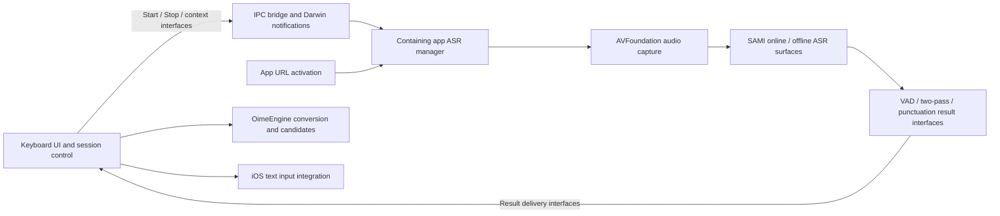

# Doubao iOS input method

This investigation covers the downloaded App Store IPA **1.6.1 (1060105)**, bundle `com.bytedance.ios.doubaoime`. It is independent of the [macOS investigation](doubao.md). The IPA SHA-256 is `75b60d6fbc249d1f1814814accdea6517459b3ed4e2f6b8d5f1b4965bd892c64`.

The strongest finding is a split between a containing app with audio capture and a native keyboard extension with composition/candidate controllers. The package also ships a SAMI online/offline speech stack, downloadable offline-model interfaces, and an OimeEngine Swift/C++ typing engine with local ranking and optional cloud/LLM interfaces. These are static implementation surfaces, not a verified runtime call graph.

## Evidence boundary

- REA 6.4.0 inspected the archive, projected its Apple bundle graph, and parsed the host and keyboard property lists. Full Evidence IDs are in the [ledger](evidence/doubao-ios.json).
- Ordinary local parsers inspected Mach-O load commands, export tries, nlist symbol tables, resource files and signed entitlements. `DI-*`, `IV-*`, `IA-*`, and `IK-*` are local observation identifiers, not REA Evidence IDs.
- All 12 Mach-O images in this IPA declare `cryptid=1`. Main, keyboard and engine encrypted ranges start at file offset `0x4000`; their lengths are 63,045,632, 29,212,672 and 15,532,032 bytes respectively. No encrypted instructions were interpreted as code. [DI-01]
- The unencrypted export trie retained 97,807 complete main-app export names, 33,304 keyboard export names and 16,018 engine export names. Names were reconstructed across prefix-compressed trie edges and Swift-demangled; searching individual trie fragments would lose scope and parameter names. The engine nlist table also retains native C++ names.
- An ordinary native REA inspection failed when `dyld_info` rejected an initializer offset. Its error is retained locally. The export/symbol parsers read original metadata without modifying or decrypting the binaries; they do not recover instruction bodies.
- No iPhone execution, decryption, traffic capture, account operation, model download, service request or private user database inspection occurred. No model weights or commercial implementation code are included in this report.

Complete records, extracted files and parsing scripts remain in ignored `.workspace/research/doubao-ios/`. The compact ledger preserves provenance and selected names/locations, not the complete REA artifact record.

## Package and inferred responsibilities

| Component | Direct package evidence | Supported interpretation |
| --- | --- | --- |
| `oime_iOS.app` | Microphone usage declaration, background `audio`, app URL schemes, `MainAppASRManager` and `ASRAudioEngine` exports | Containing app owns the audio/session side of dictation |
| `KeyboardExtension.appex` | `com.apple.keyboard-service`, `KeyboardExtension.KeyboardExtensionEntry`, `RequestsOpenAccess=true` | Separate native custom-keyboard process |
| `OimeKeyboardKit` | Keyboard controller, marked-text, candidates, context and commit exports | Keyboard orchestration and presentation layer compiled into the extension |
| `OimeEngine.framework` | Swift engine API and extensive native C++ symbols | Local conversion, dictionaries, ranking, handwriting and ASR-aware text processing |
| `OimeCommon`, App Group and account access group | Shared utility exports and matching signed entitlements | Cross-process storage/account capability |
| `KeyboardLiveActivityExtension.appex` | WidgetKit extension, iOS 16.1 minimum, Live Activity declarations | Activity presentation/control surface; exact runtime behavior unknown |
| `NotificationExtension.appex` | Notification service extension and shared App Group entitlement | Notification processing surface |

Host and keyboard declare iOS 15.0 as their minimum. Component placement is observed; arrows below are an inference from interfaces, not decompiled calls. [DI-02, IV-01-capture, IV-02-host, IK-01, IK-08]

## Voice implementation

### Capture and host ownership

`OimeAudio.ASRAudioEngine` exports the actual capture-delegate signature `captureOutput(_: AVCaptureOutput, didOutput: CMSampleBufferRef, from: AVCaptureConnection)`, plus audio-session configuration, reusable-engine creation, start/stop and an `AudioDataReceiver` property. `MainAppASRManager` has a protocol witness for that receiver and exports `onDataArrived(data:)`, amplitude updates, audio-interruption handling and recording/ASR stop operations. [IV-01-capture, IV-02-host]

Together with the host microphone declaration and background audio mode, these strongly support capture in the containing app. The keyboard has separate session-control interfaces. This fits continued dictation after the user returns to another app's keyboard. The exact audio category/options, PCM rate, channel count, frame duration, recording lifetime and interruption recovery are unresolved.

Apple documents custom-keyboard microphone restrictions and the separate network/shared-container privileges enabled by full access. Full access is not equivalent to microphone consent. See [custom keyboard restrictions](https://developer.apple.com/library/archive/documentation/General/Conceptual/ExtensibilityPG/CustomKeyboard.html) and [open access](https://developer.apple.com/documentation/uikit/configuring-open-access-for-a-custom-keyboard). This platform boundary corroborates the host/keyboard split; it does not establish Doubao's exact execution path.

### Starting dictation and avoiding repeated app switches

The keyboard's `KeyboardASRManager` exposes start/stop, recording status, `CanStartASRWithoutJumpMethod`, context construction, finishing audio, forcing a second pass and receiving ASR results. The host exposes `handleStartASRByOpenURL(UIScene)`. `StartASRByOpenURLUtils` exports parameter storage and `getParamAndClear`; the model contains context, start time, log ID and jump ID. [IV-02-host, IV-03-keyboard, IV-08-ipc]

`IPCBridgeMethod.call` takes a lane, callback timeout and typed completion. `IPCBridgeMessage` has callback ID, timeout, name, type and parameters. `OimeIPCManager` exports events and Darwin-notification observers. This supports an explicit cross-process command/result protocol, rather than a keyboard extension directly owning every speech operation. The signatures do not reveal whether payloads live in files, MMKV, another store, or how lanes are transported.

Return-coordination members include the current return bundle, return eligibility, pending return timeout, and RTI/PiP-related names. These are clues to app-return orchestration; they do not prove a particular private API, PiP flow or App Review behavior. A stop-parameter model includes command ID, creation time, validity duration and `stopAudioNow`, suggesting stale-command handling without proving its validation logic.

### Online/offline ASR and provisioning

The binary retains SAMI `AsrOnWorker`, `AsrOffWorker` and `AsrProcessor` names for worker creation/start/audio submission, network changes, online results, result fusion, switching offline, and moving cached online audio into the offline path. WebSocket and Opus encoder symbols also ship. This establishes stack capabilities; it does not establish a default mode, active codec, connection policy or measured offline reliability. [IV-10-sdk]

`ASROfflineModelManager` exposes fetching model metadata, updating, downloading with a Wi-Fi-only parameter, retrying/cancelling, deletion and returning an optional local model path. Offline assets therefore have a separately provisioned lifecycle at the interface level. The actual acoustic model architecture, weight format, model source, integrity validation, download defaults and devices on which it is available remain unknown. [IV-04-offline]

The engine resources contain three opaque files under `asr/`, including a 7,235,000-byte file. Their location and size do not identify them as complete acoustic models; they may contain dictionaries or other speech-related data. They are not evidence that the IPA alone contains a working offline recognizer. [IV-11-resources]

### Results, context and correction

`ASRTypeWriter` exposes result updates and committed-result synchronization. ASR result models contain VAD completion, stream completion, modification pairs and punctuation post-processing. The keyboard exposes finishing audio, waiting for VAD and forcing two-pass processing. These support distinct streaming/final/revision stages; replacement timing and commit atomicity cannot be recovered from encrypted instructions. [IV-03-keyboard, IV-05-processing]

`ASRContext` can represent host/input type, cursor position and text, chat history, hotword frequencies, location fields and tracking information. These are representable fields, not proof of collection, permission grants or remote transmission. The typing engine also names ASR user-correction dictionaries, hotword context, ASR word conversion and NER-response ingestion. That supports local adaptation surfaces alongside speech recognition. Exact scoring and when each dictionary participates are unresolved. [IV-06-context, IV-12-engine]

## Authorization implementation

### OS permissions and user consent

| Boundary | Observed mechanism | What is still unknown |
| --- | --- | --- |
| Enable keyboard | Native keyboard-service registration and enable/full-access guide types | Actual onboarding sequence and return-from-Settings refresh |
| Allow full access | `RequestsOpenAccess=true`, `hasFullAccess`, `startupOnce(hasFullAccess:)` and persisted last-state interfaces | Which features are gated and behavior after revocation |
| Microphone | Host usage text; `AudioPermissionChecker.authorizationStatus` and callback use `AVAuthorizationStatus` | Exact request call, trigger timing and denied/restricted transitions |
| Shared container | Matching signed App Group entitlements | Actual stored fields, locking and transport protocol |
| Shared credentials | Matching signed account Keychain access groups | Accessibility class, access control and actual read/write/delete sites |
| Privacy/user agreement | Policy/agreement URL configuration, privacy settings, basic/smart mode types | Consent gates, SDK initialization timing and actual data collection |

The keyboard does not declare microphone usage in its own plist. The host additionally declares camera use for scanning login codes, photo-library purposes and an advertising-tracking usage description. These declarations do not prove that requests are made in a given session. [IA-01 through IA-05, IA-09, IV-07-authconfig]

### Account sign-in and synchronization

The host and keyboard share `group.com.bytedance.ios.doubaoime` and the signed account Keychain group `96L78H6LMH.com.bytedance.ios.doubaoime.account`. The host has an additional `chainlogin` access group. This establishes access capability, not actual stored credentials. [IA-03]

`WaveAccountSessionSync` is a particularly strong architectural clue: it declares `Credential`, `PublicState`, configuration of App Group/Keychain groups, `syncFromHost(credential:userSnapshot:)`, `clearFromHost(shouldClearLastAccountID:)`, `currentXTTToken()` and `currentRequestHeaders()`. Its credential model names cookies, an X-TT token and update time; public state names credential presence, account/logout versions and keyboard heartbeat. This supports host-led login with credential and logout-state synchronization to the keyboard. Exact storage allocation, encoding, token refresh, synchronization atomicity and server-side validation remain unresolved. [IA-08]

FlowAccount/TTAccount, phone authorization, third-party OAuth, H5 login and scanning-login interfaces ship. WeChat/QQ callback schemes are registered. These are SDK and registration evidence, not confirmation that every login method is visible or enabled. No OAuth state/PKCE or refresh/revocation policy was recovered. [IA-06, IA-07]

The speech layer separately declares request-header/token configuration, including an optional X-TT token field. Account credentials and speech-service request authorization are related interface surfaces, but the exact connection and cryptographic signing algorithm cannot be established from names. No token values or embedded secrets were extracted. [IV-07-authconfig]

## Keyboard implementation

### Composition, candidates and text insertion

The extension imports `UIInputViewController` and defines `OimeKeyboardKit.KeyboardViewController`. Its exports separate user input, marked-text changes, candidate selection, association selection, deletion and insertion. It caches marked text, input-box display text and surrounding document context; `syncMarkedTextToFirstResponderIfNeeded` is a separate named operation. [IK-02, IK-03]

The engine API separately exposes `convert`, `getCandidates` and commit by absolute candidate index or candidate-plus-Pinyin. `CommitResult` has selected-candidate and remaining-conversion fields, consistent with selecting part of a composition while retaining the remainder. [IK-04]

Apple's [keyboard text interaction documentation](https://developer.apple.com/documentation/uikit/creating-a-custom-keyboard) explains the `textDocumentProxy` boundary. The package evidence supports a controller abstraction around this boundary; it does **not** establish the exact proxy calls, marked-text range handling, secure-field behavior or atomicity of the final insertion.

### Conversion and ranking

The Swift wrapper connects to a native C++ engine with named stages for:

1. Building full-Pinyin, nine-key, Shuangpin, intelligent-fuzzy and Wubi lattices.
2. Conversion/search over system/user dictionaries and user bigrams, with correction and other auxiliary dictionary types.
3. Local candidate ranking, including `SortCandidatesByMLPModel` and `EvaluateLocalConfidence`.
4. Optional cloud/LLM response parsing and local/cloud feature merge.
5. Candidate selection, partial conversion and final commit through separate wrapper APIs.

This is a symbol-supported stage map, not proven execution order. `getCloudRequestData(precedingText:)`, `parseCloudAndLLMResponse` and `sessionLLMEnabled` expose context-aware remote enhancement surfaces. They do not establish default enablement, actual uploads, timeouts, privacy-mode behavior or offline results. A namespace containing `old_900M` does not identify a bundled 900-million-parameter model. [IK-04 through IK-06]

### Handwriting and layouts

Native symbols identify a handwriting model loader/inference interface, a CRNN pipeline, continuous-stroke and overlapping-stroke recognition, and candidate generation. Packaged `hw/micro/arm64` resources strengthen the local-inference interpretation, but formats, model selection, accuracy and actual invocation are unverified. A stroke-request model alone does not prove network transmission. [IK-07]

Keyboard settings and assets describe T9/T26, English layouts, Shuangpin schemes and Wubi settings. Assets establish packaged presentation support, not which modes are currently exposed or selected by default. [IK-09]

## Coverage and next evidence

| Original question | Status | Remaining decisive evidence |
| --- | --- | --- |
| Voice implementation | Partially answered: capture ownership, IPC interfaces, SAMI online/offline/provisioning and result stages | Plaintext function bodies or an authorized device trace for the actual capture-to-commit sequence and mode policy |
| Authorization implementation | Declarations and synchronization interfaces answered; runtime enforcement partial | Permission denial/revocation scenarios, login/logout propagation, Keychain call sites and request authorization construction |
| Keyboard implementation | Components and conversion/ranking/handwriting surfaces answered; exact control flow partial | Plaintext candidate/commit functions and device behavior for partial selection, context updates and cloud-off conditions |

A focused device pass should compare first dictation versus an already active host audio session; mic/full-access denial and revocation; provisioned versus unprovisioned offline recognition; host/keyboard login and logout; and candidate partial-commit/cancellation. Packet observation would need separate consent and sanitized data. No static observation here establishes performance, uninterrupted background capture, uploaded content or service-side behavior.

For Arion, the transferable architectural lesson is to separate capture ownership, cross-process session commands, recognition revisions and final text commit. This investigation does not expand Arion's mobile scope, adopt a cloud recognizer or establish a reusable competitor implementation.
