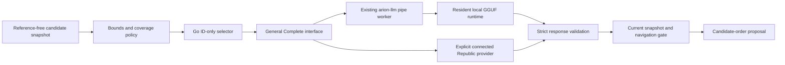

# General LLM alignment for keyboard candidates

## Decision and current scope

Implement a separate, bounded candidate-selection task over the existing LLM transport. Keep Rime conversion and the native personal context ranker as the immediate path. The Go selector is connected to native snapshots and an explicit default-off setting under [ADR 031](../decisions/031-local-keyboard-neural-ranking.md). It reuses only the local polishing worker; this does not claim competitor-equivalent quality.

The [measured pilot](../../benchmarks/results/llm-ime-alignment-v1/README.md) improves authored top-1 from 56/100 to 68/100 after a no-context abstention gate, but breaks eight previously correct cases. Actual resident model calls take approximately 404 ms p50 / 515 ms p95. These results do not authorize enabling automatic promotion by default. Generic LLM selection and IME-specific LM scoring remain different approaches.

## Alignment with observed competitors

| Observed role | Arion alignment | Status |
| --- | --- | --- |
| Native dictionary/phonetic candidate producer | Pinned Rime; preserve actual commits, partial choices and suffix | Existing |
| Local personalized ranking | Confirmed context-pair counts before model enhancement | Existing; not replaced |
| Model scores/selects existing candidates | General chat model selects one eligible ID; stable promotion retains every producer ID | Implemented local opt-in adapter |
| Independent model task and state | Dedicated prompt; shared resident worker, separate operation; erase native slot before/after generic completion | Implemented |
| Conditional enhancement | No context means explicit abstention; bounded deadline; latest pending snapshot replaces old work | Implemented |
| Native asynchronous fusion | Immediate local menu, revision-scoped apply on main thread, freeze on navigation/ownership changes | Connected under ADR 031; installed-host acceptance remains separate |
| Generated/remote candidate fusion | Would require independent provenance, phonetic alignment and selection/commit rules | Excluded from this experiment |

Competitor artifacts establish client call paths, not their model checkpoints, active configuration or measured quality. See [candidate-ranking evidence](context-ranking.md).

## Data and task boundary

`contracts.KeyboardRankRequest` carries session/generation, composition revision, raw Pinyin input, approved preceding text, and up to 27 candidates. Each candidate has its producer ID/text/source and actual `start` and `end` UTF-8 byte offsets in the raw input when available. Unknown ranges cannot authorize promotion. Scope IDs to the producer snapshot; an engine index alone is never a reusable cache key.

The model sees only raw input, preceding text and eligible candidate IDs/text/source. Session bookkeeping and evaluator targets are not sent. Bounds are 256 input bytes, 2,048 context bytes, 256 text bytes per candidate and 64 bytes per ID/source. Invalid UTF-8, empty/duplicate IDs, control markers and incompatible consumed-input spans fail explicitly.

Current `ime-choice-v2` candidates can compete for first place only when their actual consumed-input start and end match the producer's first choice. The producer's original first choice can always remain first. Missing ranges no longer authorize promotion based on text length; fewer than two comparable candidates returns `abstained_no_comparable_candidates` without a model call. Both byte boundaries are validated against the input. The native shared menu now retains these ranges and producer types; the asynchronous Go snapshot transport remains to be wired. Before rollout, test abbreviations, apostrophes, partial selections, mid-buffer edits, combining characters and mixed script separately.

The archived `ime-choice-v1` pilot used equal Unicode scalar length when spans were absent. Its recorded scores remain historical evidence of that policy, not measurements of v2. Frozen reproduction sources are retained unchanged. The native personal ranker now receives an explicit same-input-range eligibility mask from the shared menu instead of comparing output text lengths. Both host adapters use that boundary; actual Windows execution remains a separate gate.

The independent `ime-choice-v2` prompt asks for exactly `{"pick":"candidate ID"}`. The Go validator rejects unknown/duplicate fields, duplicate keys, trailing data, Markdown, invented IDs, incompatible candidates and incomplete responses. It creates a stable full permutation itself. No model-generated score is treated as a calibrated probability, and no model-generated word reaches the engine or editor.

When preceding context is empty/whitespace, the adapter returns `abstained_no_context` with original order and makes no model call. `AllowWithoutContext` is an explicit diagnostic ablation. Cancellation and transport/protocol failures are errors, not successful original-order inference. The caller retains the already displayed local menu and exposes the capability/failure state without inserting text.

No rank-result cache is implemented. A future in-memory cache must include provider/model/prompt/policy identity, context, input, segment/caret state and the complete ordered candidate IDs/text/spans. Connection, model, consent, session and vocabulary changes invalidate it; positional-index-only cache entries are forbidden.

## Shared LLM implementation

- `infrastructure/llm/ranking` implements the domain keyboard-ranker port over a general completion interface. It does not call the speech cleanup, spelling or formatting recipes.
- The existing local pipe protocol gains additive `complete` operation. The pipe client uses existing out-of-band cancellation; the worker serializes requests through its existing queue. The GGUF adapter reuses native template/token-budget checks and the loaded model, erasing the one slot before/after this independent task. No additional weight copy, model process or network listener is introduced.
- `cloudpolish.Service.Complete` reuses provider connection, credentials and model selection. It does not authorize sending keyboard context. A separate explicit evaluation constructor accepts an API key from the caller without reading stored credentials. `chat` wire format permits OpenAI-compatible local MLX/oMLX servers; blank format uses the provider default. Protocol tests cover the provider boundary; no actual cloud, subscription or MLX inference was executed in this study.
- The selected local model is the existing catalog-pinned Qwen3.5-2B Q4_K_M, using the existing llama.cpp runtime, not a recovered competitor model. Local generic tasks share the serialized worker with rewriting. There is no measured ASR/rewriting priority scheduler yet; slot erasure may reduce rewrite cache reuse.
- Universal output token controls differ by provider. The local task requests 48 tokens within a 4,096-token context. The current Republic completion adapter uses provider defaults for generation options; its caller deadline and the strict 1,024-byte selection validator are enforced, but a portable cloud output-token cap is not claimed.

## Latest-request scheduling and native integration

`application.KeyboardRanking` owns one active operation and one replaceable pending slot. Each submission copies the exact snapshot and assigns a new ticket. New input cancels active work and replaces queued work. A bounded debounce runs inside the request deadline. A backend ignoring cancellation can delay the queue, but cannot make its stale result current.

`CanApply` checks the current ticket, session/generation, composition revision, full candidate-ID permutation and promotion coverage. Freeze invalidates both active and pending work. The native adapter must invoke freeze for navigation, candidate selection, commit, Escape, focus/deactivation, language switch and voice takeover; only a subsequent composition update may submit again. Recheck `CanApply` and the native menu's own revision on the UI thread immediately before applying.

The native rollout sequence is:

1. Extend the engine snapshot to export consumed input range/segment identity. Retain raw input/caret, selected-prefix/suffix state and producer indices separately from display text.
2. Add a distinct authenticated `keyboard_rank` IPC family, bound to the existing connection and activation plus a keyboard session/generation. Do not reuse mutable voice session ownership. Replies carry the exact revision and candidate IDs; resolve IDs back to the captured engine indices.
3. Publish the local/personalized menu immediately. Submit only supported snapshots asynchronously; copy model input and never pass native client pointers into Go.
4. On a still-current reply, reorder the owned menu, preserve the selected ID if permitted, and synchronize the engine highlight as the current native implementation does. Navigation freezes automatic reorder until explicit new input. The adapter must never insert model text directly.
5. With the app stopped, model missing, unsupported snapshot or expired deadline, the independent offline keyboard remains usable. Report explicit capability state; no cloud rerouting. Validate these outcomes against the installed host in actual editors.

The experiment uses a 75 ms debounce, 1,500 ms total request deadline, one pending slot, and real 100 ms inter-key replay with a 1,000 ms inter-fixture pause. These are declared experimental settings, not accepted UX latency targets. Benchmark tighter deadlines and debounce values on development data before freezing release gates.

## Context and privacy

Start with bounded confirmed commits owned by the same keyboard client/session. Do not treat recognition drafts, model output or a different app's history as confirmed context. Preserve existing reset/expiration semantics. Longer commit history is an additional product change; host-cursor reads require their own permission and capability handling.

Current product specs keep keyboard ranking local and do not authorize cloud context. Reusing cloud polishing credentials or a subscription does not reuse its content-sending consent. Product cloud ranking requires a separate explicit choice defining the exact Pinyin/candidates/context sent, independent model selection and revocation. Never send audio, window text, personal vocabulary or clipboard contents implicitly. Subscription authorization/official endpoint compatibility and real-service verification remain separate gates; this experiment neither reads nor spends the user's stored subscription credentials.

Synthetic evaluation requests may use an explicitly selected provider/key. Do not archive keys, account tokens or personal input. Production diagnostics remain content-free; raw text in this study is repository-authored synthetic evidence only.

## Evaluation and adoption method

### Executed exploratory comparisons

Reuse the original 100 authored cases and their frozen real Rime first-page candidates. Reference labels remain in the Python evaluator; the Go driver reads strict reference-free JSONL only. Warmups are separate. Case order is paired and shuffled with seed 42. Runs record wall time, model/runtime/worker hashes, prompt/source identity, load observations and failures. No parameter training or test-derived memory is performed.

Retain the initial ungated pilot, the final no-context policy run and both scheduled-replay observations. The gate was selected after inspecting the exploratory pilot, so the final result is development evidence, not held-out validation. The initial Lua/0.8B result cannot isolate this adapter's causal effect because model, prompt and parsing differ.

For each arm report all-case top-1, MRR, candidate oracle recall, eligible-set oracle recall, rescues, breakages, invalid responses, model-call count and model-only p50/p95/p99. Error cases stay in denominators; their still-displayed local order is recorded with an explicit error. Report immediate/no-inference outcomes separately from model latency. Recompute reports from retained raw responses and validate exact producer requests to prevent label leakage or fabricated candidates.

The real-time schedule uses 142 native prefix snapshots from 22 overlapping cases. Record submit/decision/inference events with monotonic timestamps, queue replacement, cancellation, current-result eligibility and submission lateness. Count cancelled inference attempts toward compute/call totals. Go scheduling observations are not rendered-preedit latency or OS key-to-window measurements.

### Required next validation

| Dimension | Comparison or scenario | Required evidence |
| --- | --- | --- |
| Baselines | Producer; current personal ranker with separately enrolled history; LLM enhancement on each | Same candidate sets, no evaluation-derived learning |
| Context | None; last confirmed word; bounded same-client history; permitted cursor context | Fixed model/prompt and explicit context acquisition scope |
| Candidate coverage | Full words, partial conversions, abbreviations, names, technical and mixed-language input | Real consumed spans, oracle recall and denominator retention |
| Model/provider | Existing local model; other provisioned local model; explicitly authorized API/subscription | Digests or exact provider/model IDs, request options, usage/cost and independent request traces |
| Robustness | Reordered/duplicate IDs, malicious instruction-like text, malformed/truncated JSON, timeouts, disconnect/model change | Reject invalid/stale results; no committed text mutation |
| Interaction | Realistic paced keys, pauses, edits, navigation, focus changes and cancellation | Latest-snapshot proposals only; selected identity preserved |
| Resources | Cold/resident runs, rewriting/ASR concurrency, long typing sessions | Native child RSS, queue age, cancelled compute, audio deadlines and load cost |
| Native acceptance | Actual installed IMK in owned editors, app stopped and offline | Key-to-preedit and candidate-update p50/p95/p99; native event/UI observations |
| Generalization | Independent reviewed dev/test sessions, ambiguous-label review, fixed policy before test | Clustered paired intervals; no tuning on held-out labels |

Promotion-quality gates and latency thresholds must be fixed after development baselines and before held-out testing. The v1 pilot recorded eight breakages; the [historical span-aware v2 study](../../benchmarks/runs/llm-ime-alignment-v2-inference/README.md) recorded fourteen. These development failures and absent native/cloud/concurrency evidence block default product enablement. Generated candidates require an independent experiment rather than weakening the permutation contract.

## Reproduction

See the [commands, source snapshots and verification procedure](../../benchmarks/reproduction/llm-ime-alignment-v1/README.md). `pnpm ime:align verify` replays archived reports without model/runtime dependencies; live runs require explicitly provisioned local artifacts or an explicitly supplied API key. Nothing changes the installed input method.

## Residual scope after bilingual integration

The main branch already includes typo/fuzzy settings, approved personal readings, encrypted delivery, actual native candidate ranges and ranked bilingual input (ADR 017, ADR 030). The rebased change retains exact-range eligibility and no-comparable-candidate abstention, adds default-off native integration under ADR 031, and preserves [span-aware reproduction](../../benchmarks/reproduction/llm-ime-alignment-v2/README.md). It does not replace the main English lexicon or candidate admission policy.

The v2 bundles preserve the original PR 45 execution/source bytes. They are historical evidence, not measurements of the integrated main producer. Replaying their hashes and reports does not establish current inference quality, installed IMK/TSF dispatch or independent held-out acceptance. Model-backed native dispatch, English personal learning and automatic bilingual sentence disambiguation remain separate product work.
