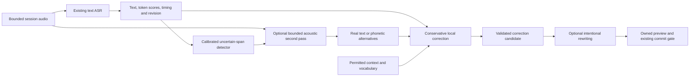

# Phonetic evidence for ASR correction

Status: primary-paper and public-interface research, matched-artifact static investigation, and a [completed exploratory Qwen3-1.7B benchmark](https://github.com/AstraFoundry/Arion-evaluation) (`benchmarks/results/phonetic-asr-1.7b-v2/README.md`). No production recognition model, phonetic sidecar or correction policy was changed. This does not change the normative [speech contract](../../specs/002-speech-pipeline.md).

## Finding

Audio can be recognized into phonemes or Mandarin pinyin and then decoded by an LLM. Published systems implement this explicitly. Existing text ASR checkpoints do not generally acquire this capability through an output-format prompt or a replacement token file. The acoustic model, output vocabulary and training objective must support it.

For Arion, preserve the text hypothesis and expose uncertainty before considering a new model. A promising experimental input is **original text + uncertain spans + real alternatives/scores + optional acoustically recognized pronunciation + permitted context**. Passing only a single phonetic transcription would discard useful lexical evidence and still force an uncertain acoustic decision.

Three distinctions determine what such a system can recover:

| Representation | Source | What it contributes |
| --- | --- | --- |
| Text-derived pinyin, IPA or pronunciation dictionary entry | Already decoded text | A useful pronunciation constraint or retrieval key; no additional observation of the audio |
| Recognized pinyin/phones | Audio through a trained acoustic recognizer | An alternative acoustic representation; it has its own recognition errors |
| N-best/lattice/posterior | Decoder paths or acoustic outputs | Alternative interpretations and scores; exported paths and score semantics must be verified |

Even perfect pronunciation cannot identify a name among exact homophones without context. Acoustic noise, missing syllables and code switching can also make phoneme recognition uncertain. A model's fluent rewrite is not evidence that it recovered what was said.

## Measured local comparison

The [complete 1.7B result](https://github.com/AstraFoundry/Arion-evaluation) (`benchmarks/results/phonetic-asr-1.7b-v2/README.md`) covers 154 test cases and 924 actual generations across six treatments. The user stopped the remaining 4B checkpoint; its partial observations are excluded. The cancelled parent execution is retained, and the complete 1.7B observations have a separately verified analysis view.

| Condition | Mandarin CER | English WER | Synthetic mixed MER |
| --- | --- | --- | --- |
| Raw streaming X-ASR | 8.17% | 7.63% | 36.39% |
| Offline acoustic X-ASR control | 5.82% | 3.97% | 22.10% |
| Qwen3-1.7B text only | 8.42% | 7.53% | 36.39% |
| Qwen3-1.7B text plus text-derived pinyin | 8.42% | 7.63% | 36.39% |
| Qwen3-1.7B text plus audio IPA | 19.06% | 10.38% | 73.32% |

Raw-score inputs and IPA-only input fail more strongly; the complete report retains their insertion errors, repetition, evidence leakage and length-limit hits. The minimum-token risk achieves spoken-case AUC 0.840, but the fixed development threshold has 73.21% false positives among correctly recognized scored utterances. Applying that threshold to invoke correction still selects 136/154 cases and does not rescue the IPA treatment.

This favors investigating the existing acoustic second pass before deploying this unadapted 1.7B phonetic editor. It does not reject trained PYG-ASR or phoneme-to-grapheme systems. The universal phone recognizer has no reviewed phonetic truth here; the editor has generic text-copy demonstrations and no task-specific training. The test corpus was reused after an initial output-format failure, so these are exploratory engineering measurements. There is no uncertain-span hybrid decoder, spontaneous-dictation evaluation or native end-to-end latency result. See [the procedure](phonetic-asr-benchmark.md) for inference boundaries and provenance.

## Primary papers

The papers below establish mechanisms in their reported settings, not offline desktop performance. CER and WER numbers are percentages. Relative reductions are relative to the identified baseline, not percentage-point changes.

| Paper | Mechanism and verified evidence | Boundary for Arion |
| --- | --- | --- |
| [Decoupling recognition and transcription in Mandarin ASR](https://arxiv.org/abs/2108.01129), ASRU 2021 | Audio → wav2vec2/CTC pinyin → Transformer characters; reports 3.9 CER on AISHELL-1 | Direct precedent for separating pronunciation recognition from writing, using specifically trained models |
| [Pinyin-Guided Chinese Speech Recognition with Large Language Model](https://www.isca-archive.org/interspeech_2025/zhengjie25_interspeech.pdf), Interspeech 2025 | Audio → pinyin and characters → text LLM correction. Table 2 test CER: baseline 4.0; PYG-ASR1 3.8; with correction 3.0. The advertised 25% reduction compares 4.0 with 3.0 | Closest Chinese match; requires acoustic-model adaptation. The experiment uses HuBERT + Qwen2-7B and DeepSeek-v3 for correction; no local desktop latency is established |
| [LLM-based phoneme-to-grapheme for phoneme-based speech recognition](https://www.isca-archive.org/interspeech_2025/ma25_interspeech.html), Interspeech 2025 | Speech-to-phoneme followed by LLM phoneme-to-grapheme. Noisy-phone augmentation and randomized top-K marginalization address error propagation. Relative WER reductions of 3.6%/6.9% against WFST for Polish/German | Direct support for phones → LLM, including why a single phone path is insufficient; not Chinese-English validation |
| [Pinyin Regularization in Error Correction for Chinese Speech Recognition with Large Language Models](https://arxiv.org/html/2407.01909v1), Interspeech 2024 | Pinyin is converted from ASR text. Table 4 AISHELL-1: raw 5.84 CER; 5-best text correction 5.14; with pinyin 4.74. Wenet-net raw 11.62 versus 12.28 with pinyin | Cheap text-only comparator; improvement over another correction method does not guarantee improvement over raw ASR |
| [Large Language Model Should Understand Pinyin for Chinese ASR Error Correction](https://arxiv.org/html/2409.13262v1), ICASSP 2025 | Synthetic-error training plus pinyin/text multitask learning. Table 2 mean CER: raw 13.43; direct correction 11.48; pinyin correction 11.10; multitask+pinyin 10.53; pinyin-only 12.65 | Supports retaining characters beside pinyin. Uses a fine-tuned Llama3-8B-Chinese, rather than demonstrating the same gain from a small unadapted local LLM |
| [LLM-based Generative Error Correction for Rare Words with Synthetic Data and Phonetic Context](https://arxiv.org/html/2505.17410v1), Interspeech 2025 | Real 5-best, synthetic rare-word training and pronunciation derived from 1-best. Table 3 GPT-4o-mini: English raw WER 2.7, synthetic+N-best 2.6, +IPA 2.8, +simplified pronunciation 2.5; Japanese eval1 CER 15.5, 14.2, 27.3 and 13.7 respectively | IPA is not automatically the best notation for a text LLM; phonetic representation and model training matter |
| [HyPoradise: An Open Baseline for Generative Speech Recognition with Large Language Models](https://arxiv.org/html/2309.15701v2), 2023 | Real 5-best hypotheses → generative correction; [author implementation](https://github.com/Hypotheses-Paradise/Hypo2Trans) | Useful candidate-based baseline. Generating beyond the supplied candidates is a different capability from selection-only ranking |
| [ASR Error Correction using Large Language Models](https://arxiv.org/html/2409.09554v2), IEEE TASLP 2025 | Compares unconstrained correction and candidate/lattice constraints. Table 2 transducer clean/other WER 2.79/6.90 → lattice-constrained 2.41/6.10 | Lattice constraints require a real decoder lattice and compatible tokenization; cannot be simulated by calling one transcript a lattice |
| [Listen Again and Choose the Right Answer](https://aclanthology.org/2024.findings-acl.37/), ACL Findings 2024 | N-best differences become cloze choices; SpeechGPT also receives source speech | Shows how audio-aware correction can check wording against the sound, instead of relying exclusively on text plausibility |
| [Multi-stage Large Language Model Correction for Speech Recognition](https://arxiv.org/abs/2310.11532), 2023, revised 2024 | Uses N-best uncertainty to select less reliable transcriptions for LLM correction | Supports selective correction as an experiment; does not establish a universal confidence threshold or phonetic output mode |

PYG-ASR generates pinyin and text for the utterance; it does not specifically demonstrate switching only ambiguous spans into pinyin. Its correction gain is 3.8 → 3.0 CER, approximately 21.1% relative; 25% includes the changed acoustic system. Its 49.2% bias-word improvement concerns a separate artificial bias-list experiment, not overall CER. The paper links the general [SLAM-LLM toolkit](https://github.com/X-LANCE/SLAM-LLM); this investigation did not establish a paper-specific downloadable checkpoint or packaged native runtime.

## Mainstream implementation surfaces

Context7 resolve/query searches were used for sherpa-onnx, whisper.cpp and Vosk. Important capability and score claims were then checked against primary source, including Arion's pinned version. A field in a shared result structure does not establish that every model populates it.

| Stack | Actual uncertainty surface | Phonetic output and limits |
| --- | --- | --- |
| sherpa-onnx v1.13.8 | Online result has text, tokens, timestamps and JSON. Transducer JSON includes `ys_probs`, `lm_probs`, `context_scores`; the selected path is exported | Standard text checkpoints do not expose a phone recognition mode. Internal beam width is not an exported N-best list. See [JSON serialization](https://github.com/k2-fsa/sherpa-onnx/blob/v1.13.8/sherpa-onnx/csrc/online-recognizer.cc) and [beam result selection](https://github.com/k2-fsa/sherpa-onnx/blob/v1.13.8/sherpa-onnx/csrc/online-transducer-modified-beam-search-decoder.cc) |
| Vosk / Kaldi | Vosk `SetMaxAlternatives` exports genuine N-best. Ordinary MBR output can include word confidence. Kaldi supports lattices and phone alignment | Vosk's N-best `confidence` is a negative sum of graph/acoustic costs, not calibrated correctness; the inspected alternatives word records omit per-word confidence. Phone alignment depends on model/graph/tool support. See [Vosk recognizer](https://github.com/alphacep/vosk-api/blob/master/src/recognizer.cc), [Kaldi lattices](https://kaldi-asr.org/doc/lattices.html), [phone alignment tool](https://kaldi-asr.org/doc/lattice-align-phones_8cc.html) |
| whisper.cpp | Token `p`/`plog` and low-level vocabulary logits; beam/best-of search controls | Standard output tokens are text subwords. Search width alone does not export complete N-best sequences; per-step top-k tokens are not coherent alternative sentences. See [C interface](https://github.com/ggml-org/whisper.cpp/blob/master/include/whisper.h) |
| Qwen3-ASR | Official wrapper provides language/text, optional forced-alignment timestamps and contextual input | No verified public scored-N-best/phoneme result contract in the inspected wrapper. Forced alignment locates supplied/recognized text; it is not independent phone recognition. See [official implementation](https://github.com/QwenLM/Qwen3-ASR/blob/main/qwen_asr/inference/qwen3_asr.py) |
| Allosaurus | Audio → IPA phones, emitting-frame top-k phone predictions/probabilities and approximate CTC timing | A genuine local phonetic recognizer to evaluate as a sidecar. The public inventory/model does not establish sufficient Mandarin-tone, mixed-language accuracy or desktop latency. See [official repository](https://github.com/xinjli/allosaurus) |
| Azure / Google Cloud Speech | Text alternatives, confidence, word timing and vocabulary adaptation, depending on model/configuration | Representative public contracts emphasize text hypotheses and biasing; they do not establish a generic low-confidence-to-IPA switch. They are reference designs for Arion's offline pipeline. See [Azure results](https://learn.microsoft.com/en-us/azure/ai-services/speech-service/get-speech-recognition-results?pivots=programming-language-csharp), [Google result schema](https://docs.cloud.google.com/speech-to-text/docs/reference/rest/v1/speech/recognize) and [adaptation](https://docs.cloud.google.com/speech-to-text/docs/adaptation-model) |

Scores need their producer and meaning. In sherpa's tagged [greedy transducer implementation](https://github.com/k2-fsa/sherpa-onnx/blob/v1.13.8/sherpa-onnx/csrc/online-transducer-greedy-search-decoder.cc), `ys_probs` holds log-softmax values despite its name. These are conditional token scores on the chosen path, not probabilities that a word is correct. Scores from different engines, tokenizations, utterance lengths and decoding configurations are not interchangeable.

## Doubao and Chatterfly investigation

The requested `reverse-engineer-anything` skill (version 37) workflow was followed through the available REA 6.4.0 CLI. No REA MCP tools were connected in this chat; a read-only doctor check found valid Codex registration. No registration, engine or client settings were changed. New `inspect-macho` records authenticate the exact package executables; existing matching native evidence was reused. No persistent native analysis session was opened.

The [sanitized evidence ledger](evidence/phonetic-asr.json) links actual REA IDs and ordinary `PA-*` observations. Full records and bounded string scans remain in ignored `.workspace/research/phonetic-asr/`. Static strings are weaker than instruction data flow, and neither demonstrates execution or server behavior.

| Target/question | Finding | Evidence and confidence |
| --- | --- | --- |
| Doubao IME 1.0.2 (1) identity | Installed universal main SHA-256 matches prior research | New REA `ev_66516fc55867516031ba4c3c21cfcfd36c135cf6b7e3d1a9cbc94dbd80198f0e`; artifact observation |
| Does Doubao condition recognition on context? | `HOTWORDS`, `USER_MODIFY`, `CUR_CONTEXT` and speech-decoder surfaces exist; prior [context investigation](competitor-rewrite.md#screen-and-cursor-context) also identifies dialogue/context slots | `PA-DB-context`; static surface inference, not proof of active settings, checkpoint or measured gain |
| Do its phoneme strings establish the proposed ASR path? | No. `phonemeAlignment` is a property of `SAMICore_TtsResult`; `_transformWordsPhonemes` diagnostics occur with TTS callback/source-path/event literals | `PA-DB-tts`; class metadata and static bytes identify a TTS surface, without proving any ASR phoneme path |
| Does its `nbest is only support 1 now` prove ASR cannot export alternatives? | No. The literal occurs beside transition initializers and a `ViterbiDecoderV2` kernel diagnostic; attribution to ASR output was not established | `PA-DB-nbest`; bounded negative interpretation |
| Chatterfly 1.0.6.13398 identity | Retained extracted input-method executable matches its installer-derived evidence, including byte-verified arm64 slice | REA `ev_357f2213ffae36932ca3c1c489824db2b8487a33c049894dba6808dca0e0d91e`; artifact observation |
| What enters Chatterfly rewriting? | Inspected instructions read `asrStableText`, invoke `processWithAsrText`, and serialize `asr_text` with context/settings into the SSE postprocessor | `PA-CF-path`, reused `CF-asm-llm-orchestrator` and `CF-asm-payload`; bounded native instruction evidence |
| Does Chatterfly send phones or N-best to that postprocessor? | No explicit phone/pinyin/N-best field was found in the inspected payload function. Optional context/config, other paths and server-side inputs remain unresolved | `PA-CF-path`; bounded search, not application-wide absence |
| Are its phonetic/N-best symbols sufficient evidence? | No. Observed `xsp.NBestSentencePieceText` names concern tokenization; `PhoneticCandEntry` and `PhoneticGeneEntry` belong to the keyboard pinyin engine namespace | `PA-CF-false-leads`; symbol attribution does not establish an ASR-to-LLM path |

Only package bytes and retained package-derived evidence were inspected. Neither competitor was launched; no microphone, user database, account material, private endpoint or live traffic was accessed. The selected versions are not asserted to be latest releases, and no conclusion extends to their mobile/Windows builds.

Current vendor pages describe [Doubao's recognition and text organization](https://shurufa.doubao.com/pc) and [Chatterfly's contextual expression assistance](https://chatterfly.tencent.com/). Neither reviewed product page specifies the proposed phonetic handoff. ByteDance's [Seed-ASR paper](https://arxiv.org/abs/2407.04675) documents continuous audio representations plus context into an LLM, which is another relevant architecture; it does not identify the model deployed in this installed input method.

## Arion implementation opportunity

This section describes the retired runtime retained as research evidence. The desktop now uses native workers under [ADR 020](../decisions/020-native-qwen-asr.md). The historical desktop module pinned sherpa-onnx Go v1.13.8. Its cached macOS binding defines online `Text`, `Tokens`, `Timestamps`, `Json`, and offline `YsLogProbs` alongside tokens/timing. Actual model coverage still needs verification: the inspected [tagged Qwen3-ASR implementation](https://github.com/k2-fsa/sherpa-onnx/blob/v1.13.8/sherpa-onnx/csrc/offline-recognizer-qwen3-asr-impl.cc) sets text/tokens without establishing populated token log probabilities.

The archived [ASR adapter](https://github.com/AstraFoundry/Arion-evaluation) (`benchmarks/reproduction/qwen17-accessibility-v1/source-final/apps/desktop/infrastructure/asr/sherpa.go`) uses `greedy_search` and takes only `.Text` at streaming partial/final and offline recognition sites. The [Draft contract](../../packages/core/contracts/contracts.go) has no token-evidence fields; the [Finalizer port](../../packages/core/domain/ports/ports.go) returns a string. Therefore, preserving the current transducer's evidence is a concrete first experiment, rather than assuming the existing pipeline already passes confidence to correction.

Proposed information flow, not an implementation commitment:

The detector needs errors and correct low-score words during calibration. A low score alone must not authorize replacement. Acronyms, rare names and token boundaries can yield low scores without a recognition error. Conversely, confident homophone substitutions may remain wrong. ASR disagreement is another signal, not independent proof.

For Mandarin, compare tone-bearing pinyin with tone-insensitive retrieval; preserving both avoids assuming that tone is perfectly recognized. For English, compare phoneme notation with readable pronunciation representations. Code-switch boundaries need explicit language attribution. This is an experiment choice, not a claim that IPA or pinyin universally wins.

Correction should decide what was said before optional scene/style rewriting decides how to express it. Preserve raw recognition, phonetic provenance, proposal, validation and delivered text separately. Acoustic phones, text-derived pronunciation and LLM-generated alternatives must retain different source labels. Generated alternatives cannot be presented as producer-owned ASR N-best or passed through a selection-only ranker as if they were supplied by the recognizer.

## Staged experiment proposal

These priorities propose further product work. The separate diagnostic benchmark implements the basic text/pinyin/score/IPA controls; it does not change a default model or product behavior. Follow [008](../../specs/008-evaluation.md) before implementing experiments and [009](../../specs/009-contextual-rewrite.md) for intentional rewriting.

1. **P0: retain and inspect existing evidence.** Preserve transducer tokens, scores and time coordinates with session/revision/segment identity. Verify populated fields against native results for each model and decoder. Calibrate error detection on development data; report precision/recall and calibration separately from transcript accuracy.
2. **P0: establish correction controls.** Compare raw ASR, text-only correction, and text plus text-derived pinyin using the same source and local LLM. Include unchanged correct utterances. This isolates whether pronunciation constraints help without claiming new acoustic evidence.
3. **P1: add real alternative evidence.** Compare real N-best plus context with original ordering and with text correction. A Vosk baseline or an explicitly extended sherpa decoder can supply real alternatives. Measure candidate oracle coverage; more internal paths alone do not establish exported candidates.
4. **P1: compare bounded second passes.** On the same suspicious audio spans, compare existing acoustic finalization with a genuine phone/pinyin recognizer sidecar. Preserve enough surrounding audio to avoid cutting syllables. Compare both against processing every segment so that detector misses remain visible.
5. **P2: train a pronunciation-aware model.** Evaluate a pinyin/character multitask model or phone recognizer plus trained P2G. Include noisy pronunciation training or multiple phone paths, following PYG-ASR/LLM-P2G. This is new model development and requires its own data, license, export and native-parity evidence.

Use frozen, speaker-separated Mandarin/English/mixed speech covering homophones, uncommon names, technical terms, accents, noise, number/negation preservation and silence. Keep references and acceptable alternatives out of inference. Report CER/WER/MER, correct-source corruption, harmful correction, protected-span preservation, named-term recall, candidate oracle coverage, uncertainty-detection misses, end-to-end p50/p95, load/RSS and concurrent ASR cost. Compare against the current acoustic second pass, not only against an intentionally weak transcript.

Bound audio retention to the active session and declared optional second pass. Keep the existing offline, cancellation, revision and target-ownership rules. Irresolvable ambiguity remains a reviewable candidate; it must not be converted into an unsupported confident rewrite.

## Question status

| Original question | Status |
| --- | --- |
| Can audio be decoded to phonetic units and then understood/written by an LLM? | Established by trained research systems; the unadapted local 1.7B pilot is measured above, while a trained desktop P2G system remains unvalidated |
| Can a standard current text ASR simply switch output format on uncertain spans? | No verified generic interface; requires a suitable model/decoder or sidecar |
| What mainstream uncertainty interfaces can be used? | Source-verified comparison above; emitted-token log scores verified at runtime for the selected X-ASR transducer, without calibrated probabilities or exported N-best |
| Do the inspected Doubao/Chatterfly builds implement this exact handoff? | Unresolved; no supporting ASR phonetic handoff established in inspected client paths |
| What is the smallest Arion experiment? | Preserve current transducer evidence and evaluate selective correction before adding a phonetic model |
| Does this improve Arion accuracy, latency or memory? | Exploratory 1.7B quality and CPU compute measured above; the unadapted phonetic editor does not improve this corpus. Production latency, memory acceptance and trained-model efficacy remain unresolved |
