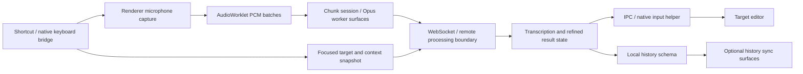

# Typeless installed-artifact investigation

## Target and scope

Installed `/Applications/Typeless.app`: version **2.8.1**, build **2.8.1.130**, bundle ID `now.typeless.desktop`. The app contains Electron, `Resources/app.asar`, native FFI helpers and packaged SQL migrations. Artifact digests and bounded offsets are in the [ledger](evidence/typeless-static.json).

REA CLI 6.4.0 actually produced application Evidence `ev_17708dd83c71fab9ced0d18a4df9036551e5e4aca46326f121f929f1cbaa2ccb`. Its summary-view ID is recorded in the ledger. No REA native session was opened, so there is no session to close. The active chat lacked connected REA tools; a read-only doctor found aligned Codex registration but no configured native decompiler. No client configuration or engine was installed.

The first ASAR analysis rejected a native companion digest mismatch. The next call explicitly used `record-and-continue`, preserving both contradictions as **observed-untrusted**. This does not establish malicious tampering or byte equivalence: signing/stripping is one possible explanation, not verified here. Full immutable analysis and view remain in ignored `.workspace/research/`; the committed ledger is a compact derivative, not replayable full Evidence.

## Coverage and limits

REA inventoried 10,499 relevant files, parsed 6,007 JavaScript files and recorded three parse failures. Application graph coverage is **partial**, with budget-constrained expansion and unresolved dynamic/obfuscated relationships. Complete file inventory does not imply complete behavior recovery. Native helper exports, cloud model choices, actual requests, server retention and runtime reachability are not established by this analysis.

The six module identities in the ledger come from REA; TL-* literal observations are separately obtained from inert packaged bytes. No bundled bootstrap code was executed. User recordings, private history databases, credentials and live traffic were not examined.

## Pipeline evidence

| Stage | Direct static evidence | Interpretation and boundary |
| --- | --- | --- |
| Trigger and OS bridge | Packaged keyboard helper, shortcut names and native callback surfaces | Global shortcut/native integration exists in the package; physical key semantics and callback ordering unverified |
| Target context | `getFocusedAppInfo`, `text_insertion_point`, `cursor_state`, selected-text fields; context-helper library | Structured application/cursor context feeds the client data model; exact AX traversal and sent fields require native/runtime evidence |
| Microphone | Renderer uses `navigator.mediaDevices.getUserMedia` with audio device options | Browser audio capture path is present; runtime chosen device/rate not measured |
| PCM capture | Custom AudioWorklet processor; Float32 buffers; 1,024-sample message batches; explicit stop flush | Capture batches PCM before processing; 1,024 is a code-level batch size, not proof of end-to-end latency |
| Compression/session | Chunk-session worker with native session functions; Opus chunk and Opus encoding libraries/workers | Native audio chunk/compression machinery is present; compression mode per session remains unverified |
| Remote stream | Renderer constructs WebSocket, installs open/close handlers and carries audio-session/chunk control names | Supports an inferred streaming service boundary; static presence is not observed traffic or proof of a particular server protocol |
| Refinement | Raw/refined fields, audio-processing lifecycle events and refine-completion handlers | Transcript and polished text are separate client states; exact backend ASR/LLM ordering/model is unknown |
| Delivery | Insert-text IPC name, input-helper library, target/cursor data and insertion symbols | Native delivery bridge is present; clipboard vs AX path selection and insertion success unverified |
| Persistence | Packaged SQL schema includes refined text, audio/context metadata and local audio path | A local history storage design exists; no user's database was read and schema presence does not prove every field is populated |
| Memory/history sync | Dictionary settings, user-edit surfaces, sync-state store and history push/pull/status routes | Separate personalization/history synchronization surfaces exist; their runtime defaults, conflict logic and encryption are unknown |

## Reconstructed flow

Here "browser audio" means Electron's embedded Chromium implementation, not a separately running browser. Typeless is a standalone desktop application.

The audio lifecycle follow-up used the official arm64 2.8.1 DMG; its ASAR SHA-256 exactly matches the installed-Mac artifact above. REA CLI 6.4.0 produced Evidence `ev_f369db9ec9464c91957871f4105951aea032c636ef9f3dfe688b01fbe690661d`. Graph coverage remains partial, with three JavaScript parse failures. The [`audio_lifecycle_followup` ledger](evidence/typeless-static.json) separates REA coverage from independently inspected inert-source byte anchors:

- The floating-bar recording actor survives ordinary recording sessions. Its start action calls the recorder's `startRecording`, which obtains a new `getUserMedia` stream and connects a new source node to the cached worklet. The inspected default constraints request mono, 16-bit samples, with echo cancellation, noise suppression and automatic gain disabled; they do not request a capture sample rate.
- Normal finish, cancellation and interruption reach the stop path. It flushes the worklet, disconnects the source and resets the recorder, including `track.stop()` on all media tracks and clearing the stream reference. This path does not retain the same active microphone stream between sessions.
- A module singleton constructs an AudioContext requesting 16 kHz and, when supported, requests a non-output sink. Its worklet module promise and node are cached lazily. The worklet has one input and zero outputs. Ordinary stop/reset does not close or suspend the AudioContext or release the worklet; actor cleanup releases the worklet. This is processing-resource reuse, not evidence of continuously running microphone capture or observed CoreAudio device caching.

The follow-up did not execute Typeless, record audio or measure startup. Exact OS/backend resource lifetime, wake recovery and physical input sample rate remain unverified. The observed stop-side wait and flush timeout are not startup latency measurements.

Chromium's public [`AUAudioInputStream` implementation](https://chromium.googlesource.com/chromium/src/+/6c219a3c720961c65fa80a59afbb8b873821f147/media/audio/apple/audio_low_latency_input.cc) separates `Open`, `Start`, `Stop` and `Close`: `Stop` calls `AudioOutputUnitStop`, resets the AudioUnit's render state with `AudioUnitReset`, clears its FIFO and detaches the sink; `Close` disposes the unit. This is evidence for that upstream component's lifecycle, not proof of the exact Chromium version shipped by Typeless or of Typeless's reuse policy. Arion's stopped-device reuse follows this general resource/session separation using its own native adapter; it does not execute or copy Typeless's bundled application code.

This is a static reconstruction with inferred edges, not a traced call graph. It does not imply every session takes every branch or that ASR/refinement both run on the same server/model.

## Full-screen Spaces and the floating bar

A focused inert-literal decoding pass recovered the installed floating-bar window configuration (`CW-typeless-floating` in [the window ledger](evidence/competitor-windows.json)). Its `FLOATING_BAR` window uses `type: "panel"`, `focusable: false`, a transparent background and no frame. Creation explicitly sets:

- `setHiddenInMissionControl(true)`.
- `setAlwaysOnTop(true, "screen-saver", 1)`.
- `setVisibleOnAllWorkspaces(true, { visibleOnFullScreen: true, skipTransformProcessType: true })`.
- `setFullScreenable(false)`.

The interactive-card creation path also sets the same full-screen/workspace visibility and topmost level. The floating bar selects the display nearest the cursor and refreshes that selection every 100 ms. This separates placement from visibility across Spaces.

These are static configuration calls from packaged `dist/main/index.js`, recovered by deterministic lookup-array substitution without executing the application bootstrap. They establish that Typeless explicitly handles full-screen Spaces in addition to always-on-top behavior. They do not establish the underlying Electron/AppKit flags, actual focus preservation, or successful presentation on this device. Arion should verify its native window policy against another app's actual full-screen Space; a high window level alone does not validate that behavior.

## Public documentation corroboration

Typeless's current policy describes cloud processing of voice and limited app/text context, with optional history synchronization. That is a **vendor statement**, not proof of installed-client enforcement or server behavior. [Official privacy policy](https://www.typeless.com/privacy). Its personalization guide describes abstract style learning rather than retaining specific writing content; the actual algorithm is not established. [Official personalization guide](https://www.typeless.com/help/quickstart/personalization).

Do not equate local history or a zero-retention statement with local speech inference. Arion's offline inference boundary is a deliberate different design choice.

## Checklist for this investigation

- **Answered:** installed version/package/entrypoint identity; microphone/worklet source; native context/input/compression surfaces; history schema and sync route presence.
- **Partially answered:** trigger-to-capture-to-result-to-delivery flow; refinement/personalization stage division. Static source provides boundaries but obfuscation/native/backend edges remain unknown.
- **Unresolved:** exact ASR/correction server models, complete protocol/call ordering, actual latency/traffic/retention, native helper traversal/insertion semantics and runtime sync policy.

Arion should reuse the separation of capture, draft/refinement and target delivery as an architectural lesson. It should implement its own ownership/revision guards, local models and approved-memory protocol rather than copying commercial bundled code or treating unresolved server behavior as a requirement.
